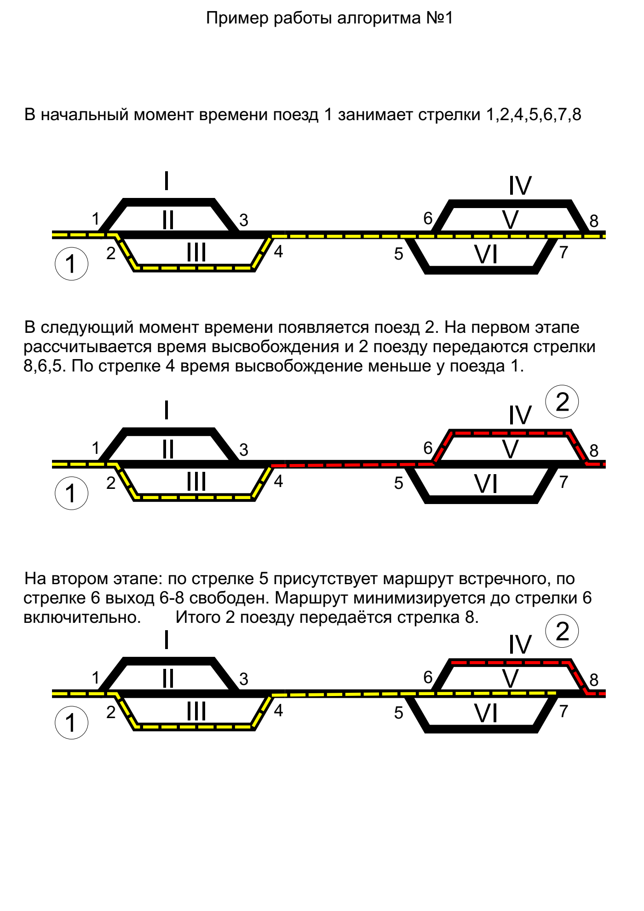
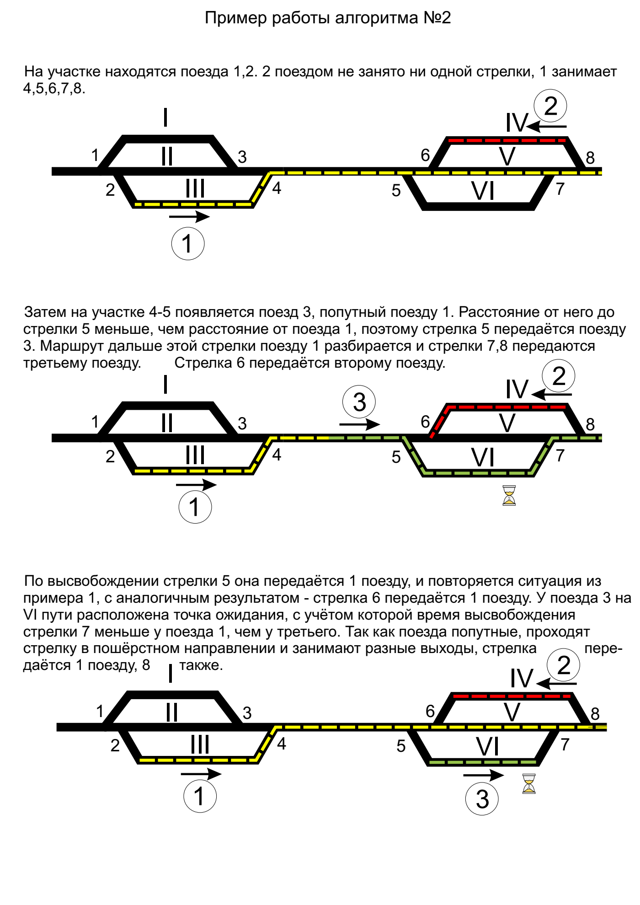
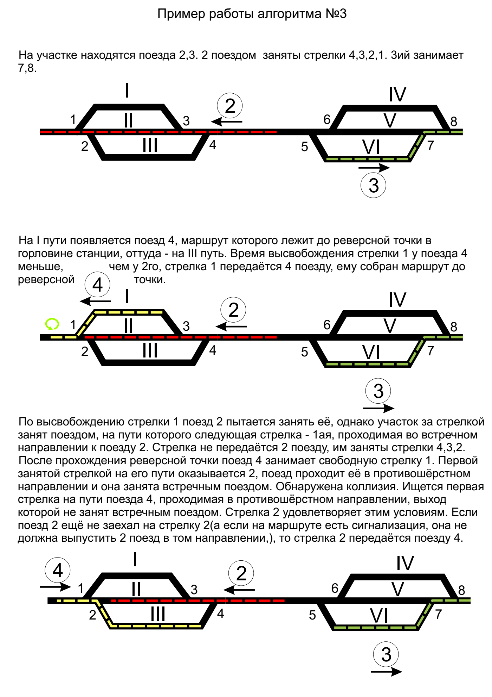

# Формат сценариев

RTS 0.44

## Структура сценария

Сценарий состоит из файла сценария `[имя_файла].act` и директории `[имя_файла]`, расположенных в директории с маршрутом в поддиректории `RTS_ACT`. Директория сценария может содержать файлы путей и составов, статических объектов и проч., используемых в сценарии.

Файл сценария имеет следующую структуру:

```
SIMISA@@@@@@@@@@JINX0a1t______
Tr_Activity_Header Tr_Activity_Header (
  ...заголовок сценария...
)
...параметры сценария...
EnvironmentConditions EnvironmentConditions (
  InitialConditions InitialConditions (...начальные погодные условия...)
  WeatherChange WeatherChange ( ...изменение погодных условий... )
)
StaticObjects StaticObjects ( n
  Object Object ( ...описание объекта... )
)
ActivityMenus ActivityMenus ( ( n
  ActivityMenu ActivityMenu ( ...описание меню... )
)
PlayerTasks PlayerTasks ( (
  Task ( ...описание задания... )
)
GlobalBlockPoints GlobalBlockPoints ( n
  BlockPoint BlockPoint (
      ...описание точки блокировки...
  )
  ...
)
GlobalEvents GlobalEvents ( n
  ServiceEvent ServiceEvent (
      ...описание события...
  )
  ...
)
Services Services ( (
  Service Service(
      ...описание сервиса...
  )
  ...
)
```

## 1. Заголовок сценария

Заголовок сценария состоит из следующих элементов:

1. `RouteID RouteID ( “name” )` — ID маршрута, для которого сделан сценарий.

2. `Name ( “name” )` — название сценария

3. `Description ( “description” )` — описание сценария

4. `ActivityStartsIn ( “name” )` — точка начала сценария

5. `ActivityEndsIn ( "name" )` — точка окончания сценария

6. `Duration ( 3:30 )` — продолжительность сценария, в формате h[:m[:s]]

7. `Season ( s )` — сезон. Значения s:

- `0` — весна

- `1` — лето

- `2` — осень

- `3` — зима

8. `Weather ( w )` — погода. Значения w:

- `0` — ясно

- `1` — снег

- `2` — дождь

9. `Environment ( “name” )` — имя env-файла, используемого сценарием.

По умолчанию используется файл, соответствующий сезону и погоде в маршруте.

10. `ActivityStarts ( 10:0:0 )` — время начала сценария

11. `PlayerStartsInTrain ( ServiceID TrainID WagonNum Area )` — поезд в котором начинает сценарий игрок.

- `ServiceID` — ID сервиса. Значение -1 означает, что игрок начинает сценарий вне поездов. -2 - игрок помещается в точку RouteStart маршрута.

- `TrainID` — ID поезда. Значение -1 означает любой поезд данного сервиса.

- `WagonNum` — порядковый номер вагона в составе. Нумерация вагонов начинается с головы состава с 0. Отрицательные значения параметра n означают -n-ный вагон с хвоста поезда.

- `Area` — область, в которой находится игрок. Значения параметра:

- `0` — вне поезда. Игрок размещается около заданного вагона. По умолчанию.

- `1` — внешняя область вагона

- `2` — кабина или салон вагона. Если у вагона есть кабина, игрок размещается в кабине, иначе - в салоне.

- `3` — салон или кабина вагона. Если у вагона есть салон, игрок размещается в салоне, иначе - в кабине.

12. `PlayerStartsInTile ( TileX TileZ )` — координаты тайла, на котором находится игрок. Используется только если игрок начинает сценарий вне поездов.

13. `PlayerStartPosition ( X Y Z )` — координаты игрока. В случае, если игрок начинает сценарий вне поездов - глобальные координаты. Иначе - координаты в локальной системе координат вагона.

## 2. Параметры сценария

1. Дистанция невозврата

```
TrainsDistanceOfNoReturn ( d )
```

Максимальное расстояние от поезда до стрелочного перевода, при котором маршрут не может быть отменён. Параметр может быть переопределён для отдельных поездов в сценарий. При возникновении коллизий может быть проигнорирован.

2. Таблица ограничений скорости в кривых

```
TrafficLimitsTable (
  TrafficLimit ( Radius Limit )
)
```

Содержит до 10 элементов, устанавливающих ограничение скорости Limit (в м/с) для трафика при движении по кривым радиуса меньше Radius.

3. Неудачное завершение сценария

```
FailActivityOnPassingRedSignal ( b )
FailActivityOnPassingStopSignal ( b )
FailActivityOnCouplingBreak ( b )
FailActivityOnForcingJunction ( b )
FailActivityOnDerail ( b )
```

Завершить сценарий при:

- проследовании красного сигнала `(SIGASP_STOP_AND_PROCEED)`

- проследовании тупикового сигнала `(SIGASP_STOP)`

- изломе сцепки

- взрезе стрелки

- сходе соответственно. 1 - завершить, 0 - не завершать.

## 3. Точки блокировки

Точки блокировки представляют собой средство регулирования задания маршрутов для поездов. Когда точка включена, поезду не может быть задан маршрут дальше неё. В случае, если точка включена уже после задания маршрута за неё, то, если поезд находится дальше расстояния невозврата от точки, маршрут далее неё ему отменяется.

В сценарии могут быть глобальные точки блокировки, перекрывающие путь всем или заданным сервисам, на пути у которых она стоит и точки блокировки сервисов, действующие только для поездов данного сервиса.

Формат описания точки блокировки:

```
BlockPoint (
    ID ( id )
    Enabled ( state )
    Location ( TileX TileZ X Y Z )
    NumPassed ( N )
    PointAffects ( Num ID... ID )
                        1 Num
    ReleaseOnTime ( h:m:s )
    ReleaseOnReach ( ServiceID TrainID )
    ReleaseOnApproach ( ServiceID TrainID )
    ReleaseManual ( b )
    SuppressErrors ( )
)
```

- `ID` — целочисленный идентификатор точки блокировки.

- `Enabled` — начальное состояние точки(1 - включена, 0 - выключена).

- `Location` — расположение точки блокировки

- `NumPassed` — число пересечений данного местоположения путём игрока перед фактическим расположением точки. Для точек блокировки сервисов каждая точка устанавливается только на одном элементе пути. Для глобальных точек блокировки данный параметр не используется, точка ставится везде на путях сервисов.

- `PointAffects` — для глобальных точек здесь перечисляется Num идентификаторов сервисов, которые блокирует данная точка. Для точек сервиса - идентификаторы поездов, блокируемых точкой. При отсутствии параметра точка располагается на путях всех сервисов или всех поездов сервиса.

- `ReleaseOnTime` — отключение точки в заданное время

- `ReleaseOnReach` — отключение точки при достижении её поездом с заданными идентификаторами сервиса и поезда. Значение -1 для ServiceID означает любой сервис. Значение -2 для ServiceID точки блокировки сервиса означает данный сервис. Значение -1 для TrainID означает любой поезд данного сервиса.

- `ReleaseOnApproach` — отключение точки при занятии маршрута через неё поездом с заданными идентификаторами сервиса и поезда.

- `SuppressErrors` — подавление ошибок при невозможности расположить точку на пути сервиса(для глобальной точки - при невозможности расположить точку ни на одном из путей сервисов).

- `ReleaseManual` — разрешить открывать точку вручную игроку. Когда поезд занял маршрут до точки, игрок может по готовности отправиться дальше нажать Tab.

## 4. Система событий

Формат описания событий:

```
ServiceEvent (
    ID ( id )
    ActivationLevel ( l )
    Enabled ( state )
    Timeline ( h:m:s h:m:s )
    Permanent ( b )
    ReportSuccess ( “text” )
    ReportFailure ( “text” )
    Action (
        ...условие наступления события...
    )
    Outcome (
        ...реакция...
    )
)
```

- `ID` — целочисленный идентификатор события

- `ActivationLevel` — уровень активации события, событие активируется, при условии, что уровень больше 0.

- `Enabled` — начальное состояние события (1 - включено, 0 - выключено).

- `Timeline` — время жизни события. Событие включается только в течение заданного промежутка времени. При этом вручную включить или выключить такое событие нельзя, можно только устанавливать уровень активации.

- `Permanent` — событие может наступать многократно.

- `ReportSuccess` — строка, добавляемая в отчёт при наступлении события.

- `ReportFailure` — строка, добавляемая в отчёт при ненаступлении события.

- `Action` — условие наступление события. Каждое событие имеет простое условие или не имеет вовсе.

- `Outcome` — реакция на событие. Может включать одно, несколько или ни одного действия.

## 4.1. Условия событий

Каждое условие может иметь параметр

```
TrainID ( ServiceID Train )
```

- `где ServiceID` — идентификатор сервиса, Train - идентификатор поезда, для которого проверяется условие. Для ServiceID значение -1 означает любой сервис, -2 - данный сервис. Для Train значение -1 означает любой поезд, -2 - данный поезд. По умолчанию значения параметров -2 -1 для событий сервиса, -1 -1 для глобальных событий.

Для каждого поезда проверяется наступление условий глобальных событий и событий текущего сервиса.

Для поездов трафика события сервиса являются также и указаниями к действию.

1. **Прицепка состава**

```
CoupleCars (
  ConjTrainID ( ServiceID TrainID )
  Direction ( Dir )
  OpenValves ()
)
```

- `ConjTrainID` — идентификатор сервиса и поезда, к которому осуществляется прицепка.

- `Direction` — 1 - прицепка осуществляется к голове состава -1 - прицепка осуществляется к хвосту состава

- `0` — направление прицепки неважно

- `OpenValves` — автоматически открыть концевые краны и соединить магистрали при наступлении события.

2. **Отцепка состава**

```
UncoupleCars (
  WagonRange ( StartNum EndNum )
  WagonList ( n
      Wagon ( WagonID )
  )
  ShutValves ()
  LockCouplings ()
  PreventRecoupling ()
)
```

- `WagonRange` — порядковые номера первого и последнего вагона. StartNum - число отцепляемых вагонов с головы состава. При этом основным составом остается передняя часть состава. EndNum - число отцепляемых вагонов от хвоста поезда. Тогда основной считается хвостовая часть состава.

- `WagonList` — список ID вагонов, которые должны находится в отцепе. ID каждого вагона записывается в формате 14-символьной строки, состоящей из идентификатора сервиса, идентификатора поезда, идентификатора вагона. ID каждого вагона неизменен в течении всего сценария. Идентификатор сервиса и поезда берутся из сервиса и поезда в котором стартует вагон. Идентификатор вагона берётся из файла состава. Для условия отцепки нужно указывать либо WagonRange либо WagonList.

- `PreventRecoupling` — указывает, что при наступлении данного события необходимо предотвратить повторную сцепку (например из-за сжатых сцепок). Это может быть необходимо, если для отцепа важно сохранить назначенный сервис. Данный параметр действует только в течение момента времени после сцепки. Если игрок отъедет от отцепа и снова поедет на сцеп, параметр не помешает сцепке. Если отцепу назначается тип TRAFFIC, параметр как правило излишен - с трафиком игрок не может сцепится, за исключением случаев, когда такая прицепка предусмотрена событиями.

- `ShutValves и LockCouplings` — при наступлении события автоматически перекрыть концевые краны и/или заблокировать сцепку. Для трафика краны перекрываются автоматически.

3. **Событие локации**

```
ReachLocation (
  Location ( TileX TileZ X Y Z )
  Radius ( R )
  ReachWith ( Reach )
  SpeedNotAbove ( S1 )
  SpeedNotBelow ( S2 )
)
```

- `Location` — местоположение

- `Radius` — радиус

- `ReachWith` — проверка достижения местоположения. Значения:

- `WAGON_ANY` — любой из вагонов поезда в радиусе;

- `WAGON_ALL` — все вагоны поезда в радиусе;

- `WAGON_FRONT` — передний вагон поезда в радиусе;

- `WAGON_BACK` — задний вагон поезда в радиусе;

- `WAGON_PLAYER` — вагон поезда с игроком в радиусе;

- `PLAYER_POSITION` — игрок в радиусе;

- `SpeedNotAbove` — скорость не более(м/с).

- `SpeedNotBelow` — скорость не менее(м/с).

4. **Событие времени**

```
ActivateOnTime (
  Time ( h:m:s )
)
```

Событие активируется в заданное время. Если событие включено, но уровень активации меньше или равен 0, то по наступлению заданного времени событие отключится. Если событие было выключено, то при его включении в любой момент времени позднее заданного(с положительным уровнем активации), произойдёт наступление события.

5. **Таймер**

```
ActivateByTimer (
  Time ( sec )
)
```

При включении события начинается отсчёт таймера. При отключении события таймер останавливается без сброса. При сбросе состояния события в незавершённое значение таймера сбрасывается в первоначальное.

6. **Посадка игрока**

```
PlayerBoardsTrain (
  WagonID ( ID )
  WagonNum ( Num )
  Area ( Area )
)
```

- `WagonNum` — порядковый номер вагона в составе. По умолчанию -1 - любой вагон.

- `WagonID` — 14-символьный ID вагона

- `Area` — область, куда переходит игрок.

- `EXTERIOR` — вне поезда;

- `INTERIOR` — любая внутренняя область, кабина или салон;

- `CABIN` — кабина;

- `SALON` — салон;

- `EXT_WAG` — внешняя область;

- `WAGON` — любая внешняя и внутренняя область вагона.

7. **Достижение точки блокировки**

```
ReachBlockPoint(
  PointID ( ServiceID PointID )
)
```

- `PointID` — идентификатор сервиса и точки. -1 означает любой сервис и/или любую точку блокировки. -2 - текущий сервис.

8. **Занятие маршрута до точки блокировки**

```
ApproachBlockPoint(
  PointID ( ServiceID PointID )
)
```

- `PointID` — идентификатор точки.

9. **Запуск поезда**

```
OnStart ( )
```

10. **Удаление поезда**

```
OnFinish ( )
```

11. **При изменении уровня активации**

```
OnActivationLevel (
  WhenAbove ( a )
  WhenBelow ( b )
)
```

- `WhenAbove` — активировать при уровне выше a.

- `WhenBelow` — активировать при уровне ниже b.

12. **Доставка вагонов**

```
DeliverCars (
  Siding ( “name” )
  Location ( TileX TileZ X Y Z )
  Radius ( R )
  ReachWith ( Reach )
  SpeedNotAbove ( s1 )
  SpeedNotBelow ( s2 )
  WagonList ( n
      Wagon ( WagonID )
      ...
  )
)
```

- `Siding` — имя запасного пути

- `Location` — местоположение

- `Radius` — радиус

- `SpeedNotAbove` — скорость не более

- `SpeedNotBelow` — скорость не менее

- `WagonList` — список 12-символьных ID вагонов. В данном событии можно задать либо имя запасного пути, куда необходимо доставить вагоны, либо местоположение. Путь сервиса должен пересекать данный запасной путь.

13. **Остановка на станции**

```
StopAtStation (
  StationNum ( num )
)
```

- `StationNum` — порядковый номер станции в расписании поезда.

14. **Отправление от станции**

```
DepartFromStation (
  StationNum ( num )
)
```

- `StationNum` — порядковый номер станции в расписании поезда.

15. **Завершено выполнение расписания**

```
TimetableCompleted (
  Delays ( i )
  AllStops ( i )
)
```

- `Delays` — были ли опоздания. 0 - безразлично, 1 - были, 2 - не было.

- `AllStops` — Все ли остановки. 0 - безразлично, 1 - есть пропущенные, 2 - посадка произведенана всех остановках.

16. **Достижение реверсной точки**

```
ReachReversePoint(
  PointID ( num )
)
```

- `PointID` — порядковый номер реверсной точки в пути игрока. При принудительном поиске следующего элемента пути при назначении сервиса, счётчик реверсных точек сбрасывается в 0.

17. **Старт сценария**

```
ActivityStarts(
  FirstStartOnly FirstStartOnly ( n )
)
```

Событие запускается при старте сценария. Если FirstStartOnly FirstStartOnly равно 1, оно запускается только при самом первом запуске, в противном случае - также и при загрузке сохранённой игры.

18. **Закрытие окна сообщения**

```
OnCloseMessageBox (
  MsgID ( id )
  ButtonID ( button )
)
```

- `MsgID` — идентификатор окна сообщения

- `ButtonID` — кнопка по которой закрыто окно.

- `ID_OK` — ОК

- `ID_CANCEL` — Отмена

- `ID_YES` — Да

- `ID_NO` — Нет

19. **Произвольное событие**

```
RandomEvent (
  StartTime ( h:m:s )
  EndTime ( h:m:s )
  EventProbability ( d )
)
```

- `StartTime` — начальное время возможного наступления события. По умолчанию

- время включения события или начала сценария.

- `EndTime` — конечное время возможного наступления события. По умолчанию - 1 час с начального времени.

- `EventProbability` — вероятность наступления события. Значение в интервале [0;1]

20. **Остановка в местоположении**

```
WaitAtLocation (
  Siding ( “name” )
  Location ( TileX TileZ X Y Z )
  Radius ( R )
  ReachWith ( Reach )
  WaitingTime ( sec )
)
```

Событие вызывается после того как поезд остановится на заданное время в указанном местопололожении. Для трафика - указание остановиться и ждать указанное время.

- `WaitingTime` — время ожидания.

21. **Достижение скорости**

```
ReachVelocity (
  SpeedNotAbove ( Speed1 )
  SpeedNotBelow ( Speed2 )
)
```

В отличие от прочих условий, данное не является указанием для трафика.

- `Speed1` — значение скорости, ниже которого срабатывает событие.

- `Speed2` — значение скорости, при превышении которого срабатывает событие.

22. **Погрузка/разгрузка**

```
PickupEvent (
  Location ( TileX TileZ X Y Z )
  Radius ( R )
  WagonList ( n
      Wagon ( WagonID )
      ...
  )
  CargoMassUnload ( Mass1 )
  CargoMassLoad ( Mass2 )
  CargoType ( CargoType )
  PickupTask ( TaskID )
)
```

Погрузка/разгрузка или заправка указанных в списке вагонов в заданном пункте.

- `CargoMassUnload` — общая масса разгрузки.

- `CargoMassLoad` — общая масса погрузки.

- `CargoType` — тип груза.

DIESEL GASOLINE ALCOHOL GAS SAND WATER ELECTRICITY COAL

- `PickupTask` — ID задания погрузки.

23. **Выбор пункта меню пользователем**

```
OnMenuSelect (
  MenuID ( ID )
  MenuItemID ( ID )
)
```

24. **Достижение конца пути**

```
ReachEndPoint (
  Distance ( f )
)
```

Событие происходит при достижении поездом конечной точки пути, на расстоянии не менее Distance от неё. Если задать отрицательное значение расстояния - событие произойдёт при задании маршрута до конца пути.

25. **Изменение статуса задания игрока**

```
TaskCompletion (
  TaskID ( ID )
  GroupID ( ID )
  OnCompletionAbove ( i )
  OnCompleted ( )
  OnFailed ( )
  OnCancelled ( )
  OnEnabled ( )
  OnDisabled ( )
  OnShow ( )
  OnHide ( )
  OnAssigned ( )
  OnUnassigned ( )
  OnDeleted ( )
  OnUncompleted ( )
  IfCompleted ( )
  IfFailed ( )
  IfCancelled ( )
  IfEnabled ( )
  IfDisabled ( )
  IfShow ( )
  IfHide ( )
  IfAssigned ( )
  IfUnassigned ( )
  IfDeleted ( )
  IfUncompleted ( )
)
```

Событие происходит при изменении состояния задания игрока c идентификатором TaskID или принадлежащего к группе GroupID. Событие активируется, когда произойдёт одна из указанных смен состояния:

- `OnCompleted` — завершение, OnFailed - провал, OnCancelled - отмена, OnEnabled - включение, OnDisabled - отключение, OnShow - показ, OnHide - скрытие,

- `OnAssigned` — назначение, OnUnassigned - отмена назначения, OnDeleted - удаление, OnUncompleted - возврат в незавершённое состояние. При этом активация произойдёт, только если выполняются все заданные условия

- `If: IfCompleted` — задание выполнено, IfFailed - задание провалено и т.д.

26. **Открытие точки блокировки**

```
ReleasedBlockPoint (
    PointID ( ServiceID PointID )
)
```

Открытие вручную точки блокировки. Аналогично ApproachBlockPoint.

27. **Значение переменной состояния вагона**

```
WagonState (
  TrainID ( ServiceID TrainID )
  WagonID ( WagonID )
  WagonNum ( WagonNum )
  All ( )
  Any ( )
  Equal ( Area TrackedWagonVar Idx SubIdx Value )
  NotEqual ( Area TrackedWagonVar Idx SubIdx Value )
  Above ( Area TrackedWagonVar Idx SubIdx Value )
  AboveOrEqual ( Area TrackedWagonVar Idx SubIdx Value )
  Below ( Area TrackedWagonVar Idx SubIdx Value )
  BelowOrEqual ( Area TrackedWagonVar Idx SubIdx Value )
  IncPast ( Area TrackedWagonVar Idx SubIdx Value )
  DecPast ( Area TrackedWagonVar Idx SubIdx Value )
  SetTo ( Area TrackedWagonVar Idx SubIdx Value )
  SetNotTo ( Area TrackedWagonVar Idx SubIdx Value )
)
```

Событие происходит при выполнении заданных соотношений по переменным состояния вагона. Если заданы WagonID или WagonNum, то соотношения проверяются только для указанного вагона. Соотношения проверяются, когда другим событием включено непрерывное отслеживание состояния вагона или когда вызвана однократная проверка. All указывает проверять все соотношения после него, событие вызывается только когда выполнены все. С Any событие вызовется при выполнении любого из указанных после него соотношений. Динамические соотношения IncPast, DecPast, SetTo, SetNotTo проверяют изменение значения переменной - срабатывают, когда новое значение удовлетворяет условию, а предыдущее значение - нет. Статические соотношения просто проверяют текущее значение. Динамические соотношения проверяются только когда включено непрерывное отслеживание состояния вагона, при однократной проверке они не вычисляются.

- `Area` — где в вагоне искать значение:

- `WAGON` — внешняя модель

- `CABIN` — кабина локомотива

- `SALON` — пассажирский салон

*Таблицу значений TrackedWagonVar и индексов см. в* `activity_WagonStateVariables.pdf`

## 4.2. Реакция на наступление событий

Каждое действие может иметь параметр

```
TrainID ( ServiceID Train )
```

- `где ServiceID` — идентификатор сервиса, Train - идентификатор поезда, для которого применяется действие. Для ServiceID значение -2 означает сервис поезда, для которого наступило условие. Для Train значение -1 означает все поезда, -2 - данный поезд, -3 - отцеп, для событий отцепки/прицепки и для событий где одним из предыдущих действий являлась отцепка. По умолчанию значения параметров -2 -2. Параметр TrainID должен располагаться в конце описания действия.

Обратите внимание, что в событиях времени (ActivateOnTime, ActivateByTimer) отсутствует текущий поезд, поэтому в реакции на событие необходимо указывать конкретный ID поезда, значение -2 работать не будет.

1. **Изменить тип сервиса**

```
ChangeServiceType ( newtype )
```

2. **Изменить тип поезда**

```
CastTrainType ( newtype )
```

3. **Назначить сервис поезду**

```
AssignService (
  NewID ( ServiceID TrainID )
  NewType ( newtype )
  NewPathLoad ( “path” loc )
  NewPathSeekNext ( Reach )
  NewPathPointsPassed ( num )
)
```

- `NewID` — идентификаторы нового сервиса и поезда. Значение -1 для ServiceID означает не назначать сервис, -2 - назначить нулевой сервис. Для TrainID значение -1 означает не назначать поезд. По умолчанию значения -1 -1.

- `NewType` — назначить тип сервиса поезду. По умолчанию поезду назначается тот же тип, что и у назначаемого сервиса.

- `NewPathLoad` — назначить поезду новый путь. По умолчанию - путь назначаемого сервиса. Для назначения пути обязательно необходимо указывать NewID.

- `NewPathSeekNext` — найти следующий элемент пути, исходя из текущего положения поезда.

- `WAGON_ANY` — искать, исходя из секций пути, на которых находятся хвост и голова состава;

- `WAGON_FRONT` — искать, исходя из того, что голова состава находится в данный момент на пути;

- `WAGON_BACK` — искать, исходя из того, что хвост состава находится в данный момент на пути.

- `NewPathPointsPassed` — пропустить num пересечений пути заданной точки. По умолчанию - 0.

4. **Выключение точки блокировки**

```
ReleaseBlockPoint ( ServiceID PointID )
```

Значение -1 для ServiceID означает глобальные точки блокировки, -2 - точки блокировки текущего сервиса. -1 для PointID означает все точки.

5. **Включение точки блокировки**

```
EnableBlockPoint ( ServiceID PointID
  Distance ( f )
)
```

Значение -1 для ServiceID означает глобальные точки блокировки, -2 - точки блокировки текущего сервиса. -1 для PointID означает все точки. Если на момент включения поезд, блокируемый точкой, находится от неё на расстоянии, менее Distance, включение точки не возымеет никакого результата.

6. **Изменение максимальной скорости и ускорения поезда**

```
ModifyVelocity ( MaxVel MaxAcc MaxDec )
```

- `MaxVel` — максимальная скорость поезда.

- `MaxAcc` — максимальное ускорение поезда.

- `MaxDec` — максимальное замедление поезда. Неположительное значение одного из параметров означает, что данный параметр менять не надо.

7. **Отцепка вагонов**

```
UncoupleCars (
  StartNum ( num )
  StartID ( id )
  Reversed ( )
  ShutValves ( )
  LockCouplings ( )
  NewID ( ServiceID TrainID )
  NewType ( newtype )
  NewPathLoad ( “path” loc )
  NewPathSeekNext ( Reach )
  NewPathPointsPassed ( num )
)
```

- `StartNum или StartID` — порядковый номер или 14-символьный ID вагона, начиная с которого производится отцепка. Для StartNum можно задать отрицательные значения - тогда первый вагон, с которого производится отцепка, будет отсчитываться от хвоста.

- `Reversed` — если этот параметр присутствует, значит основной считается часть состава, начиная с первого отцепляемого вагона и за ней сохраняется текущие значения сервиса и пути, а передняя часть считается отцепом. По умолчанию наоборот.

- `ShutValves` — перекрыть краны и рассоединить магистрали.

- `LockCouplings` — заблокировать автосцепки.

```
NewID, NewType, NewPathLoad, NewPathSeekNext, NewPathPointsPassed
```

- см. 4.2.3.

8. **Включение события**

```
EnableEvent ( ServiceID EventID )
```

- `ServiceID` — идентификатор сервиса. -1 - глобальные события.

- `EventID` — идентификатор события.

9. **Выключение события**

```
DisableEvent ( ServiceID EventID )
```

- `ServiceID` — идентификатор сервиса. -1 - глобальные события.

- `EventID` — идентификатор события.

10. **Увеличить уровень активации**

```
IncreaseActivationLevel ( ServiceID EventID Num )
```

увеличивает уровень активации события на Num. Num может быть отрицательным.

11. **Приостановить выполнение события**

```
Suspend ( time )
```

приостанавливает выполнение события на time секунд. Если time <=0.0 время приостановки неограничено. Для досрочного возобновления события можно применить действие активации события.

12. **Остановиться на определённое время**

```
WaitHere ( time )
```

Поезд останавливается на время time секунд. Если time <=0.0, время стоянки неограничено.

13. **Показать сообщение**

```
ShowMessage (
  Title ( “title” )
  Text ( “Text” )
  MsgID ( id )
  ShowModal ( m )
  Colour ( col )
  Expires ( time )
  Buttons ( buttons )
)
```

- `Title` — заголовок окна сообщения.

- `Text` — текст сообщения.

- `MsgID` — целочисленный идентификатор сообщения.

- `ShowModal` — 1 - модальное сообщение, 0 - обычное сообщение.

- `Colour` — цвет текста в сообщений, по умолчанию - ffffffff.

- `Expires` — время, в секундах, через которое сообщение автоматически убирается с экрана.

- `Buttons` — кнопки в окне. Может быть одно или несколько из:

```
MB_OK
MB_OKCANCEL
MB_YESNO
```

14. **Изменить состояние вагонов**

```
ModifyWagons (
  WagonParameters ( n
      WagonGroup (
          Range ( Start End )
          WagonState ( i )
          TrainPipePressure ( d )
          BrakeCylinderPressure ( d )
          AuxiliaryPressure ( d )
          ChargingPipePressure ( d )
          HandbrakePercent ( d )
          PlaceDrag ( bitmask )
          DisconnectTrainPipe ( bitmask )
          DisconnectChargingPipe ( bitmask )
          DisconnectEPCable ( bitmask )
          СonnectTrainPipe ( bitmask )
          СonnectChargingPipe ( bitmask )
          СonnectEPCable ( bitmask )
          CloseEndValves ( bitmask )
          OpenEndValves ( bitmask )
          DisconnectSMECable ( bitmask )
          DisconnectHVBus ( bitmask ) ]
          LockCouplings ( bitmask )
          UnlockCouplings ( bitmask )
          SandLeft ( d )
          FuelLeft ( d )
          WaterLeft ( d )
          RaisePanto ( bitmask )
          LowerPanto ( bitmask )
          CargoType ( cargotype )
          UseFreightAnim ( id )
          CargoMass ( d )
          Durability ( d )
          Cold ( b )
          AIControlled ( b )
          OpenDoors ( bitmask )
          CloseDoors ( bitmask )
          NoAutoOpenAtStop ( bitmask )
          EnableAutoOpenAtStop ( bitmask )
      )
      ...
  )
)
```

- `Range` — порядковые номера первого и последнего вагона, к которым применяются параметры. По умолчанию - весь состав.

- `TrainPipePressure` — давление в тормозной магистрали(здесь и далее - 2 кг/см ).

- `BrakeCylinderPressure` — давление в тормозном цилиндре.

- `AuxiliaryPressure` — давление в запасном резервуаре.

- `ChargingPipePressure` — давление в напорной магистрали.

- `HandbrakePercent` — ручной тормоз, в %. Значения [0;100].

- `PlaceDrag` — положить башмак под переднюю(1), заднюю(2) или обе(3) телеги.

- `DisconnectTrainPipe` — рассоединить тормозную магистраль.

- `DisconnectChargingPipe` — рассоединить напорную магистраль.

- `DisconnectEPCable` — рассоединить кабель ЭПТ.

- `CloseEndValves` — перекрыть концевые краны.

- `OpenEndValves` — открыть концевые краны.

- `DisconnectSMECable` — рассоединить кабель СМЕ.

- `DisconnectHVBus` — рассоединить высоковольтную шину.

- `LockCouplings` — заблокировать сцепки.

- `UnlockCouplings` — разблокировать сцепки.

- `SandLeft` — остатки песка(в секундах).

- `FuelLeft` — остатки топлива(в литрах).

- `WaterLeft` — остатки воды(в литрах).

- `RaisePanto` — поднять токоприёмники.

- `LowerPanto` — опустить токоприёмники.

- `CargoMass` — масса груза на вагоне.

- `Durability` — прочность груза.

- `Cold` — 0 - включить локомотивы, 1 - выключить локомотивы. при выключении локомотива глушатся дизели, опускаются все токоприёмники, выключаются звуки.

- `AIControlled` — для состава игрока. 1 - включить AI-управление локомотивом, 0 - выключить.

- `OpenDoors` — открыть двери.

- `CloseDoors` — закрыть двери.

- `NoAutoOpenAtStop` — отключить авто-открытие дверей на остановках

- `EnableAutoOpenAtStop` — включить авто-открытие. (1 - левые; 2 - правые; 3 - все) Параметры, связанные с рассоединением кабелей и магистралей, применяются с передней стороны первого вагона в группе и с задней стороны последнего. Остальные применяются к каждому вагону.

15. **Активизировать событие**

```
ActivateEvent ( ServiceID EventID )
```

Если событие включено, оно запускается. Если оно было приостановлено, выполнение возобновляется.

16. **Запустить поезд**

```
SpawnTrain ( ServiceID TrainID )
```

17. **Удалить поезд**

```
RemoveTrain ( ServiceID TrainID )
```

18. **Показать подсказку**

```
ShowHint (
  Text ( “text” )
)
```

19. **Отослать сообщение**

```
PostMessage (
  Title ( ”title” )
  Text ( “text” )
  Colour ( col )
  Expires ( time )
)
```

- `Title` — заголовок сообщения.

- `Text` — текст сообщения.

- `Colour` — цвет текста сообщения.

- `Expires` — время жизни сообщения.

20. **Установить уровень активации события**

```
SetActivationLevel ( ServiceID EventID Level )
```

устанавливает уровень активации Level событию.

21. **Сменить тип перевозок поезду**

```
СastTrainServiceType ( NewType ( type ) )
```

- `NewType` — новый тип перевозок. FREIGHT - грузовой. PASSENGER - пассажирский.

22. **Сменить тип запуска сервиса**

```
ChangeServiceStartupType (
  NewStartupType ( type )
)
```

- `NewStartupType` — новый тип запуска.

- `SERIAL` — последовательный;

- `SINGLE` — одиночный;

- `NONE` — отсутствует.

23. **Прекратить сценарий**

```
ActivityFailed ( )
```

24. **Успешно завершить сценарий**

```
SuccessfullyCompleteActivity ( )
```

25. **Остановиться до определённого времени**

```
WaitHereUntil ( h:m:s )
```

26. **Прекратить ожидание**

```
StopWaiting ( )
```

27. **Начать игнорировать сигналы**

```
StartIgnoringSignals ( type )
```

- `type` — тип сигналов:

```
NORMAL
DISTANCE
SHUNTING
INFO
```

28. **Прекратить игнорировать сигналы**

```
StopIgnoringSignals ( type )
```

- `type` — тип сигналов:

```
NORMAL
DISTANCE
SHUNTING
INFO
```

по умолчанию трафик подчиняется только сигналам NORMAL. Если предписать трафику подчинятся другим типам сигналов, он будет руководствоваться их показаниями и ограничениями точно также как и с обычными сигналами.

29. **Назначить ограничение скорости**

```
SetSpeedLimit ( speed )
```

Ограничение будет действовать вплоть до его отмены другим событием. Значение меньше или равное 0 отменяет ограничение.

30. **Начать игнорировать ограничения скорости**

```
StartIgnoringSpeedLimits ( )
```

31. **Прекратить игнорировать ограничения скорости**

```
StopIgnoringSpeedLimits ( )
```

32. **Открыть двери**

```
OpenDoors ( bitmask )
```

33. **Закрыть двери**

```
CloseDoors ( bitmask )
```

34. **Изменить завершённость события**

```
SetEventCompletion ( ServiceID EventID State )
```

- `0` — событие не выполнено, 1 - событие выполнено. Для событий типа таймер действие сбрасывает счётчик в начальное состояние.

35. **Изменить скорость поезда**

```
PushTrain ( speed )
```

Если значение ненулевое, оно добавляется к скорости поезда, иначе - скорость поезда устанавливается в 0.

36. **Запустить смену погоды**

```
StartWeatherChange ( id )
```

Запустить смену погоды номер id из соответствующего списка.

37. **Применить стоп-кран**

```
ApplyEmergencyBrake ( WagonNum time )
```

Включить стоп-кран в вагоне номер WagonNum на время time. Если время меньше или равно 0 - перекрыть стоп-кран.

38. **Показать объект**

```
ShowActivityObject ( ObjectNum State )
```

Изменяет видимость сценарного объекта или включает/выключает звуки. 0 - скрыть объект. 1 - показать объект.

39. **Вызвать звуковой триггер**

```
SendSoundTrigger ( ObjectNum TriggerID
  WagonNum ( Num )
)
```

Отправить звукам сообщение с кодом TrigggerID. ObjectNum - номер сценарного объекта. Если он равен -1, сообщение отправляется звукам вагона Num в поезде.

40. **Установить электроснабжение поезда**

```
SetTrainElectricity ( Voltage Frequency Power )
```

Установить для поезда параметры электроснабжения: напряжение, частоту тока и мощность источника. Отрицательное значение одного из параметров означает использовать фактическое значение.

41. **Изменить свойства пункта меню**

```
ModifyMenuItem ( MenuID MenuItemID Visible Enabled )
```

Изменить видимость и блокировку пункта MenuItemID меню MenuID.

- `Visible: 0` — скрыть, 1 - показать, -1 - не изменять.

- `Enabled: 0` — разблокировать, 1 - блокировать, -1 - не изменять.

42. **Показать меню**

```
ShowActivityMenu ( MenuID )
```

43. **Назначить главное меню**

```
SetMainMenu ( MenuID )
```

-1: убрать текущее главное меню.

44. **Изменить путь поезда**

```
AlternatePath (
  ThroughPoint ( TileX TileZ X Y Z )
  StartPoint ( TileX TileZ X Y Z )
  EndPoint ( TileX TileZ X Y Z )
  CheckIfBusy ( )
  PlaceBlockPoint ( ServiceID PointID )
  RepositionPoints ( )
  AllowReversePoints ( )
  MaxSearchLevel ( i )
  MinDistance ( f )
  Retry ( i )
)
```

Изменить путь поезда. Альтернативный путь строится от текущего пути поезда и задаётся точкой, через которую он проходит, и/или точками начала и конца.

- `ThroughPoint` — точка, через которую необходимо провести новый путь.

- `StartPoint` — начальная стрелка альтернативного пути.

- `EndPoint` — конечная точка альтернативного пути. Если заданы точки начала и конца, альтернативный маршрут ищется, начиная со стрелки StartPoint на пути поезда, и ведётся не далее чем до стрелки EndPoint пути. В противном случае альтернативный путь ищется начиная с ближайшей стрелки на пути, расстояние до которой более MinDistance.

- `CheckIfBusy` — проверять занятость пути. Если путь задан точкой прохождения, альтернативный маршрут задаётся только при его свободности. Если же для пути не задано точки прохождения, этот параметр незначим: для пути всегда проверяется занятость.

- `PlaceBlockPoint` — расположить точку блокировки в точке прохождения.

- `RepositionPoints` — найти в новом пути платформы, точки блокировки сервиса.

- `AllowReversePoints` — разрешить использовать реверсные точки в новом пути. Пока не реализовано.

- `MaxSearchLevel` — максимальная длина (в элементах пути) поиска нового маршрута.

- `MinDistance` — минимальное расстояние от поезда до стрелки, начиная с которой разрешается изменение маршрута.

- `Retry` — число попыток повторного поиска маршрута. Попытки повторяются через 20 секунд.

45. **Параметры отцепов**

```
SetDefaultUncouple (
  NewID ( ServiceID TrainID )
  NewType ( newtype )
  MainWagon ( WagonID )
)
```

Устанавливает параметры отцепов от данного поезда по умолчанию. См. отцепку от состава.

- `MainWagon` — ID вагона, который всегда находится в основной части состава.

46. **Изменить статус задания игрока**

```
SetTaskState (
  TaskID ( ID )
  GroupID ( ID )
  TaskCompletion ( NewLevel )
  IncreaseTaskCompletion ( LevelIncrease )
  Completed ( )
  Failed ( )
  Cancelled ( )
  Enabled ( )
  Disabled ( )
  Show ( )
  Hide ( )
  Assigned ( )
  Unassigned ( )
  Deleted ( )
  Uncompleted ( )
)
```

Изменить состояние задания игрока TaskID или группы заданий GroupID.

- `TaskCompletion` — установить уровень завершённости NewLevel.

- `IncreaseTaskCompletion` — повысить уровень на LevelIncrease.

- `Completed` — успешно завершить, Failed - провал, Cancelled - отменить, Enabled - включить, Disabled - отключить, Show - показать, Hide - скрыть, Assigned - назначить, Unassigned - отмена назначения, Deleted - удалить, Uncompleted - возврат в незавершённое состояние.

47. **Сохранить игру**

```
AutoSaveGame (
  Label ( text )
)
```

Сохраняет игру, в файле с пометкой Label.

48. **Включить отслеживание состояния вагонов**

```
StartWagonStateTracking (
    Enable ( b )
    WagonRange ( StartNum EndNum )
    WagonList (
        Wagon ( WagonID )
        ...
    )
    Interval ( sec )
)
```

Запускает или прекращает отслеживание состояния вагонов поезда TrainID,всех или указанных в WagonRange или в WagonList. Состояние проверяется с интервалом Interval. По умолчанию - на каждом шаге симуляции. Для указанных вагонов проверяется выполнение условий по переменным состояния вагона и вызываются события.

49. **Проверка состояния вагонов**

```
CheckWagonState (
    WagonRange ( StartNum EndNum )
    WagonList (
        Wagon ( WagonID )
        ...
    )
)
```

Выполняет однократную проверку состояния вагонов поезда TrainID,всех или указанных в WagonRange или в WagonList. Вызывает события с условием по переменным состояния вагона.

## 5. Сервисы

Каждый сервис объединяет несколько поездов, следующих или хотя бы начинающих движение, по одному и тому же пути, либо не имеющих пути(отцепы). Каждый сервис может иметь свои точки блокировки и события. Формат записи сервиса:

```
Service (
  ID ( id )
  Name ( “name” )
  Type ( type )
  Path ( “filename” location )
  ServicePlacement (
      PointStart ( TileX TileZ X Y Z )
      PointHeading ( TileX TileZ X Y Z )
  )
  ServiceStartup (
      ServiceStarts ( startup_type )
      ServiceTrainSelection ( trsel_type )
      ServiceSerialNumRepeats ( num )
      ServiceTrainStartupTime ( time_start interval_min
```

`interval_max` `time_end` )

```
  )
  ServiceFlags ( flags )
  ServiceBlockPoints ( n
      BlockPoint (
          ...определение точки блокировки...
      )
      ...
  )
  ServiceTrains ( n
      Train (
          ...определение поезда...
      )
      ...
  )
  ServiceEvents ( n
      ServiceEvent (
          ...определение события...
      )
  )
)
```

- `ID` — целочисленный идентификатор сервиса. Должен быть положительным числом.

- `Name` — имя сервиса.

- `Type` — тип сервиса.

- `STATIC` — статический состав;

- `TRAFFIC` — траффик. Сервис перемещается по своему пути, соблюдая сигнальные ограничения и ограничения скорости.

- `LOOSE` — отцеп. Составу не задаётся маршрута, он свободно перемещается под действием сил, действующих на него.

- `PLAYER` — сервис игрока.

- `Path` — имя файла пути и идентификатор местоположения. Значения идентификатора: 0 - путь находится в директории `маршрута\PATHS`; 1 - путь находится в директории сценария; 3 - задан полный путь.

- `ServicePlacement` — задание расположения сервиса двумя точками, без загрузки файла пути. Подходит для расположения статических составов. Особенностью такого метода служит то, что для отдельных поездов сервиса могут быть заданы свои точки расположения.

- `PointStart` — точка расположения поезда.

- `PointHeading` — точка, задающая направление сервиса. Должна быть расположена на том же элементе пути, что и точка старта.

- `ServiceStarts` — тип запуска сервиса.

- `NONE` — сервис не запускается, либо запускается вручную, либо назначается отцепам.

- `SINGLE` — каждый поезд сервиса запускается в назначенное время.

- `SERIAL` — поезда запускаются в заданное время через заданные интервалы.

- `ServiceTrainSelection` — метод выбора поездов для последовательного запуска.

- `SEQUENTIAL` — в порядке очерёдности;

- `RANDOM` — произвольный.

- `ServiceSerialNumRepeats` — число повторных проходов списка поездов при последовательном запуске. 0 - неограничено.

- `ServiceTrainStartupTime` — начальное время, минимальный интервал между поездами, максимальный интервал между поездами, конечное время. Всё в формате h:m:s.

- `ServiceFlags` — флаги сервиса.

- `FORCE_REMOVAL` — принудительно убирать поезда по достижению конечной точки или наступления времени удаления поезда. Если флаг не установлен, то поезда убираются только если они не находятся поблизости от игрока.

- `CHECK_IF_BUSY` — проверять занятость участка для добавление поезда. Если участок занят, ждать высвобождения до времени удаления поезда и выставить поезд по высвобождению участка. Если флаг не установлен, при занятости участка в момент запуска будет выдана ошибка размещения поезда и запуск прекратится.

- `NO_REMOVE` — не удалять поезд по достижению конечной точки.

- `CHECK_PLAYER_APPROACH` — не запускать сервис, если игрок находится поблизости от места запуска.

## 5.1. Поезда

Определение поездов:

```
Train (
  ID ( id )
  Name ( “name” )
  Consist ( “filename” location )
  TrainPlacement (
      PointStart ( TileX TileZ X Y Z )
      PointHeading ( TileX TileZ X Y Z )
  )
  StartupSpeed ( speed1 )
  FinishSpeed ( speed2 )
  TrainEfficiency ( d )
  TrainMaxSpeed ( d )
  TrainAcceleration ( MaxAcc MaxDec )
  TrainServiceType ( service_type )
  TrainState ( state )
  TrainFlags ( flags )
  TrainStartTime ( h:m:s )
  TrainRemoveTime ( h:m:s )
  TrainStartOffset ( d )
  TrainDistanceOfNoReturn ( d )
  TrainTimetableTollerance ( d )
  TrainRaiseSecondPantoWhenSpeedBelow ( d )
  TrainAlwaysUsePanto ( bitmask )
  TrainLowerPantoOnStop ( bitmask )
  TrainCheckOpenedDoorsAtStop ( b )
  TrainDefaultUncouple (... )
  WagonParameters ( n
      WagonGroup (
          ...
      )
  )
  TrainSchedule(
      Station (
          StationName ( “Name” )
          NumSkipped ( i )
          NumPassengers ( i )
          ArrivalTime ( h:m:s )
          DepartureTime ( h:m:s )
          AlignWhenStops ( align )
          SuppressErrors ( )
      )
      ...
  )
)
```

- `ID` — целочисленный идентификатор поезда.

- `Name` — имя поезда.

- `Consist` — имя файла состава и идентификатор расположения: 0 - в директории

- `TRAINS\CONSIST; 1` — в директории сценария.

- `StartupSpeed` — начальная скорость поезда(м/с).

- `FinishSpeed` — конечная скорость поезда. Если она не равна нулю, то в независимости от флагов сервиса, поезд по достижению конечной точки удаляется.

- `TrainEfficiency` — эффективность движения поезда. Допустимы значения [0.03; 2.0]. При значении эффективности в 1.0 поезд точно соблюдает ограничения, при 0.5 - едет в 2 раза медленнее ограничения.

- `TrainMaxSpeed` — максимальная скорость поезда(м/с). Требуется положительное значение.

- `TrainAcceleration` — максимальное ускорение и замедления. Оба значения должны быть положительными.

- `TrainServiceType` — тип перевозок.

- `FREIGHT` — грузовые;

- `PASSENGER` — пассажирские.

- `TrainState` — состояние поезда. Нулевое значение означает холодный состав: выключенные огни, заглушенные дизели и опущенные токоприёмники, отсутствие звуков. Также этот параметр передаётся dll локомотивов игрока в составе при инициализации. По умолчанию для статических составов состояние равно 0, для прочих - 1.

- `TrainFlags` — флаги поезда.

- `OBEY_DISTANCE` — подчинятся сигналам типа DISTANCE

- `OBEY_SHUNTING` — подчинятся сигналам типа SHUNTING

- `OBEY_INFO` — подчинятся сигналам типа INFO

- `IGNORE_SIGNALS` — игнорировать все сигналы DISABLED

- `MUTE` — не грузить звуки. В отличие от состояния 0 поезда или холодных лоокомотивов, когда звуки не запускаются, при установке данного флага звуки не грузятся вовсе, и не запустятся, даже если состав сдвинется.

- `NO_LIGHTS` — не зажигать сигнальные огни.

- `DOORS_LOCKED` — двери поезда закрыты.

- `IGNORE_SPEED_LIMITS` — игнорировать ограничения скорости.

- `CRITICAL_TRAIN` — поезд необходим для сценария. При ошибках загрузки состава сценарий аварийно завершается.

- `TrainStartTime` — время запуска поезда.

- `TrainRemoveTime` — время удаления поезда.

- `TrainStartOffset` — смещение поезда по пути при запуске.

- `TrainDistanceOfNoReturn` — расстояние невозврата поезда. По умолчанию равно общему параметру сценария.

- `TrainTimetableTollerance` — максимальная задержка в прибытии, не считающаяся опозданием. По умолчанию берётся из trk-файла.

- `TrainRaiseSecondPantoWhenSpeedBelow` — поднимать вторые токоприёмники на электровозах при скорости менее заданного значения.

- `TrainAlwaysUsePanto` — всегда использовать заданные токоприёмники, в независимости от направления движения.

- `TrainLowerPantoOnStop` — опускать заданные токоприёмники на остановке.

- `TrainCheckOpenedDoorsAtStop` — проверять при начале посадке пассажиров, открыты ли двери. Может быть использовано для составов игрока с автоматическими дверями, открывающимися централизовано из кабины машиниста, таким образом не допуская начала посадки при закрытых дверях.

- `TrainDefaultUncouple` — параметры отцепов по умолчанию. См.4.2.45.

- `TrainSchedule` — расписание поезда.

- `StationName` — название станции.

- `NumSkipped` — число пропущенных пересечений путём маркеров платформы заданной станции, от предыдущей станции.

- `NumPassengers` — число пассажиров на станции.

- `ArrivalTime` — время прибытия. Для трафика незначимо.

- `DepartureTime` — время отправления.

- `AlignWhenStops` — по какому краю платформы трафик выравнивает состав при остановке.

- `LEFT` — по дальнему краю платформы. По умолчанию.

- `CENTER` — по середине платформы. Состав останавливается так чтобы голова состава находилась бы на таком же расстоянии от дальнего края платформы, как хвост от ближнего.

- `RIGHT` — хвост выравнивается по ближнему краю платформы.

Если состав не помещается на платформе, выравнивание всегда происходит по дальнему краю. Если поезд останавливается по какой-либо иной причине, но при этом оказывается полностью у платформы, посадка происходит в независимости от значения выравнивания.

## 6. Погодные условия

Начальные погодные условия задаются так:

```
InitialConditions (
  Sunrise ( h:m:s h:m:s )
  Moonrise ( h:m:s h:m:s )
  SkyLayerFadeIn ( NumLayer h:m:s h:m:s )
  SkyLayerFadeOut ( NumLayer h:m:s h:m:s )
  AirTemperature ( f )
  AdhesionQ ( f )
  PrecipitationDensity ( f )
  SoundInternal ( “file.sms” )
  SoundExternal ( “file.sms” )
  FogDistanceAndColour ( FogDistance DayColour NightColour )
  SunrisePosition ( i )
)
```

Изменения погоды:

```
WeatherChange (
  Environment ( “file.env” )
  StartMode ( startmode )
      AreaPosition ( TileX TileZ X Z )
      AreaRadius ( f )
      AreaFadeRadius ( f )
      AreaMoves ( Azimuth Velocity )
      RandomTimeRange ( h:m:s h:m:s )
      RandomProbability ( f )
      RandomMaxRepeats ( i )
      RandomDuration ( h:m:s h:m:s )
      WeatherTimeRange ( h:m:s h:m:s )
  FadeInMode ( fadeinmode )
  FadeIn ( h:m:s )
  RollDirection ( Azimuth )

  Sunrise ( h:m:s h:m:s )
  Moonrise ( h:m:s h:m:s )
  SkyLayerFadeIn ( NumLayer h:m:s h:m:s )
  SkyLayerFadeOut ( NumLayer h:m:s h:m:s )
  AirTemperature ( f )
  AdhesionQ ( f )
  PrecipitationDensity ( f )
  SoundInternal ( “file.sms” )
  SoundExternal ( “file.sms” )
  FogDistanceAndColour ( FogDistance DayColour NightColour )
  SunrisePosition ( i )
  ChangeWeatherType ( Weather )
)
```

- `Environment` — загружает новый env-файл. Меняется небо, сателлиты, осадки, водная поверхность.

- `StartMode` — метод запуска смены погоды.

- `OnEvent` — погода начинает меняться по наступлению события в сценарии.

- `OnTime` — погода меняется в определённое время.

- `Area` — погода меняется в определённой области.

- `Random` — погода запускается произвольно.

*Параметры области погоды:*

- `AreaPosition` — положение центра области на начало сценария.

- `AreaRadius` — радиус области, в километрах.

- `AreaFadeRadius` — дополнительный радиус, в котором начинается смена погоды.

- `AreaMoves` — перемещение области. Задаётся азимутом, в градусах: направление 0

- на север, 90 - на восток; и скоростью, в м/с.

*Параметры произвольного запуска:*

- `RandomTimeRange` — минимальное и максимальное время наступления погоды.

- `RandomProbability` — вероятность смены погоды.

- `RandomMaxRepeats` — максимальное число повторной смены погоды.

- `RandomDuration` — минимальное и максимальное продолжительность погоды.

*Параметры временной смены погоды:*

- `WeatherTimeRange` — время наступления и окончания погоды.

- `FadeInMode` — метод смены неба.

- `FADE` — новое небо постепенно проявляется от прозрачного до непрозрачного.

- `ROLL` — новое небо выкатывается из-за горизонта.

- `RollDirection` — азимут направления, в котором перемещается новое небо при появлении. Если погода меняется в определённой области, то направление будет рассчитываться автоматически, исходя из текущего положения области и игрока, но только если данный параметр отсутствует. Если параметр присутствует, то вне зависимости от текущего положения, небо все равно будет двигаться в заданном направлении.

- `FadeIn` — время, за которое происходит смена погоды.

- `Sunrise` — время восхода и захода первого сателлита.

- `Moonrise` — время восхода и захода второго сателлита.

- `SkyLayerFadeIn` — время начала и окончания появления небесного слоя NumLayer.

- `SkyLayerFadeIn` — время начала и окончания исчезновения небесного слоя

```
NumLayer.
```

- `AirTemperature` — температура воздуха.

- `AdhesionQ` — корректировка коэффициента сцепления.

- `PrecipitationDensity` — повышение плотности осадков.

- `SoundInternal` — озвучивание осадков на внутренних видах.

- `SoundExternal` — озвучивание осадков на внешних видах.

- `FogDistanceAndColour` — расстояние и цвет тумана, дневной и ночной.

- `SunrisePosition` — азимут восхода солнца.

- `ChangeWeatherType` — сменить тип погоды в сценарии. Может быть использован для смены сезонных текстур на снежные и наоборот по ходу сценария.

## 7. Сценарные объекты

Определение объекта:

```
Object (
  Type ( objecttype )
  Shape ( “file” loc )
  Position ( TileX TileZ X Y Z )
  Direction ( oX oY oZ )
  ShapeAnimated ( b )
  ObjectAnimated ( b )
  Collide ( b )
  Visible ( b )
  DetailLevel ( i )
      SoundType ( soundtype )
      SoundWagonID ( WagonID )
)
```

- `Type` — тип объекта.

- `STATIC` — статический объект, модель.

- `SOUND` — звук.

- `Shape` — файл модели/звука. loc - расположение файла: 0 - папка SHAPES или

- `SOUND маршрута, 1` — папка `RTS_ACT` маршрута, 3 - директория `TRAINS\TRAINSET`.

- `Position` — положение объекта. Для вагонных звуков - в локальной системе координат вагона.

- `Direction` — ориентация объекта, в углах Эйлера.

- `ShapeAnimated` — включать статическую анимацию модели.

- `Visible` — видимость объекта, 0 - невидим, 1 - видим.

- `DetailLevel` — уровень детализации, на котором виден объект. Для звуков неважно.

- `SoundType` — тип звуков.

- `STATIC` — обычные звуки окружения, размещаемые на тайле.

- `AMBIENT` — звуки без положения, до них не считается расстояния, они всегда звучат одинаково.

- `WAGON` — вагонные звуки. Привязываются к определённому вагону, в том числе по положению. Также им передаются звуковые переменные этого вагона.

- `SoundWagonID` — 12-значный идентификатор вагона, к которому привязаны звуки.

## 8. Меню

Меню могут использоваться в сценарии для интерактивности: выбора игроком из альтернативных вариантов прохождения сценария, для получения игрока сведений о готовности выполнять задание и т.п. Меню, используемые в сценарии аналогичны меню сцепок и телег.

Меню могут отображаться по наступлению какого-либо события. Также в каждый момент времени в сценарии может быть задано главное меню, которое игрок может вызвать в любой момент времени по нажатию F8.

Определение меню:

```
ActivityMenu (
  MenuID ( ID )
  MenuSize ( Width Height ItemCountInView )
  Name ( “имя меню” )
  MainActivityMenu ( b )
  DefaultItemID ( ItemID )
  SelectedItemID ( ItemID )
  Expires ( sec )
  MenuItems ( n
      MenuItem (
          ItemLabel ( “строка меню” )
          MenuItemID ( ID )
          Enabled ( b )
          Visible ( b )
      )
      ...
  )
)
```

- `MenuID` — уникальный целочисленный положительный идентификатор меню.

- `MenuSize` — размер меню. Ширина, высота и число строк, помещающихся в окне. Ширина и высота задаются в экранных координатах [-1;1].

- `Name` — заголовок меню.

- `MainActivityMenu` — обозначает главное меню сценария при запуске.

- `DefaultItemID` — код пункта меню, передаваемый в систему событий, когда игрок закрывает меню, не выбрав пункта (по Esc ).

- `SelectedItemID` — код выбранного изначально пункта меню.

- `Expires` — срок истечения, через который меню закрывается автоматически.

- `ItemLabel` — текст, отображаемый в строке меню.

- `MenuItemID` — уникальный положительный код пункта меню.

- `Enabled` — доступен ли пункт меню.

- `Visible` — видим ли пункт меню.

## 9. Задания

Задания представляют собой древовидный список целей и задач, стоящих перед игроком в сценарии. Они отображаются в окошке по F9. Каждое задание характеризуется кратким описанием, типом, наличием родительского задания, может сопровождаться подробными пояснениями.

Задания могут быть обычными, опциональными, альтернативными, составными. В зависимости от типа и состояния задания слева от его заголовка в окне отображается значок его статуса.

Определение задания:

```
Task (
  ID ( ID )
  Name ( str )
  Parent ( ID )
  Description ( str )
  ReportSuccess ( str )
  ReportFailure ( str )
  ReportNotCompleted ( str )
  ReportCancelled ( str )
  ReportGroup ( GroupID )
  TaskGroup ( GroupID )
  AttachToEvent ( ServiceID EventID )
  Visible ( b )
  Enabled ( b )
  Type ( i )
  State ( i )
  Completion ( CurrentLevel LevelToComplete )
)
```

- `ID` — уникальный целочисленный положительный идентификатор задания.

- `Name` — заголовок задания.

- `Parent` — ID родительского задания.

- `Description` — описание задания.

```
ReportSuccess, ReportFailure, ReportNotCompleted, ReportCancelled -
```

запись в отчёте при успехе, провале, незавершению и отмене задания соответственно.

- `TaskGroup` — номер группы заданий. Может быть использован для действия задания состояния заданий или в альтернативных заданиях, где при назначении одного остальные отменяются.

- `AttachToEvent` — привязка к событию сервиса. -1 - глобальные события. Когда задана привязка, статус задания обновляется автоматически при изменении состояния привязанного события.

- `Visible` — видимость на экране заданий.

- `Enabled` — включено ли задание.

- `Type` — тип задания. 0 - обычное; 1 - необязательное; 2 - составное; 3 - альтернативное; 4 - подсказка; 5 - без значка.

- `State` — состояние задания. 0 - незавершено; 1 - завершено; 2 - провалено; 3 - отменено; 4 - удалено; 5 - назначено.

- `Completion` — завершённость задания. Текущий уровень и уровень, при котором задание считается выполненным. Если у задания есть подчинённые - текущая завершённость всегда является суммой уровней завершённости всех непосредственно подчинённых.

## Пути сервисов

В сценариях используются стандартные файлы путей и составов МСТС, создаваемые в редакторе сценариев. Для путей статических составов или отцепов желательно создавать простые пути, начинающиеся и заканчивающиеся на одном и том же элементе пути. Сервисы этого типа стартуют в начале их пути, направленные к следующей точке пути. Также при старте им готовится маршрут до следующей реверсной точки или конечной точки на пути. В дальнейшем расположение остальных точек их пути неважно и не используется. Если состав не помещается перед конечной точкой пути, он все равно будет размещён и не будет удалён. Статические составы удаляются только в назначенное время.

Для сервисов трафика важно расположение всех точек пути. Для сервисов игрока нужно принять во внимание особый порядок проследования реверсных точек. Реверсные точки считаются взятыми сервисом игрока, когда и голова и хвост состава оказывается на том же элементе пути, где расположена реверсная точка.

При планировании остановки поезда у пассажирской платформы с расположением реверсной точки на платформе необходимо делать остановку у второго пересечения маркера платформы, так как в подобных ситуациях RTS считает оба пересечения маркера и до и после реверсной точки. Таким образом, дальним краем платформы до взятия будет считаться сама реверсная точка.

Не следует располагать реверсные точки на пути одна за другой. Во-первых, это бессмысленно: следует использовать другие способы блокировки поездов. Во-вторых у трафика могут возникнуть проблемы с прохождением этих точек.

## Алгоритм задания маршрутов

Для занятия маршрута по стрелочным переводам по каждому поезду рассчитывается теоретическое время их высвобождения, исходя из параметра максимальной скорости поезда и точек ожидания, расположенных на пути перед переводами.

I) На первом этапе поезд занимает все стрелки, время высвобождения которых у данного поезда меньше всех остальных поездов, стоящих в очереди на занятие стрелки, и расстояние от поезда, занявшего маршрут, больше его расстояния невозврата и расстояние попутных поездов меньше чем расстояние данного.

II) На втором этапе маршрут поезда минимизируется до первой пошёрстной стрелки, по которой нет в очереди маршрута встречного поезда с отклонением по тому же выходу, откуда идёт поезд или до первой противошёрстной, по которой нет встречных маршрутов, и участок пути за которой не занят встречным поездом.

III) На третьем этапе разрешается коллизия со встречным поездом, когда все стрелки на пути отданы встречному и маршрут ему отдан до самого данного поезда. Ищется возможность отменить часть маршрута встречного, так чтобы данный поезд можно было выпустить по свободному выходу стрелочного перевода в противошёрстном направлении.

### Пример работы алгоритма №1

В начальный момент времени поезд 1 занимает стрелки 1,2,4,5,6,7,8



В следующий момент времени появляется поезд 2. На первом этапе рассчитывается время высвобождения и 2 поезду передаются стрелки 8,6,5. По стрелке 4 время высвобождение меньше у поезда 1.

На втором этапе: по стрелке 5 присутствует маршрут встречного, по стрелке 6 выход 6-8 свободен. Маршрут минимизируется до стрелки 6 включительно. Итого 2 поезду передаётся стрелка 8.

### Пример работы алгоритма №2

На участке находятся поезда 1,2. 2 поездом не занято ни одной стрелки, 1 занимает 4,5,6,7,8.



Затем на участке 4-5 появляется поезд 3, попутный поезду 1. Расстояние от него до стрелки 5 меньше, чем расстояние от поезда 1, поэтому стрелка 5 передаётся поезду

3. Маршрут дальше этой стрелки поезду 1 разбирается и стрелки 7,8 передаются третьему поезду. Стрелка 6 передаётся второму поезду.

По высвобождении стрелки 5 она передаётся 1 поезду, и повторяется ситуация из примера 1, с аналогичным результатом - стрелка 6 передаётся 1 поезду. У поезда 3 на VI пути расположена точка ожидания, с учётом которой время высвобождения стрелки 7 меньше у поезда 1, чем у третьего. Так как поезда попутные, проходят стрелку в пошёрстном направлении и занимают разные выходы, стрелка передаётся 1 поезду, 8 также.

### Пример работы алгоритма №3

На участке находятся поезда 2,3. 2 поездом заняты стрелки 4,3,2,1. 3ий занимает 7,8.



На I пути появляется поезд 4, маршрут которого лежит до реверсной точки в горловине станции, оттуда - на III путь. Время высвобождения стрелки 1 у поезда 4 меньше, чем у 2го, стрелка 1 передаётся 4 поезду, ему собран маршрут до реверсной точки.

По высвобождению стрелки 1 поезд 2 пытается занять её, однако участок за стрелкой занят поездом, на пути которого следующая стрелка - 1ая, проходимая во встречном направлении к поезду 2. Стрелка не передаётся 2 поезду, им заняты стрелки 4,3,2. После прохождения реверсной точки поезд 4 занимает свободную стрелку 1. Первой занятой стрелкой на его пути оказывается 2, поезд проходит её в противошёрстном направлении и она занята встречным поездом. Обнаружена коллизия. Ищется первая стрелка на пути поезда 4, проходимая в противошёрстном направлении, выход которой не занят встречным поездом. Стрелка 2 удовлетворяет этим условиям. Если поезд 2 ещё не заехал на стрелку 2(а если на маршруте есть сигнализация, она не должна выпустить 2 поезд в том направлении,), то стрелка 2 передаётся поезду 4.

## Расположение точек блокировки, событий места и пр.

Удобнее всего располагать данные объекты, используя ActivityEditor. В нём необходимо создать и расположить событие места в нужной точке пути, затем сохранить сценарий. Из сохранённого файла сценария необходимо далее скопировать параметр Location события.

Этот параметр нужно добавить в описание точки блокировки, события места и т.д. Последнее значение в параметре в сценарии МСТС - это радиус события. Его нужно убрать. Значения перед ним

- TileX, TileZ, X, Z.

После этого остаётся только добавить недостающую координату(Y). Её можно взять из любого файла пути, проходящего поблизости от нужной точки, ища там самую близкую точку пути.

Итоговый параметр в файле сценария RTS:

## Пример файла сценария

```
SIMISA@@@@@@@@@@JINX0a1t______

Tr_Activity_Header (
  RouteID( Stepanovka )
  Name ( "dummy" )
  Description ( "dummy" )
  ActivityStartsIn ( "Сонячна" )
  ActivityEndsIn ( "Енергоград" )
  Duration ( 3:30 )
  Season ( 2 )
  Weather ( 0 )

  ActivityStarts ( 10:40:0 )
  PlayerStartsInTrain ( -1 0 0 0 )
  PlayerStartsInTile ( -4788 14820 )
  PlayerStartPosition ( -500.0 24.275 158.0 )
)

TrainsDistanceOfNoReturn ( 5000 )
TrainsDistanceOfNoReturn ( 4500 )
FailActivityOnPassingRedSignal( 1 )
FailActivityOnPassingStopSignal( 0 )
FailActivityOnCouplingBreak( 0 )
FailActivityOnForcingJunction( 1 )
FailActivityOnDerail( 0 )

TrafficLimitsTable (
  TrafficLimit ( 6000 60.0 )
  TrafficLimit ( 4000 45.0 )
  TrafficLimit ( 2500 33.0 )
  TrafficLimit ( 1500 25.0 )
  TrafficLimit ( 750 18.0 )
  TrafficLimit ( 300 11.0 )
  TrafficLimit ( 200 8.0 )
)
GlobalBlockPoints ( 1
  BlockPoint (
      ID ( 1 )
      Enabled ( 1 )
      Location ( -4788 14820 -1001.453 24.275 158.355 )
      PointAffects ( 2 3 7 )
      ReleaseOnTime ( 10:09:00 )
      _ReleaseOnReach ( -1 -1 )
      _ReleaseOnApproach ( -1 -1 )
  )
)
GlobalEvents ( 2
  ServiceEvent (
      ID ( 1 )
      ActivationLevel ( 1 )
      Enabled ( 1 )
      Action (
          ActivityStarts ()
      )
      Outcome (
          ShowHint (
              Text ( "start event" )
          )
          ShowMessage (
              MsgId ( 1 )
              Title ( "Start event" )
              Text ( "Старт сценария" )
              ShowModal ( 1 )
              Buttons ( MB_OKCANCEL )
          )
      )
  )
  ServiceEvent (
      ID ( 2 )
      ActivationLevel ( 1 )
      Enabled ( 1 )
      Action (
          OnCloseMessageBox (
              MsgId( 1 )
              ButtonId ( ID_OK )
          )
      )
      Outcome (
          ShowMessage (
              MsgId ( 2 )
              Title ( "Start event" )
              Text ( "Счастливого пути" )
              ShowModal ( 0 )
              Colour ( ffeeffee )
              Buttons ( MB_OK )
          )
      )
  )
)
Services (
  Service(
      ID ( 10 )
      Name ( "Сонячна проходящий 2" )
      Type ( TRAFFIC )
      Path ( ..\1\1_son_e-loz 1 )
      ServiceFlags ( )
      ServiceStartup (
          ServiceStarts ( SINGLE )
      )
      ServiceTrains ( 2
          Train (
              ID ( 1 )
```

- `Name ( "Сонячна` — Лозова" )

```
              Consist ( "..\1\tedTEP70BS-111_pass20" 1 )
              TrainStartTime ( 10:06:00 )
              StartupSpeed ( 25.0 )
              FinishSpeed ( 0.0 )
              TrainEfficiency ( 0.9 )
              TrainAcceleration ( 0.15 0.4 )
              TrainMaxSpeed ( 33.0 )
              TrainServiceType ( PASSENGER )
              TrainSchedule (
                  Station (
                      StationName ( "Сонячна" )
                      NumSkipped ( 0 )
                      NumPassengers ( 50 )
                  )
                  Station (
                      StationName ( "Краснозем`я" )
                      NumSkipped ( 0 )
                      NumPassengers ( 150 )
                  )
                  Station (
                      StationName ( "Залізноводськ" )
                      NumSkipped ( 0 )
                      NumPassengers ( 20 )
                  )
                  Station (
                      StationName ( "Лозова" )
                      NumSkipped ( 0 )
                      NumPassengers ( 20 )
                  )
              )
          )
          Train (
              ID ( 2 )
              Consist ( "VL82m-064" 0 )
              TrainStartTime ( 10:25:00 )
              StartupSpeed ( 20.0 )
              FinishSpeed ( 25.0 )
              TrainEfficiency ( 0.98 )
              TrainAcceleration ( 0.25 0.8 )
              TrainMaxSpeed ( 30.0 )
          )
      )
  )
)
```
