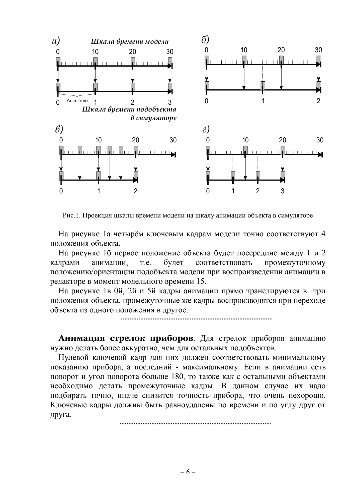

# Создание кабин для RTrainSim

краткое руководство

v.0.43

Скворцов В.А., 2020

## Содержание

- Создание и экспорт моделей

- WAG/ENG файл

- SD-файл модели

- Внешняя модель

- Геометрия кабины/салона

- Переключатели

- Приборы

- Локомотивная сигнализация

- Прочая анимация

- DLL-модуль

- Задачи модуля управления

- Классы и методы

- Управление звуками из DLL

- Адаптация серии локомотивов под уже существующую кабину

## Создание и экспорт моделей

Кабина в РТС представляет собой отдельную модель, которая отображается только когда игрок находится внутри локомотива. Внешняя модель локомотива в принципе может использоваться без переделки из МСТС.

Поэтому для того чтобы управлять локомотивом, или ездить в вагоне, необходимо создать модель внутренних интерьеров.

Эта модель должна также включать анимацию:

- дверей;

- окон;

- переключателей, кранов, рукояток и т.д.;

- стрелок манометров, скоростемеров и прочих приборов;

- любых других объектов, которые планируется анимировать.

Также в модели нужно сделать подобъекты, изображающие горящие лампы на панели машиниста, АЛСН и лампы источников света.

Помимо этого, можно также выделить в отдельные подобъекты всю геометрию, пересекающуюся с геометрией внешней модели (аналогичные действия можно сделать и при адаптации внешней модели), чтобы когда игрок выглядывал из окна, часть подобъектов скрывалась и модель кабины и внешняя модель могли отрисовываться вместе без артефактов и z-файтинга.

Реализовать подсветку приборов можно в том числе с помощью смены текстур, описываемой в настройках кабины и включаемой, когда это нужно. Для этого нужно вынести все подсвечиваемые приборы в отдельную текстуру.

3d-модель может быть создана в любом 3d-редакторе, который может экспортировать модели в формат 3ds. Наиболее известный из них конечно *«3ds Max».*

**Наименование подобъектов модели.** Подобъекты могут быть названы любыми именами. Соответствие между именем определённого подобъекта модели и интерактивным объектом кабины устанавливается впоследствии в sd-файле модели.

Существуют ограничения на наименования подобъектов модели:

1. *Максимальная длина имени* – 10 символов. Стоит отметить, что это ограничение промежуточного формата – 3ds. В формате s ограничение – 255 символов. Поэтому если есть необходимость, подобъекты можно вручную переименовывать в экспортированном s-файле. Если данное ограничение будет нарушено, то при экспорте в 3ds имя будет обрезано и в дальнейшем может возникнуть конфликт из-за одинаковых имён подобъектов.

2. В имени не *должно быть пробельных символов.*

Иначе модель не сможет быть сжата `ffeditc_unicode`.

3. В модели не должно быть объектов с одинаковыми именами.

**Структура модели.** В экспортируемой модели должен быть только один корневой подобъект. Все остальные подобъекты должны быть прилинкованы к нему. Иначе при экспорте конвертер выдаст ошибку «Animation hierarchy contains multiple root nodes».

При этом пивот корневого объекта должен совпадать с пивотом внешней модели локомотива, то есть в общем случае он должен находится в середине модели по X и Z, и в нижней точке внешней модели по Y (на уровне рельсов), и должен быть направлен вперёд по направлению движения локомотива.

Желательно также упорядочить все подобъекты по отсекам локомотива/вагона и выделить на каждый отсек по одному подобъекту, к которому линковать остальные.

Плоскости, изображающие оконные стёкла лучше выделить в отдельные подобъекты, так как в будущем они могут использоваться для имитации погодных эффектов и т.п.

Корневой объект не может быть анимирован.

Подобъекты модели не должны быть масштабированы или отражены.

Иначе при конверте возникнет ошибка «One of the nodes has scale or reflection in it, which is unsupported».

Исправить ошибку с масштабированием объекта можно задав масштаб 100 по всем осям и затем уже применяя масштабирование, но не к объекту, а ко всем его точкам.

В любом случае эта ошибка может быть исправлена с помощью инструмента *«Reset XForm».* Но при этом у объекта, у которого в матрице было отражение, вывернутся наизнанку все нормали. Их нужно будет обратить.

В экспортируемой модели не должно быть клонированных подобъектов и ссылок *(Clone, Reference, XRef).* Если они есть в модели, то перед экспортом необходимо выполнить для них *«Make Unique»* или просто преобразовать такие подобъекты в Editable Mesh. Иначе при конверте будет ошибка «Dummy nodes are not supported».

В подобъектах не должно быть вершин, не включённых ни в один полигон.

В противном случае при конвертации возникнет ошибка «Mesh contains one or more isolated vertices, which is unsupported». Для удаления таких точек можно перед экспортом выделить все подобъекты, применить модификатор *«Edit Mesh»* и нажать кнопку *«Remove isolated vertices».*

Также в модели не должно быть пустых объектов, не содержащих ни одной вершины. Если таковые есть, при сжатии `ffeditc_unicode` будет выдана ошибка.

**Анимация.** Продолжительность анимации в редакторе не имеет значения, она всегда задаётся в sd-файле кабины. Область, занимаемая кадрами на общей шкале анимации модели также незначима. Значимо только относительное расположение всех ключевых кадров по отношению к первому и последнему кадру анимации подобъекта. При загрузке моделей в симулятор шкала анимации разбивается на n-1 равных отрезков, где n – число положений в настройках в sd-файле для данного подобъекта.

Таким образом, для каждого подобъекта можно делать анимацию из нескольких ключевых кадров, число которых соответствует числу положений объекта. Если промежуточные положения объекта равноудалены друг от друга, то достаточным будет создать два ключевых кадра анимации, соответствующих начальному и конечному положению объекта.

Это справедливо для всех случаев, за исключением тех, когда между крайними положениями объекта угол поворота больше 180 градусов. В таких случаях если оставить два кадра, анимация в симуляторе (да и в Максе) будет воспроизводиться по кратчайшей дуге. Для нормального воспроизведения следует добавить несколько равноудалённых по углу и по времени промежуточных ключевых кадров.

Соответственно, для неравномерного воспроизведения анимации необходимо добавлять ключевые кадры, неравноудалённые по времени и/или по положению друг от друга.



## а) Шкала времени модели

***Шкала времени подобъекта в симуляторе*** *в) г)*

Рис.1. Проекция шкалы времени модели на шкалу анимации объекта в симуляторе

На рисунке 1а четырём ключевым кадрам модели точно соответствуют 4 положения объекта.

На рисунке 1б первое положение объекта будет посередине между 1 и 2 кадрами анимации, т.е. будет соответствовать промежуточному положению/ориентации подобъекта модели при воспроизведении анимации в редакторе в момент модельного времени 15.

На рисунке 1в 0й, 2й и 5й кадры анимации прямо транслируются в три положения объекта, промежуточные же кадры воспроизводятся при переходе объекта из одного положения в другое.

**Анимация стрелок приборов.** Для стрелок приборов анимацию нужно делать более аккуратно, чем для остальных подобъектов.

Нулевой ключевой кадр для них должен соответствовать минимальному показанию прибора, а последний - максимальному. Если в анимации есть поворот и угол поворота больше 180, то также как с остальными объектами необходимо делать промежуточные кадры. В данном случае их надо подбирать точно, иначе снизится точность прибора, что очень нехорошо. Ключевые кадры должны быть равноудалены по времени и по углу друг от друга. **Материалы.** Все материалы, используемые в модели должны быть названы с соответствии со списком поддерживаемых конвертором материалов. Материалы Multi/Sub-Object не обязаны иметь понятное название, но все входящие в них простые материалы должны быть названы в соответствии с форматом.

Названия большинства материалов состоят из трёх частей: типа материала, типа модели освещения и идентификатора.

**Название материала Модель освещения Идентификатор**

- `Alph` — 8-битная альфа **Norm** – обычная Для материалов типа

- `Alph*` — здесь может

- `Bright` — светлая быть задан приоритет

- `Trans` — 1-битная альфа материала, в виде

- `HlfBright` — полустроки 1s2s3s…

- `Solid` — непрозрачный светлая В остальных случаях **Crcfrm** – идентификатор – целое унифицированные число. нормали

- `Gloss` — блестящий

К примеру, материал может быть назван: AlphNorm1, AlphBright1s2s, TransNorm41, SolidCrcfrm3.

С полным списком материалов можно ознакомиться в документации к конвертеру.

В материалах должна присутствовать текстурная карта Diffuse, в которой должен быть назначен файл текстуры. Остальные текстурные карты (за исключением Glossiness), в модели и в симуляторе не используются.

Если материал назван неправильно, при конвертации возникнет ошибка «Material… is of unknown type».

Материалы с текстурными картами Diffuse должны быть назначены всем полигонам модели. Иначе при конвертации будет выдана ошибка «Untextured nodes are not supported».

Один из крайне неприятных глюков конвертера связан с материалами Multi/Sub-Object. Проблема возникает, если среди материалов, входящих в один из мультиматериалов, есть хотя бы один, который не назначен ни одному полигону хотя бы одного из объектов, которым назначен данный мультиматериал. В таком случае при сжатии модели будет выдана ошибка.

Возникает данная проблема при удалении или отсоединении части полигонов объекта, которому назначен мультиматериал. Или при ручном назначении мультиматериала объекту.

Решение, которое мне известно, довольно трудоёмкое – нужно просмотреть каждый из мультиматериалов в редакторе и по каждому смотреть все объекты, которым он назначен, и пытаться выделить полигоны по назначенному материалу, по каждому идентификатору простого материала. В случае, если на один из идентификаторов материала не будет выделено ни одного полигона, нужно удалить данный материал из мультиматериала. Если мультиматериал назначен нескольким объектам и данный материал отсутствует не на всех, то соответственно придётся скопировать мультиматериал, назначить его проблемному объекту и удалить из него неназначенный материал.

**LOD.** Для создания объекта с несколькими уровнями детализации необходимо экспортировать каждый из уровней детализации в 3ds файл, в конце имени которого указано максимальное расстояние, на котором виден данный уровень. Помимо данного числа в имени файла не должно быть других цифр и пробельных символов, иначе конвертер выдаст ошибку «Distance not found in filename».

Далее все данные файлы нужно указать в командной строке при вызове conv3ds.

При создании уровней детализации следует также выполнять следующие ограничения:

1. Материалы c 8-битной альфой и приоритетом `(Alph*1s2s3s…)` не должны присутствовать ни на одном из LODов, кроме ближайшего. На тех LODах можно использовать только материалы без приоритета (например AlphNorm1). Иначе модель невозможно будет сжать.

2. Анимация не должна меняться от одного уровня к другому. При этом иерархия не обязательно должна соответствовать основной, можно удалять отдельные подобъекты или добавлять новые. Но не редактировать анимацию. Это не приведёт к ошибке конвертации, но как это скажется в итоге на анимации модели сказать сложно.

3. Аналогично с предыдущим нельзя изменять положение или вращать (или замещать одноимёнными) подобъекты. Но данное ограничение построже – модель не сожмётся, а МСТС при отрисовке (но не загрузке) подобной модели вылетит.

Для моделей интерьеров уровней детализации делать не следует. Они всегда рисуются только в непосредственной близости.

**Экспорт.** Экспортируйте модель из 3d-редактора в формат 3ds. Если в модели несколько уровней детализации, экспортируйте каждый в отдельный файл. В имени каждого экспортированного файла должно быть прописано максимальное расстояние, на котором отображается эта модель. Для конвертации в формат s необходимо использовать программу **conv3ds,** входящую в состав МСТС. Программа работает из командной строки. В МСТС есть инструкции по использованию конвертера и по его синтаксису командной строки.

На русском языке инструкция есть здесь: `http://faq.trainsim.ru/index.php/Описание_утилиты_CONV3DS`

После того как конвертер успешно записал s-файл, его необходимо конвертировать в Юникод. Можно сделать это вручную, через Блокнот например, или использовать ещё одну встроенную программу МСТС – **txt2uni.**

Синтаксис её очень простой: txt2uni <имя файла>.s

Перед завершением конвертации возможно потребуется заменить в файле имена текстур и/или подобъектов модели (в 3ds и те и другие обрезаются до 10 символов).

Имена файлов текстур находятся в s-файле в списке images (… ). Имена подобъектов прописаны в двух местах: в списках matrices (… ) и `anim_nodes` (… ). Заменять надо имена в обоих. Последний список находится в конце файла, но может отсутствовать, если в модели нет никакой анимации.

После этого осталось только сжать модель. Это обязательный этап, модель ни в коем случае нельзя оставлять несжатой, а тем более распространять её в таком виде. При сжатии выявляются ошибки в модели. Размер сжатого файла может быть в 100 и более раз меньше несжатого.

Сжатие модели выполняется программой `ffeditc_unicode`, также входящей в состав МСТС.

Синтаксис командной строки программы для сжатия файла: `ffeditc_unicode` <исходный файл> /k [/o:<выходной файл>]

Для экспорта текстур существует много программ. **MakeAce** – это конвертер текстур, входящий в состав МСТС. Также **существуют** и другие программы, с оконным интерфейсом: **MakeAceWin, TGATool** и т.д.

Текстуры кабин, салонов и внешних моделей при запуске симулятора должны находится в той же директории, что и файл модели.

## WAG/ENG файл

Когда модель сконвертирована в формат s, нужно прописать некоторые сведения о ней и дополнительные параметры локомотива в eng/wag файл этого локомотива/вагона.

Детальное описание параметров eng/wag-файла содержится в руководстве «Расширенная настройка дополнений RTS» ***(ext.pdf).***

Основные параметры локомотива для RTS прописываются в блоке **EngExtended.** Там указывается имя файла модели кабины, управляющий модуль для данного локомотива и другие.

*Управляющий модуль локомотива* – это библиотека dll, которая непосредственно работает с кабиной, внешней моделью и самой физикологической моделью локомотива. Она производит отслеживание текущего состояния локомотива и рассчитывает изменения состояния, параметры силы тяги, разрядки магистралей и т.п., управляет состоянием моделей.

Для локомотива игрока наличие управляющего модуля является обязательным. Вернее, запускать локомотив в симуляторе и залезать в кабину можно и без него – для этого достаточно сделать и описать модель кабины. Но управлять локомотивом без данного модуля нельзя.

Для вагонов управляющего модуля не требуется. Чтобы попасть внутрь достаточно прописать модель салона здесь и описать её в SD.

Кабина локомотива назначается в параметре Cabin. Для того чтобы использовать ту же самую кабину для задней секции двухсекционного локомотива, можно задать параметр, развёртывающий для данной секции кабину относительно внешней модели на 180º.

Управляющий модуль локомотива задаётся в LibraryModule. Также указывается основной параметр локомотива. Им можно обозначать различные варианты кабин, отличать заднюю секцию от передней и тому подобное. Как именно трактовать значение этого параметра определяет сам управляющий модуль. К примеру в ВЛ80к передняя секция обозначается параметром 0, задняя – 1. А в ЭР9т головные вагоны обозначаются 0, моторные – 1. Так модуль узнаёт, какого конкретный вагон типа и по-разному реагирует на нажатие переключателей и выполняет расчёт состояния.

По подключении управляющего модуля обязательно нужно установить достаточную величину стека переменных локомотива VariableStack.

Параметр модели салона **Interior** располагается в стандартном блоке **Wagon.** Там указывается файл модели салона и звуков. Также как и модель кабины, модель салона может быть развёрнута относительно внешней модели на 180º. Имена файлов кабины, салона и модуля указываются относительно текущей директории, где находиться eng/wag-файл. Допустимо указывать путь к директории другого локомотива. И, напротив, недопустимо просто так копировать модуль из другого локомотива и располагать его с переделываемым.

Обязательно нужно задавать имя серии локомотива LocomotiveSeries. По этой строке модуль узнаёт, может ли он работать по СМЕ с данным локомотивом. Если планируется создавать новый управляющий модуль, который будет совместим с другим(и) при работе по СМЕ, то можно указывать название серии, используемое совместимыми модулями. Если же модуль не будет совместим, необходимо задать другое имя серии.

Если планируется использовать существующий модуль управления, необходимо опять же указывать название серии, используемое данным модулем. Его можно скопировать из любого локомотива, работающего с ним.

Для вновь создаваемой модели локомотива на первоначальном этапе конвертации, когда SD-файл ещё не написан и модель не испытана, ссылку на управляющий модуль надо временно убрать или закомментировать.

Когда модель протестирована и модуль управления создан, параметр нужно раскомментировать.

Для электровозов нужно сразу определить рабочие напряжения КС **WorksOnLineVoltages** и максимальный ток на токоприёмнике MaxLineCurrent.

Также для всех локомотивов нужно указать число осей NumAxles и назначить всем осям двигатели в NumEngines.

Когда данные параметры определены, можно приступать к созданию SD-файла вагона, кабины или салона.

В дальнейшем, при создании модуля управления, произвольную часть его настроек можно вынести в eng-файл. DLL может получать значения известных ей параметров, определённых в списке **EngineParams** в **EngExtended.**

Таким образом, можно будет осуществлять индивидуальную настройку любых параметров для каждого локомотива.

Переделывать звуки для кабины локомотива или внешние можно, используя уже существующие файлы или прописывая специальными параметрами отдельные звуки для RTS. То же самое относится к внешней модели.

## SD-файл модели

SD-файл содержит описание модели. SD-файл всегда располагается там же, где расположен файл модели и имеет одинаковое имя с ним. Создать SD-файл можно, скопировав его от другой модели.

Для моделей кабин, салонов и вагонов SD-файл содержит описание геометрии модели, звуковых областей, объявление интерактивных объектов: переключателей, дверей, приборов, окон, источников света, локомотивной сигнализации, сидений, прочей анимации.

Детальное описание параметров SD-файла для вагонов, кабин и салонов содержится в руководстве «Расширенная настройка дополнений RTS» ***(ext.pdf).***

Учтите в дальнейшем, что при задании имени подобъектов везде в SD-файле, если объект с данным именем в модели не найден – никакой ошибки или иного сообщения не выдаётся. Дальнейшая работа продолжается так же, как если бы имени объекта не было задано.

Для моделей интерьеров наличие SD-файла и определение кабин в них является обязательным. Без этого кабина не загрузится, и игрок не сможет в неё попасть.

**Внешняя модель** Для внешних моделей наличие SD-файла и определения расширенных параметров в нём не является обязательным, но у локомотива игрока они обязательно должны присутствовать, так как для него как минимум нужно прописать одну дверь, через которую игрок попадает в кабину.

С этого и следует начать. Пропишите в файле блок `ESD_Exterior_Details` и в нём добавьте описание одной или двух дверей **ExteriorDoors.**

В параметре Position укажите точку активации двери – если эта точка находится в поле зрения и расстояние от игрока до неё меньше параметра Radius, дверь будет открываться. Время воспроизведения анимации для дверей и всех других объектов задаётся параметром AnimTime. Чтобы установить соответствие между прописанными дверями и подобъектами внешней модели, укажите в параметре Name двери имя соответствующего подобъекта модели. Тогда дверь будет и визуально открываться по нажатию Enter.

Все координаты описываются относительно пивота внешней модели вагона в МСТСной системе координат. Положительное направление оси X – вправо. Ось Y – вертикальная. Координаты соответствуют максовой системе координат, можно брать их оттуда, только оси Y и Z надо поменять местами. Корневой объект таким образом для получения корректных координат должен находиться в (0,0,0).

Для того чтобы показать, что дверь ведёт в кабину, необходимо в параметре Connects написать EXTERIOR INTERIOR (в салон – EXTERIOR INTERIORPASS ) для дверей, ведущих прямо в кабину. Для дверей, ведущих в кабину с наружной площадки локомотива/вагона необходимо написать `EXT_WAG` INTERIOR ( `EXT_WAG` INTERIORPASS ).

Помимо этого, необходимо также показать, как именно игрок заходит в кабину. Для того чтобы по нажатию Ctrl+Enter воспроизводилась анимация захода в дверь, например подъёма по лестнице, необходимо описать траекторию этого движения в параметре Trajectory. Для дверей, через которые игрок заходит вовнутрь, данный параметр обязателен.

Чтобы игрок мог впоследствии заходить в кабину с платформы, помоста, площадки без нажатия Ctrl+Enter (первый заход всегда осуществляется только таким образом), необходимо описать в двери параметр InteriorPlane. Здесь нужно описать внутреннюю плоскость двери, доступную только когда дверь открыта, причём эта плоскость должна пересекаться с внутренними областями кабины.

Для капотников придётся сразу же описывать и внешнюю геометрию.

- `Необходимо использовать также: ExteriorLadders` — лестницы на внешнем виде, по которым забирается игрок; **ExteriorPlanes** – плоскости, по которым перемещается игрок (см.далее про создание плоскостей в кабине);

- `ExteriorLedges` — если есть очень узкие проходы, где плоскости использовать затруднительно.

Сразу же можно описать подобъекты внешней модели, изображающие внутренние интерьеры и которые соответственно желательно не отрисовывать вместе с кабиной.

Они описываются **вне** блока `ESD_Exterior_Details` в списке `ESD_Interior_Parts` (… ), где перечисляются их имена.

**Геометрия кабины/салона I)** В SD-файле кабины или салона сперва необходимо описать геометрию и двери, для чего нужно добавить в файл блок `ESD_Interior` и в него блок **InteriorGeometryInfo.** В данном блоке в первую очередь нужно описать:  **InteriorPlanes** – плоскости, по которым перемещается игрок;  **InteriorLedges** – узкие проходы внутри кабины;  **InteriorDoors** – двери. В **InteriorPlanes** необходимо описать две точки каждой плоскости: левую переднюю и правую заднюю. Проще всего это сделать, расположив в максе плоскости там, где игрок сможет перемещаться, и скопировать координаты точек в файл. Перед этим убедитесь, что корневой объект находится в 0,0,0. Если все объекты слинкованы к корневому, то при его перемещении они все переместятся следом.

Пока отсеки интерьера не прописаны, вместо названия области в описании плоскостей впишите пустую строку, например DUMMY.

В **InteriorLedges** описывается траектория перемещения игрока по этим узким проходам. В отличии от траектории двери, данная траектория не воспроизводится как анимация. Игрок перемещается по ней, нажимая клавиши перемещения. Новая координата игрока проецируется на траекторию и отклониться от неё игрок не может, пока не окажется на одной из плоскостей.

**InteriorDoors** описывают двери. В параметре Name указывается имя подобъекта в модели, соответствующего данной двери. В параметрах Position и Radius описывается точка и радиус активации, в локальных координатах кабины. Для этих дверей также можно задавать траектории, активируемые по Ctrl+Enter, и внутренние плоскости.

Для дверей, ведущих наружу необходимо временно прописать параметр Connects равным INTERIOR EXTERIOR ( или INTERIOR `EXT_WAG` ). Когда звуковые области будут сделаны, слово INTERIOR нужно будет заменить на имя области, в которой расположена дверь.

С этого момента можно запускать, залезать и тестировать геометрию кабины. Пока по кабине можно только ходить и открывать двери.

**II)** Следующим этапом нужно закончить описание геометрии кабины.

Необходимо описать звуковые области (отсеки) интерьера, подобъекты модели, скрываемые на внешнем виде, окна и сидения.

- `InteriorAreas` — здесь описываются звуковые области (отсеки). Каждую область необходимо назвать, указать её координаты. Имена не должны повторяться. Области должны полностью покрывать всю кабину/салон, между ними не должно быть зазоров. Если потребуется отделить небольшую часть одной области в другую, необходимо добавить описание малой области перед большой.

Области используются для расчёта пути звука и его затухания при воспроизведении в зависимости от различного местоположения игрока. В каждой области можно прописать подобъекты, расположенные в этой области. Вся иерархия дочерних объектов для указанных (за исключением корневого объекта) автоматически считается принадлежащей данной области.

Когда области описаны, следует указать базовую область для каждой плоскости **InteriorPlane.**

Области нужно связать между собой дверьми. Обязательно пропишите верные названия областей в параметре Connects для всех дверей. Если области фактически не отделены дверьми, но требуется имитировать затухание звука, пропишите «виртуальные» двери без параметров точки активации и внутренней плоскости, в которых свяжите требуемые области в параметре Connects и пропишите нужный коэффициент затухания для закрытой двери.

Опишите окна в блоке **InteriorWindows.** Здесь желательно описывать все окна в модели, не только те, которые могут быть открыты.

Для окон, которые могут быть открыты игроком по Enter необходимо добавить точки активации Position и Radius. Укажите имя ассоциированного подобъекта модели в Name, если таковой есть.

Для окон, которые не могут быть открыты, но которые используются в расчёте звука, на которые возможен выход из кресла машиниста, необходимо все равно указывать точку активации Position. Radius для них можно либо не указывать вовсе, либо приравнять к 0.

Для подобъектов модели, изображающих прочие окна, достаточно указать имя Name.

Для всех окон, которые могут быть открыты, укажите параметр CanBeOpened ( 1 ).

В окнах, в которые игрок может выглядывать, добавьте HeadOutPosition.

Сидения описываются в **InteriorChairs** и **InteriorSeats.** В первом описываются кресла машиниста, во втором пассажирские сидения.

Кресла машиниста описываются тремя точками – позицией игрока на сидении Pos1; точкой, куда встаёт игрок, не покидая кресла Pos2; точкой, куда игрока переносит при выходе из кресла Pos3. Кресла машиниста не связываются ни с каким подобъектом модели.

Пассажирские сидения описываются позицией игрока на сидении Pos1, точкой выхода Pos2 и плоскостью Area, в которой игрок может перемещаться, не вставая. Плоскость – необязательный параметр. Также для них может задаваться имя связанного подобъекта Name. Если он задан, то когда игрок садится и встаёт с сидения, для данного подобъекта воспроизводиться анимация. Для обоих типов сидений нужно задавать точки активации Position и Radius. Также можно указать имя связанного окна HeadOutWindow, в которое может выглядывать игрок из сидения по Num2.

В **ExteriorNodes** перечисляются имена подобъектов, скрываемые на внешнем виде – то есть, когда игрок выглядывает из окна.

Теперь описание геометрии завершено. Помимо хождения по кабине добавилась возможность садиться в кресла и выглядывать в окна. А для звуков будет рассчитываться их громкость, в зависимости от текущего положения игрока и источника звука.

**III)** Теперь необходимо описать рабочие элементы кабины:  **Switches** – переключатели;  **Displays** – приборы (стрелки, лампы, экраны);  **Animations** – прочие анимированные объекты, не относящиеся к другим типам;  **LightSources** – источники света;  **CloseUps** – 2d-локации;  **TextureChanges** – смена текстур;  **LocomotiveSignalization** – локомотивная сигнализация.

В первую очередь нужно описать переключатели, приборы, локомотивную сигнализацию и прочую анимацию.

***Переключатели*** **Переключатели** – важнейшая часть кабины. Именно взаимодействием с ними и осуществляется весь процесс управления локомотивом. Они описываются в блоке **Switches.**

Для каждого переключателя обязательно задаётся его идентификатор ID – это целое неотрицательное число, по которому переключатель будет доступен в dll-модуле управления локомотивом. Идентификатор не может быть больше или равен общему числу переключателей – числу, указанному в начале блока. Идентификатор каждого переключателя должен быть уникальным.

Если кабина создаётся как перекраска или другая модель, совместимая с существующим модулем управления, все переключатели должны сохранять свои ***идентификаторы.*** В принципе можно удалять отдельные переключатели, если их использование в данной версии кабины не предполагается. Однако, это справедливо только для «декоративных» (которые ничем вообще не управляют) или вспомогательных переключателей (например, освещение кабины). Удаление таких переключателей не сделает локомотив неработоспобным. А вот если удаляемые переключатели используются dll в управлении локомотивом, то их удаление приведёт к частичной или полной потере функциональности локомотива.

**Недопустимо** использовать идентификаторы удалённых ранее переключателей во вновь добавляемых, даже в случае когда и те и другие декоративные, не несут функций управления. Недопустимо изменять идентификаторы существующих переключателей, так как в таком случае управляющий модуль будет ошибочно трактовать значение переключателей.

Идентификатором определяется функциональное назначение каждого переключателя, внешний вид его устанавливается путём связывания его с подобъектом модели. Имя соответствующего подобъекта задаётся в параметре Name.

Как и для остальных объектов, необходимо задавать точку активации Position и радиус Radius. Они используются для проверки расстояния до переключателя при нажатии левой кнопки мыши.

Переключатель может быть не связан ни с каким подобъектом. В таком случае нажатие его мышкой возможно только если задана точка активации – переключатель считается нажатым, если мышка нажата в радиусе 25 пикселов от проекции точки активации на вьюпорт, для самого близкого переключателя, у которого выполняется это условие.

Начиная с версии 0.37 симулятора, декоративные переключатели можно описывать в отдельном блоке **DecorativeSwitches.** Этот блок можно свободно изменять, на управлемости кабины это не скажется.

Переключателю может быть назначена одна или две клавиши клавиатуры (или сочетания) в параметре AssignKey. Если задано две клавиши – первая увеличивает положение переключателя, вторая – уменьшает. Если задана одна – по умолчанию она поочерёдно переводит переключатель в следующее положение до достижения последнего, а потом – наоборот. Если задан флаг LOOP, переключатель при ходе вверх из последнего положения переключается сразу в нулевое, соответственно при ходе вниз – из нулевого сразу в последнее (если задана одна клавиша, ход всегда вверх).

Если для переключателя задан флаг CHECKDISTANCEONPRESS, при нажатии клавиатурной комбинации проверяется расстояние от игрока до точки активации и, если оно больше радиуса активации, положение не переключается. Это может быть необходимо когда в одной модели кабины есть несколько пультов управления машиниста. Например, как в односекционном локомотиве. В таком случае, если не использовать этого флага, то по нажатию клавиш либо будут всегда срабатывать контроллеры обоих пультов, либо всегда только одного. Если прописана верно и проверяется дистанция, то срабатывает всегда только один переключатель, находящийся поблизости от игрока, что уже куда более приемлемо.

При нажатии мышки для обычного переключателя реакция аналогична нажатию на одну назначенную клавишу. В случае же, если у переключателя стоит флаг CONTROLLERX – при перемещении мыши вправо с зажатой кнопкой положение переключается на один шаг вверх, при перемещении влево – на один шаг вниз. Аналогично с флагом CONTROLLERY при перемещении мыши вверх/вниз.

Если у переключателя стоит флаг PRECISE – при управлении им мышью у него вообще отсутствуют фиксированные положения, он может останавливаться в любом промежуточном. Перемещение мыши после захвата переключателя (в пикселах) транслируется с коэффициентами из SwitchPrecision в смещение по шкале анимации. Для точных переключателей сейчас обязательно задавать флаг CONTROLLERX и/или CONTROLLERY. Если же у переключателя есть эти флаги, но нет флага PRECISE и заданы коэффициенты SwitchPrecision – перемещать его мышкой можно плавно, в любое промежуточное положение, но при отпуске он переместится в ближайшее заданное.

Флаг NONFIXED означает, нефиксированный переключатель. При отпуске назначенной клавиши или кнопки мыши он автоматически возвращается в положение, указанное в параметре FixedState (по умолчанию – 0).

Если установлен флаг DISABLED переключатель не может быть переключён игроком.

Флаг KEY означает, что изначально подобъект данного переключателя не отображается, а при клике на его расположении он появляется и становится в положение InitialState. То есть данный тип переключателей изображает ключи и рукоятки, которые могут быть изъяты из месторасположения. При захвате и протаскивании ( CONTROLLERX/Y ) или нажатии мыши с нажатой клавишей Shift, ключ «вытаскивается».

Время переключение из одного положения в соседнее задаётся в AnimTime.

Для задания различного времени переключения между различными положениями, необходимо использовать список AnimScale, где задавать NumStates -1 коэффициентов, на которые масштабируется время переключения между каждым из положений.

Подсказка, задаваемая в Hint выдаётся игроку, когда он зажимает Alt и проводит мышью над подобъектом переключателя. При этом также проверяется расстояние до точки активации.

Если для подобъекта задан список StateHints, то в различных положениях переключателя к основной добавляется подсказка, соответствующая текущему положению.

В States указано число положений переключателя. Вся анимация данного подобъекта разбивается на n-1 равных частей, где n – число положений в данном параметре. При загрузке кабины переключатель ставится в указанное здесь начальное положение. После того, как переключатели прописаны, нужно проверить их работоспособность, пощёлкав их в симуляторе. Если у локомотива ещё нет модуля управления, а у выключателей нигде нет флага DISABLED, все они должны работать как надо. Необходимо проверить начальное состояние, переключение, отображение подсказок.

В случае обнаружения неполадок нужно проверить интерьер на обычные ошибки:

1. Указано неправильное имя подобъекта

2. Не сделана анимация для данного подобъекта

3. Не указана или неверно указана точка активации или радиус

4. Неправильно указано число положений

5. Число переключателей в начале списка меньше фактического

6. Повторяющиеся идентификаторы

7. Идентификатор больше или равен числу переключателей в списке.

***Приборы*** Далее нужно описать **приборы** в блоке **Displays.** Требования к идентификаторам ID приборов полностью аналогичны переключателям.

Приборы в RTS бывают четырёх типов:

1. стрелки

2. лампы

3. дисплеи

4. экраны

**Стрелки** – это подобъекты модели, которые занимают одно из положений шкалы анимации, в зависимости от текущего значения управляющей переменной.

**Лампы** – это подобъекты модели, отображающиеся когда текущее состояние отлично от 0 и скрываемые в противном случае.

**Дисплеи** – это несколько подобъектов модели, в зависимости от состояния дисплея рисуется один из них или несколько.

**Экраны** – это самостоятельно описанные плоскости в которых рисуются элементы экрана, с моделью они не связаны. Их настройку лучше оставить на потом, ввиду необходимости работы управляющего модуля для их отладки.

Для всех приборов также как и для переключателей нужно задавать точки активации Position, радиусы Radius, подсказки Hint. Для стрелок и ламп необходимо задать имя связанного подобъекта.

Для стрелок обязательно нужно задать параметры ValuesRange и Granularity.

Первый указывает:

1. значение управляющей переменной, соответствующее нулевому кадру анимации в модели

2. значение, соответствующее последнему кадру анимации

3. начальное значение

4. частоту колебаний при зашкаливании прибора (для стрелок с флагом OVERSCALE ).

Granularity задаёт точность показаний стрелки – то есть какое минимальное изменение управляющей переменной вызовет сдвиг стрелки или иначе – каковы минимальные промежутки между занимаемыми положениями стрелки. Чем меньше значение, тем точнее прибор (но тем дольше воспроизводится анимация). Параметр не должен быть равен 0, иначе считается, что стрелка может занимать только два положения – первый и последний кадры анимации.

Скорость воспроизведения анимации зависит от точности стрелки, параметра скорости воспроизведения анимации в S-файле (по умолчанию 30) и параметра AnimSpeed в описании дисплея. Если установлен флаг PRECISE стрелка всегда точно показывает текущее значение, анимация не воспроизводится.

Для ламп можно задать начальное состояние InitialState и цвет лампы Colour. По умолчанию цвет белый: ffffffff, можно задать другой, чтобы подкрашивать лампу или изменять прозрачность (будет работать только если у подобъекта назначен прозрачный материал).

Для ламп можно задавать список подсказок StateHints. Число подсказок тут неограничено, а текущая подсказка выбирается вручную модулем управления.

Для дисплеев типа «Дисплей» можно задать флаг DISPLAYSEQUENCE. С ним при каждом состоянии отображается только один подобъект, чей номер в списке дисплея равен текущему состоянию (нумерация списка с 1 – в 0 положении все подобъекты скрываются). Без этого флага номер состояния является битовой маской, задающей несколько видимых подобъектов, также в соответствии с порядком их перечисления в списке.

Для экранов связанного подобъекта быть не может.

После того, как прописаны приборы, можно проверить их работу. Хотя полноценная проверка будет возможна только когда будет работать управляющий модуль, сейчас уже можно проверить начальное состояние приборов и отображение подсказок по ним. Возможные ошибки тут такие же, как и по переключателям.

***Локомотивная сия***

**Локомотивная сигнализация.** По сути локомотивная сигнализация

- это те же лампы, только автоматически включаемые, в зависимости от показания следующего сигнала. В принципе этот блок необязателен. В ряде случаев (к примеру когда в кабине есть несколько светофоров, которые желательно включать отдельно) удобнее прописывать огни как лампы и в управляющем модуле определять, какие огни включать и выключать самостоятельно.

В **SignalLights** нужно перечислить все имена подобъектов, изображающие в модели лампы локомотивного светофора.

В **SignalAspects** нужно показать, какие из огней АЛС зажигаются при каждом показании светофора.

Помимо этого в блоке **LocomotiveSignalization** можно предписать симулятору вызывать в dll локомотива функцию ALSN, в которую передавать стек из n сигналов впереди и сзади, и эта функция самостоятельно будет определять, как отображать текущее показание светофора(ов). Это может быть использовано, к примеру, если в локомотиве нужно отображать состояние светофоров за несколько блок-участков. Величина стека сигналов n определяется тут же параметром BlockCheckAhead.

***Прочая анмация*** **Прочая анимация.** Анимированные подобъекты, которые не могут быть ассоциированы с каким-либо иным типом объекта, должны быть описаны в блоке **Animations.**

Такая анимация может:

1. Запускаться и управляться модулем управления

2. Воспроизводиться постоянно

3. Привязываться к скорости

4. Запускаться салонными переключателями

5. Связываться с объектом внутреннего вида (для внешних моделей)

Для каждой анимированной группы здесь может быть задано несколько подобъектов модели. Их имена перечисляются в списке **ChildNodes.**

Для каждой группы нужно задать произвольное имя Name под которым она будет доступна из модуля управления.

Число фиксированных положений анимации задаётся в NumKeyFrames.

Оно должно быть не менее 2.

Здесь же задаётся время воспроизведения всей анимации в AnimTime. Теперь когда сделаны в модели и описаны все управляющие элементы, осталось только оживить их. Кабина готова к созданию или подключению модуля управления.

## DLL-модуль

DLL-модуль создаётся с помощью Win32-компилятора. Для этой цели хорошо подходит к примеру C++ Builder. При этом при создании проекта не забывайте отключать VCL. После создания проекта библиотеки необходимо:  установить выравнивание данных в Double Word (32 bit)  подключить основной заголовочный файл симулятора ts.h, расположенный в папке

```
TRAINS\TRAINSET\tsrLoco_VL80k-125\CAB
```

Ни в коем случае не копируйте этот файл из дефолтного расположения, а подключайте оттуда, добавляя этот путь в IncludePath.  создать в cpp-файле функции Init, ChangeLoco, CanWorkWith, Run.

Наличие данных функций является обязательным. Полный список функций и их прототипы приведены в руководстве «Расширенная настройка дополнений RTS» ***(ext.pdf).***

В коде управление локомотивом реализуется посредством изменения переменных и вызовов методов в передаваемых в функции объектах классов `*Locomotive`, `*Engine`, Cabin. Оттуда же получается информация о текущем состоянии.

Служебная информация для каждого локомотива может хранится в объекте класса `*Engine` данного локомотива, в частности специально для этих целей служит массив переменных Engine::var. Размер этого массива равен параметру VariableStack из eng-файла данного локомотива.

Выделять и высвобождать память самостоятельно библиотека не должна.

***Задачи модуля управления*** Задачи, решаемые библиотекой в целом это:

1. инициализация локомотива;

2. обработка пользовательского ввода (нажатия переключателей, элементов экрана);

3. реализация внутренней логики работы локомотива;

4. вычисление и хранение данных о состоянии локомотива (включение агрегатов, температура агрегатов, обороты дизеля, ток ТЭД);

5. изменение состояния объектов кабины, внешней модели, локомотива, в том числе обновление показания дисплеев;

6. вычисление результирующих параметров: силы тяги, тормозной силы ЭДТ, состояния ручного тормоза, темпа разрядки магистралей, темпа зарядки ГР, давления локомотивного тормоза, задание давления ТЦ ЭПТ, подача песка и т.д.

7. контроль звуков

8. взаимодействие с другими локомотивами по СМЕ Рассмотрим задачи отдельных функций.

1. **Init** Функция инициализирует состояние всех переменных состояния и результирующих переменных локомотива в объектах `*Locomotive` и `*Engine`, задаёт положение переключателей в кабине.

Инициализация может происходить по-разному, в зависимости от условий запуска локомотива. Параметры запуска определяются переменной State. Первый байт переменной определяет тип начального состояния. Приняты такие значения, в зависимости от условий запуска:

- `0` — локомотив без вагонов, не движется. Локомотив инициализируется в холодное состояние, полностью выключен.

- `1` — локомотив с вагонами, не движется. Локомотив включен частично.

- `2` — локомотив без вагонов, движется. Локомотив полностью включён.

- `3` — локомотив с вагонами, движется. Локомотив полностью включён и готов к работе с вагонами.

В сценарии значение переменной также может быть задано принудительно автором сценария, специально для инициализации в нужное состояние.

1 бит второго байта переменной State здесь и в функции Run обозначает, что игрок сейчас находится в данном локомотиве.

То есть, для случаев частичного и полного включения при инициализации, может быть принято, что локомотив, где находится игрок при старте считается ведущим, остальные – ведомыми. Соответственно выполняется и инициализация переменных и переключателей кабины.

Небольшое затруднение с этой функцией состоит в том, что в момент, когда она вызвана, звуки для локомотива ещё не загружены. Соответственно, изменять их состояние в этой функции ещё нельзя.

2. **ChangeLoco** В этой функции основная задача – это определить, может ли локомотив, куда переходит игрок, быть назначен ведущим.

На то, что локомотив ведущий указывает первый бит Locomotive::LocoFlags.

В функцию передаётся указатель на предыдущий ведущий локомотив, если этот локомотив в текущий момент контролирует данный.

Решение принимается как правило на основе текущего состояния переключателей и переменных внутреннего состояния ведущего локомотива. Если он выключен, отключёны цепи управления и т.п.

Дело усложняется, если локомотив может работать по СМЕ с локомотивами других серий. Тогда необходимо использовать согласованную переменную из стека, чтобы обозначать отключённое состояние во всех сериях локомотивов, с которыми возможна работа.

3. **LostMaster** Функция вызывается при отцепке или рассоединении кабеля СМЕ с ведущим локомотивом. Функция должна перевести локомотив в свободное состояние, т.е. выключить всё, что контролируется по СМЕ. К примеру: выключить тягу, опустить ТП, отключить ГВ и т.п.

4. **CanWorkWith** Функция проверяет название серии другого локомотива из сплотки и определяет, может ли он управляться из данного локомотива, Должна возвращать true, если dll может работать с данной серией.

5. **CanSwitch** Функция вызывается при попытке игрока нажать переключатель. Функция проверяет, возможен ли перевод и возвращает true, если да.

Также для тех переключателей, которым разрешён перевод, можно в звуковые объекты передать данное событие, т.е. отослать какой-либо код триггера, в зависимости от идентификатора переключателя.

6. **Switched** Вызывается после завершения переключения объекта в одно из положений.

Здесь расположены обработчики нажатия клавиш, которые соответствующим образом изменяют переменные состояния локомотива, отсылают коды звуковых триггеров, и т.п.

Здесь реализуется синхронная часть логики управления, то есть непосредственная реакция системы управления локомотивом на действия игрока.

Когда происходит переключение элементов экрана или 2d-локации, данная функция вызывается, только если у данного элемента задан параметр ID. Он же и передаётся в эту функцию.

7. **Run** Основная функция. Здесь уже происходит вычисление результирующих параметров, исходя из текущего состояния локомотива и шага времени.

Здесь же отчасти реализуется логика управления, асинхронная её часть. К примеру, работа всех устройств безопасности, систем защиты от перегрузок оборудования и т.п.

В случае если игрок находится сейчас в данном локомотиве, тут также должны обновляться все приборы.

8. **ALSN** Функция вызывается когда локомотив движется и в SD-файле кабины есть параметр SignalizationScripted ( 1 ) Функции передаётся стек сигналов, ограничения скорости. Функция должна сохранять данные для работы систем безопасности и устанавливать состояние локомотивной сигнализации.

9. **SpeedLimit** Функция вызывается, когда локомотив движется. В неё передаются данные о всех видах ограничений скорости. Она также должна передавать значения в устройства безопасности.

***Классы и методы*** **Классы «Locomotive», «ElectricLocomotive», «DieselLocomotive»** Из объектов данного класса должно производиться только чтение значений параметров, за исключением функции Init и ChangeLoco.

**Поля Тип Поле Бит Назначение** ***Locomotive*** UCHAR PantoRaised Подняты ли токоприёмники. Каждый бит обозначает поднятие соотв. токоприёмника.

ULONG Flags 1 Вагон развёрнут 3 Игрок в данном вагоне float IndependentBrakePressure Давление ТЦ локомотивного тормоза float AuxiliaryPressure Давление в ЗР float Velocity Скорость float Acceleration Ускорение float BrakeCylinderPressure Давление ТЦ float TrainPipePressure Давление ТМ float ChargingPipePressure Давление НМ ULONG LocoFlags 1 Ведущий локомотив 4 Холодный локомотив 8 Управляется компьютером float MainResPressure float SandLeft Остатки песка (сек.) UINT LibParam Основной параметр UINT StackSize Размер стека переменных **Тип Поле Бит Назначение** Locomotive Slaves Ведомые локомотивы `*` `*` UINT NumSlaves Число ведомых локомотивов UINT NumEngines Число двигателей Engine `*` locoA ***ElectricLocomotive*** Electric loco Engine `*` float LineVoltage Напряжение КС float LineFreq Частота тока float LineCurrent Ток сети ***DieselLocomotive*** Diesel loco Engine `*` float FuelAmount Топливо (л) Все параметры здесь входные.

**Методы**

**void** SwitchLight( USHORT ID, **bool** TurnOn, **float** Radius=0.0, **unsigned long** Colour=0 ) Переключить состояние сигнального огня на внешней модели.

- `ID` — порядковый номер сигнального огня

- `TurnOn` — включить или выключить

- `Radius` — изменить радиус огня, 0 – не менять

- `Colour` — изменить цвет огня, 0 - не менять

**bool** IsLightOn( USHORT ID ) Включён ли свет № ID.

***Сигнальные огни*** доступны только по своему порядковому номеру, поэтому важен порядок их следования в eng-файле! Альтернативно, можно принудительно задавать в eng-файле в каждом сигнальном огне параметр LightID, который можно использовать здесь.

**bool** PostTriggerBoth( USHORT N ) Отправить код триггера N звукам кабины и внешним.

**bool** PostTriggerCab( USHORT N ) Отправить код триггера N звукам кабины.

**bool** PostTriggerEng( USHORT N ) Отправить код триггера N внешним звукам.

**void** LockCoupling( **bool** Front, **bool** Locked ) **void** DetachCoupling( **bool** Front, **bool** Detached ) Закрыть или расцепить автосцепку локомотива.

- `Front` — true: передняя, false: задняя.

**int** GetTrackItems( UINT Code, **float** Distance, TrackItemsItem `*&items`, UINT &Count ) Получает объекты пути, расположенные вблизи поезда.

- `Code` — битовая маска, где искать объекты: 1 - впереди (по основному направлению движения состава), 2 - сзади, 4 - под составом.

- `Distance` — максимальное расстояние, на котором искать объекты. В items возвращается указатель на массив TrackItemsItem в котором Count найденных объектов.

В объектах **TrackItemsItem** получаемого массива: Pos – положение объекта относительно поезда, значения такие же как флаги Code; Z – координата объекта на пути относительно хвоста состава; Distance – расстояние от головы/хвоста поезда до объекта; obj – указатель на сам объект пути, класса TrackItem или производного. **Классы «Engine», «ElectricEngine», «DieselEngine»** Через объекты данного класса dll управляет состоянием локомотива. Здесь же хранятся данные о контексте, внутренние переменные. В этих объектах сохраняются результирующие значения.

**Поля Тип Поле Бит Назначение** ***Engine*** Cabin `*` cab float `*` var Стек переменных float Power Мощность **float Force** Сила тяги **float BrakeForce** Тормозное усилие float `*` EngineVoltage Напряжение ТЭД float `*` EngineCurrent Ток ТЭД Сила тяги ТЭД **float** `*` **EngineForce float IndependentBrakeValue** Установить давление в ТЦ от локомотивного тормоза **float TrainPipeRate** Темп разрядки ТМ

- `n>0` — магистраль сообщается с ГР

- `n<0` — магистраль сообщается с атмосферой float AuxiliaryRate **float MainResRate** Темп зарядки ГР, кг/см/с **float ChargingRate** Темп разрядки НМ **float HandbrakePercent** Ручной тормоз, % **float EPTValue** Задатчик давления в ТЦ ЭПТ.

- `n<0` — не задавать значения

- `n==0` — отпуск

- `n>0` — установить давление float DynamicBrakePercent *float ExternalPowerSource* Мощность деповского источника питания *float ExternalPowerSource* Напряжение деповского *Voltage* источника питания **UWORD BrakeSystemsEngaged** 1 Включён контроль ТМ 2 Включёно ЭПТ 3 Включён контроль НМ **UWORD ALSNOn** Включение АЛСН

- `1` — включено 0xFFFF – проверка Бит 0x8000 – AlsnOn передаёт номер аспекта в **Тип Поле Бит Назначение** первых 12 битах **UWORD Sanding** Подача песка *UWORD NumLights* Число сигнальных огней внешней модели *UWORD NumParameters* Число спец. параметров в енг-файле **ULONG EngineFlags** 1 Отпуск тормоза поезда 2 Отпуск тормоза локомотива ULONG Flags ULONG Flags2 int Reverse Реверс *UINT Wheelslip* Боксование. Каждый бит обозначает боксование соответствующей КП UINT ThrottlePosition Тяговая позиция float UR Давление УР double BatteryCharge Заряд батареи *float CurrentMilepost* Километраж ***ElectricEngine*** **UCHAR Panto** Поднять ТП UCHAR MainSwitch ГВ **float PowerConsuming** Потребляемая мощность ***DieselEngine*** UCHAR DieselOn Включение дизеля **float FuelConsuming** Потребление топлива, л/с float RPM Обороты двигателя Курсивом выделены входные параметры. Жирным шрифтом – выходные. Остальные параметры – внутренние, могут использоваться по усмотрению модуля.

Положительная сила тяги направлена всегда вперёд по составу, кроме случаев, когда локомотив развёрнут в составе. DLL должна сама проверять, задняя секция или передняя, в каком направлении поставлен реверс и находить знак силы тяги. **Методы bool PostGlobalMessage(short Action,short** ID) Отправить сообщение составу.

*Action:* **Код Значение** `GM_DOOR_OPEN` Открыть двери с GlobalID == ID `GM_DOOR_OPEN` Закрыть двери с GlobalID == ID `GM_DOOR_UNLOCK` Отпереть двери с GlobalID == ID `GM_DOOR_LOCK` Запереть двери с GlobalID == ID `GM_SMS_POST` Отправить код триггера всем звукам в составе `GM_LIGHT_ON` Включить все источники освещения с GlobalID == ID `GM_LIGHT_OFF` Выключить все источники освещения с GlobalID == ID `GM_TEX_CHANGE` Включить смену текстур с GlobalID == ID `GM_TEX_REVERT` Отключить смену текстур с GlobalID == ID

**bool ShowMessage(short** `Type,wchar_t` `*text)` Отобразить сообщение text игроку.

*Type:* **Код Значение** `GMM_HINT` Подсказка `GMM_BOX` Диалоговое окно `GMM_POST` В окно сообщений

**float GetParameter(char** `*name,float` Default=0.0) Получить значение параметра по имени name из блока **EngineParameters** из eng-файла. Если такого параметра нет – возвращает Default. `wchar_t` `*GetParameterAsString(char` `*name,wchar_t` `*Default)` Получить строковое значение параметра по имени name из блока **EngineParameters** из eng-файла. Если такого параметра нет – возвращает

- `Default. Если параметр` — число, преобразовывает к строке (только если подключен stdio.h, раньше ts.h).

**AuxLibrary** `*GetAuxLibrary(wchar_t` `*Name)` Получить объект вспомогательной библиотеки по его имени Name. **Класс «Cabin»** В данном классе хранятся данные о состоянии всех интерактивных объектов в кабине и управление ими осуществляется здесь же.

**Методы int** Switch( UINT ID ) Возвращает текущее положение переключателя с идентификатором ID. Для переключателей с флагом KEY значение 0 соответствует вынутому ключу, а остальные положения увеличиваются на 1.

**int** SwitchSet( UINT ID ) Возвращает новое устанавливаемое положение переключателя с идентификатором ID.

**int** SwitchSub( UINT ID ) Возвращает текущее положение элемента локации с идентификатором ID.

**int** SwitchSub( UINT sceneID,UINT objID ) Возвращает текущее положение элемента № objID локации № sceneID.

**void** SetSwitch( UINT ID,UINT **State,bool** SetBoth ) Установить положение переключателя ID в State. SetBoth – установить сразу же текущее положение.

**void** SetSwitch( UINT sceneID,UINT **objID,float Value,bool** SetBoth ) Установить положение Value элемента № objID локации № sceneID.

**float** GetSwitchFrame( UINT SwitchID ) Получить текущий кадр переключателя SwitchID. Для переключателей с флагом PRECISE – точное значение кадра анимации.

**void** SetDisplayValue( UINT **displayID,float** Value ) Установить управляющую переменную прибора (стрелки) displayID.

**void** SetDisplayState( UINT displayID,UINT State ) Установить состояние прибора displayID.

**float** DisplayValue( UINT displayID ) Возвращает управляющую переменную прибора displayID.

**float** DisplayState( UINT displayID ) Возвращает состояние прибора displayID. **void** SetHint( UINT **displayID,int** ID ) Установить текущую подсказку № ID для прибора (лампы) displayID.

**bool** IsDoorOpened( UINT ID ) Открыта ли дверь № ID.

**void** SwitchLight( UINT ID,UINT On ) Переключить состояние источника света № ID в кабине в состояние On.

**void** SetLightColour( UINT ID,ULONG Colour ) Сменить текущий цвет источника света №ID.

**void** SetLightState( UINT ID,UINT State,ULONG **Colour,float** SpotExp, **float** RadiusX, **float** RadiusZ ) Установить состояние источника света № ID.

- `State` — включён или нет.

- `Colour` — текущий цвет. 0 – не менять.

- `SpotExp` — экспонента. -1 – не менять.

- `RadiusX, RadiusZ` — радиус по X и Z, -1 – не менять.

**int** ScreenState( UINT DisplayID,UINT SubID ) Возвращает состояние элемента № SubID экрана DisplayID.

**void** SetScreenState( UINT DisplayID,UINT **SubID,int** State ) Установить состояние State элемента № SubID экрана DisplayID. Если State == -1, элемент невидим. Иначе – установить State кадр анимации.

**void** SetScreenLabel( UINT DisplayID,UINT `SubID,wchar_t` `*text` ) Установить текст text элементу № SubID экрана DisplayID.

**void** SetScreenValue( UINT DisplayID,UINT SubID,float Value ) Установить значение управляющей переменной Value элементу № SubID экрана DisplayID.

**void** ChangeTexture( UINT TexChangeID,UINT State ) Включить смену текстур № TexChangeID в состояние State.

**void** SetDisplayFade ( UINT **displayID,float Fade,float** Blink ) **void** SetScreenFade ( UINT displayID, UINT SubID, **float** Fade, **float** Blink ) Установить параметры появления и мигания для дисплея и экрана соответственно. -1 для каждого из параметров – не изменять. **Прочие методы void** Exhaust( **const** DieselLocomotive `*loco`, USHORT ID, **float** Rate, **float** Magnitude, **float** Dispertion, ULONG Colour, **float** Mass ) Установить параметры выхлопа № ID локомотива loco.

- `Rate` — частота. -1 – не менять.

- `Magnitude` — интенсивность. -1 – не менять.

- `Dispertion` — рассеивание. -1 – не менять.

- `Colour` — цвет. 0 – не менять.

- `Mass` — относительная плотность. 0 – не менять.

**int RTSGetInteger(const** Locomotive `*loco,UINT` Code **,int** Index ) **int RTSSetIntegerG(const** Locomotive `*loco,UINT` Code **,int** Value ) Получить или установить целочисленное значение.

**Code Значение** `RTS_VAR_TIME` Текущее время, в секундах от начала суток `RTS_NUM_WAG` Число вагонов (и холодных локомотивов) в составе. Index обозначает:

- `RTSE_AHEAD` — число вагонов перед данным

- `RTSE_BEHIND` — число вагонов сзади данного

- `0` — всего `RTS_ISNIGHT` Ночное ли в данный момент время суток `RTS_NUM_UNITS` Число работающих локомотивов в составе. Аналогично `RTS_NUM_WAG` `RTS_TRAINDIR` Направление движение поезда (по которому ищутся сигналы и ограничения скорости). -1 – назад, 1 – вперёд.

`RTS_TAPEROLL` Получить статус записи ленты или включить/выключить запись.

- `RTSGetInteger возвращает: 0` — лента выключена, 1 – лента пишется, 3 – лента пишется в данном локомотиве. Для RTSSetIntegerG Code равен 0 (отключить запись ленты в переданном локомотиве) или задаёт битовую маску:

- `1` — включить запись; 2 – если в другом локомотиве ведётся запись, отключить её (одновременно записывается всегда только одна лента); 4 – перезапустить запись ленты, если её запись ведётся в данном локомотиве. Возвращаемые значения:

- `0` — запись не была включена; 1 – запись включена; 2 – в данном локомотиве уже ведётся запись, перезапуск не производился. ***Управление звуками из DLL*** В DLL доступно два звуковых объекта: звуки кабины и внешние звуки.

Для управления звуковыми объектами можно использовать два метода:

1. Отсылка кодов триггеров с помощью Locomotive::PostTriggerBoth, ::PostTriggerCab, ::PostTriggerEng.

2. Установка значений звуковых переменных Variable1…Variable8.

Во втором случае доступ осуществляется непосредственно к звуковым объектам Locomotive::SoundEng или Locomotive::SoundCab. Перед установкой значения обязательно нужно проверять, существуют ли эти объекты!

Сами переменные доступны под именами: sound->Var1[0]… sound->Var8[0] Использовать другие звуковые переменные нельзя, так как они постоянно обновляются движком.

Если в SMS-файле описана таблица имен для кодов триггеров, с помощью функции SMSObject::GetNamedTrigger можно получить код триггера по его имени. Если имя не найдено, возвращает 0.

В RTS от версии 0.43.0.9 появились парные коды триггеров (DiscreteTriggerPairs в SMS-файле). Необходимость в них вызвана тем, что звуковая система RTS не предназначена для непрерывного повторного вызова дискретных триггеров. Т.е., подразумевается что триггер отправляется один раз на включение звука, один раз на выключение. Локально повторный вызов работал, но сетевое взаимодействие отсылка тысяч кодов в секунду рушила. Изначально предполагалось, что dll самостоятельно решает вопрос хранения статуса звуков, к примеру, посредством флагов и не отправляет триггеры повторно. На практике это не применялось. Парные триггеры в SMS реализуют установку флагов на уровне движка и удаление повторяющихся кодов триггеров из очереди. В целом гораздо эффективнее было бы, если бы dll проверяла это самостоятельно.

Тем не менее, в dll добавлена функция получения текущего состояния пары триггеров Locomotive::IsSMSTriggerOnEng и Locomotive:: IsSMSTriggerOnCab. Функция по коду включающего триггера возвращает 1, если звук включен (т.е. уже был отправлен включающий триггер), 0 – выключен (был отправлен выключающий), отрицательные значения если состояние ещё неизвестно – не было отправлено никаких триггеров из пары, отсутствует пара с таким триггером и т.п.

## Адаптация серии локомотивов под уже существующую кабину

В случае, если для одного локомотива уже сделана кабина, звуки и модуль можно быстро и с минимальными затратами приделать их ко всем локомотивам серии.

I) Нужно скопировать блок EngExtended из eng-файла. При этом копировать нужно между соответствующими файлами – то есть из енга передней секции в енг передней, из енга задней – в заднюю и т.п.

Чтобы правильно работали сигнальные огни, можно скопировать блоки Lights и RTSLights.

Также нужно скопировать имена файлов звуков, если они были переделаны под данный локомотив в RTS. При этом желательно копировать адреса звуков не в МСТСные параметры, а в RTSCabinSound/RTSExteriorSound.

При этом необходимо переписать все пути к звукам, кабине и DLL, чтобы они ссылались на соответствующие файлы адаптированного локомотива. Ни в коем случае нельзя копировать сами файлы в папки других локомотивов!

Не забывайте проверять, адекватна ли такая адаптация. Не стоит ссылать на настройки данного локомотива локомотивы других серий или изначально работавшие с разными звуками, значительно отличающиеся модификации модели. Иначе может быть нарушена работоспособность этих локомотивов в МСТС.

II) Далее необходимо скопировать содержимое SD-файлов внешней модели локомотива в другие.

Иначе в локомотив нельзя будет зайти, так как не прописано дверей и геометрии внешней модели.

Если всё сделано верно, локомотивы будут работать. Но анимация на внешней модели работать, скорее всего, не будет. Визуального открытия дверей происходить не будет. Но управлять локомотивом все равно можно.
