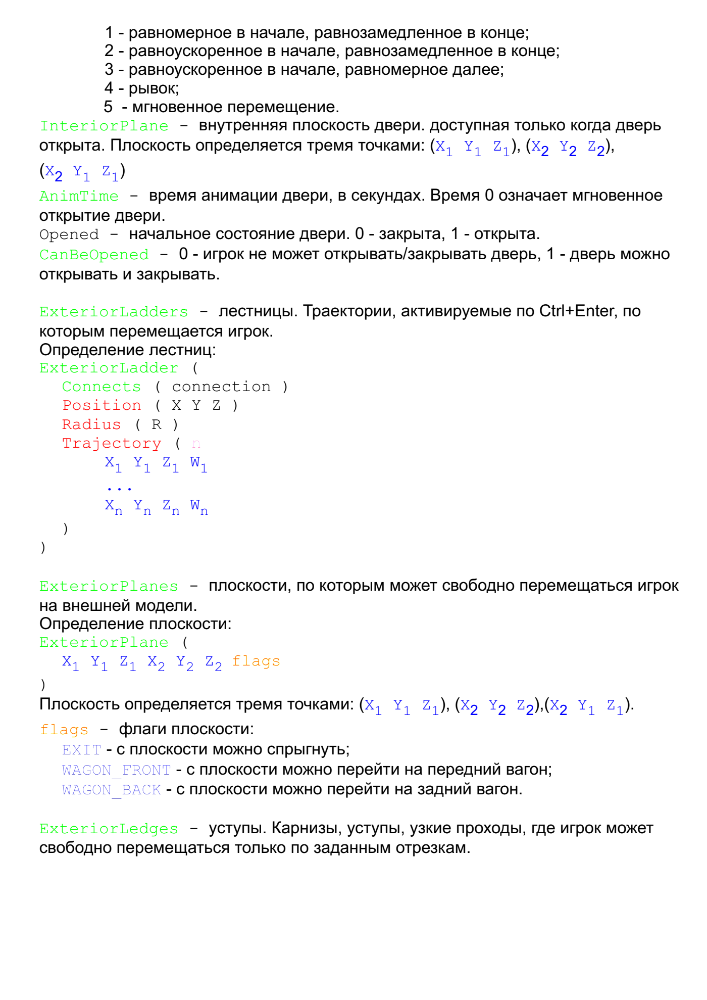
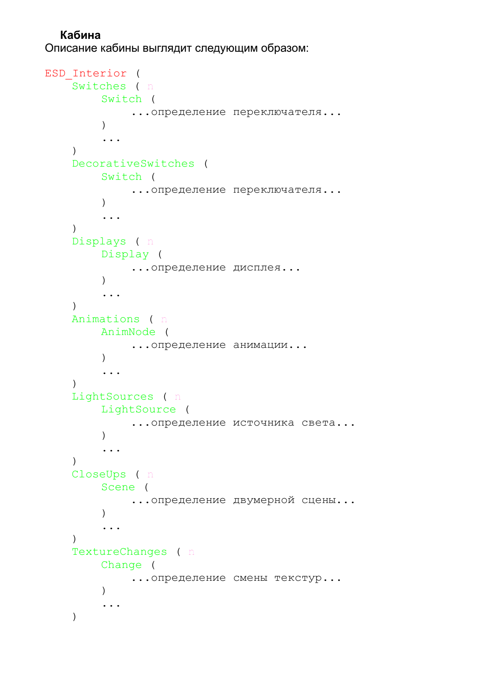
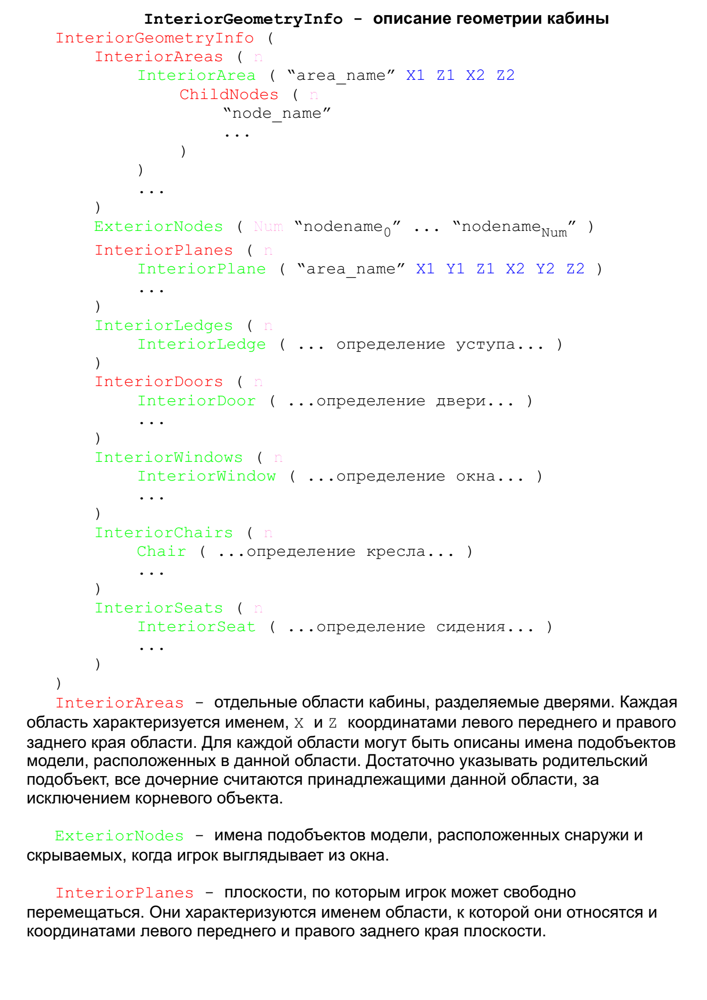
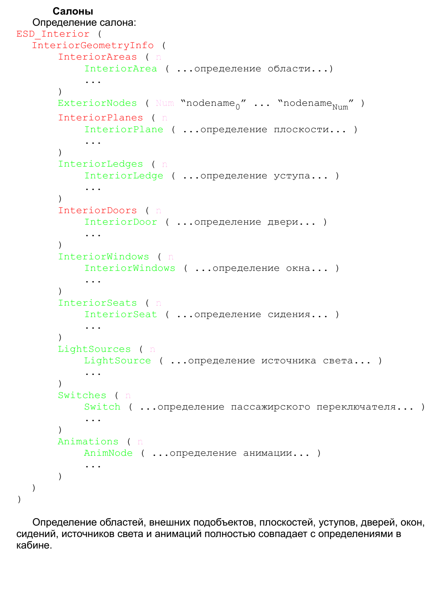

# Расширенные настройки дополнений

RTS 0.43

## Файлы вагонов и локомотивов(.eng, .wag)

- `FrameSpringStiffness ( d )` — жёсткость рессорного подвешивания вагона, в Н/м. По умолчанию - `масса_вагона*30`.

- `FrameSpringDamping ( d )` — коэффициент затухания рессорного подвешивания, Н/м/с. По умолчанию - масса `вагона*1.25`.

- `FrameOscCorrection ( d d d )` — коэффициенты коррекции величины и частоты поперечных и величины вертикальных колебаний. По умолчанию - 1.

- `PassengerCapacity ( d )` — вместимость пассажирского вагона, чел. По умолчанию для пассажирских вагонов - 200, для прочих - 0.

- `BrakeEquipmentType ( “type1, type2,...” )` — типы тормозного оборудования, используемого в вагоне.

- `auxilary_reservoir` — запасный резервуар;

- `triple_valve` — воздухораспределитель;

- `ep_brake или electro-pneumatic` — электропневматический тормоз;

- `handbrake` — ручной тормоз;

- `vacuum_brake` — вакуумный тормоз.

- `TrainPipeLeakRate ( d )` — утечки из тормозной магистрали, пси/мин. Пока не реализовано.

- `PantographRaiseTime ( d )` — время подъёма токоприёмников. По умолчанию - 3 секунды.

В блоке Lights в каждом из огней можно задавать текстуру сигнального огня.

- `LightTexture ( “filename” )` — по умолчанию “liteglow.ace”. При переопределении текстуры, она ищется в директории вагона или в `GLOBAL\TEXTURES`. Также возможно определить дополнительные огни, не используемые в МСТС, но используемые в RTS. Определять их следует в блоке `RTS_LIGHTS`:

```
RTSLights ( n
  RTSLight (
      ...
  )
  ...
)
```

Определение объекта RTSLight аналогично объекту Light. Дополнительные огни добавляются в конец списка огней. В объектах Light и RTSLight можно указывать параметр идентификатора:

- `LightID ( id )` — неотрицательное число, под которым огни будут доступны в dll локомотива. По умолчанию каждому огню присваивается идентификатор, равный порядковому номеру (от 0 до n-1). Для локомотивов игрока важны данные идентификаторы сигнальных огней. Изменения их нежелательны и должны влечь за собой изменения в dll локомотива.

- `SMECable ( front back )` — кабели управления, спереди и сзади вагона. Когда игрок заходит в локомотив, определяются все вагоны и локомотивы, соединённые между собой кабелями управления и среди них ищутся локомотивы игрока, которые могут быть объединены с данным локомотивом и они объединяются в группу.

- `HVBus ( front back )` — высоковольтная шина, спереди и сзади вагона. При поднятии токоприёмника на одном из локомотивов, соединённых между собой высоковольтной шиной, запитанными считаются все локомотивы группы. При этом потребляемая мощность локомотивов группы суммируется и делится поровну между всеми поднятыми токоприёмниками и вычисляется ток на них, исходя из напряжения сети. При превышении значения тока, заданного как максимальное, происходит “пережог провода” и отключение электричества на несколько минут.

```
Interior (
  InteriorFile ( “shape.s” Flipped )
  SoundInt ( “sound.sms” )
  DoNotHideExtInSalon ( b )
)
```

Модель и звуковой файл салона данного вагона.

- `DoNotHideExtInSalon` — не скрывать внешнюю модель на виде в салоне.

В eng/wag файле могут быть прописаны отдельная внешняя модель и звуки, когда требуется чтобы МСТСные модели и звуки не были затронуты. Они прописываются в тех же местах, что и обычные, как:

```
RTSWagonShape ( “shape.s” )
RTSExteriorSound ( “sound.sms” )
RTSCabinSound ( “sound.sms” )
```

Также могут быть прописаны отдельные параметры тормозов:

```
RTSMaxReleaseRate ( d )
RTSMaxApplicationRate ( d )
```

**Параметры локомотивов** Параметры локомотивов располагаются в блоке Engine файла.

- `IntakeExt1 ( Z Radius type )` — точки заправки на локомотиве.

- `type` — тип заправки.

- `SAND` — песок

- `PowerSocket ( X Y Z )` — координаты розетки для подключения деповского источника питания. Считается, что розетки есть у каждого локомотива, поэтому по умолчанию берутся значения равные ширине вагона и высоте 1.5 метра, и подключить можно любой локомотив, но как использовать и можно ли использовать вообще внешний источник решается в dll.

```
DieselSpecialEffects (
  ExhaustN(
      X Y Z
      DirX DirY DirZ
      Width
      Colour ( col )
      Density ( d )
      Mass ( d )
      Magnitude ( IdleMag MaxMag )
      Rate ( IdleRate MaxRate )
      Dispertion ( d )
      Texture ( “filename” )
  )
  ...
)
```

- `X Y Z` — координаты точки выхлопа.

- `DirX DirY DirZ` — вектор направления выхлопа.

- `Width` — начальный размер кванта дыма.

- `Colour` — цвет дыма. По умолчанию для дизельных локомотивов - cc909090.

- `Density` — начальная густота дыма.

- `Mass` — относительная плотность дыма. По умолчанию - 1.0.

- `Magnitude` — скорость расширения дыма, на холостых оборотах и максимальная. По умолчанию берутся значения из `DieselSmokeEffect*Magnitude`.

- `Rate` — частота выхлопа, на холостых оборотах и максимальная. По умолчанию берутся значения из `DieselSmokeEffect*SmokeRate`.

- `Dispertion` — рассеивание дыма. Большие значения соответствуют более медленному рассеиванию. По умолчанию - 1.0.

- `Texture` — текстура дыма. По умолчанию - `t_diesel_smoke.ace`. При переопределении текстуры, она ищется в директории локомотива и в `GLOBAL\TEXTURES`.

**EngExtended** Параметры, расположенные в блоке EngExtended.

- `LocomotiveSeries ( “name” )` — строковый идентификатор серии локомотива, длиной не более 15 символов. Передаётся параметром в dll для распознавания совместимых локомотивов.

- `ScaleBrakeForce ( d )` — домножить максимальную тормозную силу на коэффициент, для корректировки её МСТСных значений в двухсекционных локомотивах.

- `AddBrakeForce ( d )` — добавить максимальную тормозную силу, для корректировки МСТСных значений в задней секции.

- `NumAxles ( i )` — число осей.

```
NumEngines ( n
  EngineAxles ( m AxleNum... AxleNum )
                        0 m
  ...
)
```

Число двигателей и привод осей от двигателей. AxleNum - порядковый номер оси, упорядоченных от передней к задней. Может быть использовано для эмуляции разносного боксования.

- `Cabin ( “filename” Flip )` — кабина локомотива. filename - имя модели.

- `Flip` — 1 - развернуть кабину на 180 градусов.

- `LibraryModule ( “filename” Param )` — dll-файл локомотива. Param - основной параметр локомотива.

- `VariableStack ( i )` — размер стека переменных локомотива.

- `DoNotHideExtInCabin ( b )` — не скрывать внешнюю модель в кабине

DLL-файлом локомотива может быть предусмотрена загрузка произвольных параметров из eng-файла. Формат описания таких параметров:

```
EngineParameters ( n
  ParamName ( ParamValue )
          0 0
  ...
  ParamName ( ParamValue )
          N N
)
```

Список используемых параметров определяется в dll локомотива. Каждый параметр доступен в dll под именем ParamName. Таким образом, часть настроек может корректироваться в eng-файле для каждого отдельного локомотива. Значение строковых параметров обязательно должно быть в кавычках.

- `FlipSlaveLocoOrder ( b )` — обратить порядок следования ведомых локомотивов.

- `MaxNumSlaveLoco ( i )` — максимальное количество ведомых локомотивов. -1 - неограничено, по умолчанию.

Для локомотивов помимо основной dll можно задавать также **вспомогательные dll,** плагины. Если основная dll предназначена для реализации управления конкретной серии локомотивов, то во вспомогательные можно выносить функции, которые могут быть общими для разных серий или, с другой стороны, могут требоваться только для конкретной машины, но не для всей серии. К таким функциям можно отнести: автоинформатор электропоездов, устройства безопасности, особенности работы отдельных номеров серии. Какие из функций требуются для данного локомотива определяется в енг-файле, добавляя или исключая вспомогательные библиотеки и настраивая их параметры. К примеру, если на данной машине установлен БИЛ, в енге для неё нужно добавить библиотеку, реализующую его. В зависимости от реализуемых функций и способа их реализации, основная dll может не знать и никоим образом не взаимодействовать со вспомогательными. Если от основной требуется передача каких-то параметров во вспомогательную - она может получить доступ к ней по указанному в енг-файле имени и к стеку её переменных. Аналогично, вспомогательная библиотека имеет доступ ко всем объектам локомотива и к стеку основной. Но использовать стек основной - это весьма нежелательно, так как в таком случае потребуется либо стандартизация стеков dll разных серий, либо вспомогательная будет работать только с одной серией, что делает сомнительным необходимость её разработки. У вспомогательных библиотек может быть свой звуковой объект, sms-файл которого и параметры задаются здесь же в енге.

```
AuxLibraries (
  AuxLibrary(
      AuxLibraryName ( “Name” )
      AuxLibraryModule ( “filename” )
      AuxVariableStack ( i )
      AuxLibraryParameters (... )
      AuxCall ( “function_name” order )
      AuxCall ( “function_name” order )
      AuxLibrarySound ( “filename” )
      AuxLibrarySoundType ( soundtype )
      AuxLibrarySoundPosition ( X Y Z )
      AuxLibrarySoundExternal ( b )
      AuxLibrarySoundOwnStack ( b )
      AuxLibrarySoundSingleWagon ( b )
  )
  ...
)
```

- `AuxLibraryName` — имя библиотеки, под которым она доступна в основной dll.

- `AuxLibraryModule` — имя dll-файла.

- `AuxVariableStack` — размер стека переменных. Лучше задавать внутри dll.

- `AuxLibraryParameters` — параметры библиотеки. См. EngineParameters. Перечень используемых имён и назначение определяется dll.

- `AuxCall` — подключение вызовов функций в dll и порядка вызова. Имена функций - такие же, как используются в основной dll. Если не указано ни одного подключения, вызываются все доступные функции RTS, все с порядком 0. Для функций - кроме

- `Init, ALSN и SpeedLimit` — порядок ниже 0 означает вызов раньше вызова основной dll. Для указанных все вспомогательные dll вызываются после основной. Init вызывается всегда для всех библиотек, в том порядке, в котором они указаны в списке AuxLibraries.

- `AuxLibrarySound` — имя SMS-файла собственных звуков библиотеки.

- `AuxLibrarySoundType` — тип звуков.

- `AMBIENT` — звуки без положения, до них не считается расстояния, они всегда звучат одинаково.

- `WAGON` — вагонные звуки. Привязываются к определённому вагону, в том числе по положению. Также им передаются звуковые переменные этого вагона.

- `ROUTEFORWAGON` — вагонные звуки, специфичные для маршрута. Сначала файл ищется в паке SOUND маршрута, а при отсутствии - в папке с локомотивом. Таким образом можно создавать унифицированные звуковые настройки, которые для отдельного маршрута могут переопределяться. Или реализовать только для конкретного маршрута(ов), а для других в папке локомотива загрушка в виде пустого SMS-файла.

- `AuxLibrarySoundPosition` — положение источника звука относительно локомотива.

- `AuxLibrarySoundExternal` — внешние звуки. Если “да” - для звуков автоматически рассчитывается угасание с удалением от источника. Больше никаких отличий.

- `AuxLibrarySoundOwnStack` — не копировать звуковые переменные VariableN из звуков локомотива в библиотеку. Остальные переменные копируются всегда.

- `AuxLibrarySoundSingleWagon` — воспроизводить звуки только пока игрок находится в данном вагоне. Пригодится для звуков, которые воспроизводятся только внутри кабины. Если не ограничить здесь - при переходе в кабину другого локомотива, расположенного ближе расстояния деактивации данных звуков, их воспроизведение не прекратится. А если не включена опция внешних звуков, то и громкость при этом с удалением от источника снижаться не будет.

**Параметры электрических локомотивов**

- `MaxLineCurrent ( d )` — максимальный ток на токоприёмнике.

```
MaxLineCurrentVelocityIncrease ( MLC_B MLC_A )- параметры линейного
```

уравнения “утечки тепла” с контактного провода в зависимости от скорости. Утечка считается как `MLC_B+MLC_A*Velocity`.

- `MaxLineCurrentCatenaryBurnTime ( sec )` — время в секундах через которое при максимальном токе сети произойдёт пережог провода. Если не задано параметров уравнения утечки и время пережога - пережог происходит мгновенно и только по достижении максимального тока, на любой скорости. В противном случае тепло, выделяемое на ТП “накапливается” и уменьшается на значение утечек.

```
WorksOnLineVoltages ( n
  LineVoltage ( MinVoltage MaxVoltage MinFreq MaxFreq )
  ...
)
```

Поддерживаемые напряжения сети.

- `MinVoltage` — минимальное напряжение.

- `MaxVoltage` — максимальное напряжение

- `MinFreq` — минимальная частота.

- `MaxFreq` — максимальная частота.

```
ExcludePantograph ( PantoNum )
...
ExcludePantograph ( PantoNum )
```

- `Отключение токоприёмников. PantoNum` — номер пантографа, от 1 до 8.

- `RaiseSecondPantoWhenSpeedBelow ( speed )` — поднимать второй токоприёмник на электровозе при скорости менее speed.

- `AlwaysUsePanto ( bitmask )` — всегда использовать заданные токоприёмники, в независимости от направления движения.

- `LowerPantoOnStop ( bitmask )` — опускать заданные токоприёмники на остановке.

## Кабины, салоны, внешняя модель

Параметры геометрии, свойств и назначений подобъектов модели описываются в sd-файлах. Для внешней модели это sd-файл модели вагона, для кабины и салона - sd-файл модели кабины и салона.

**Внешняя модель** Структура описания внешней модели такова:

```
ESD_Interior_Parts ( Num “Name ”... “Name ” )
                            0 Num
ESD_Exterior_Details (
    ExteriorDoors ( n
        ExteriorDoor (
            ...описание двери...
        )
        ...
    )
    ExteriorLadders ( n
        ExteriorLadder (
            ...описание лестницы...
        )
        ...
    )
    ExteriorPlanes ( n
        ExteriorPlane (
            ...описание плоскости...
        )
        ...
    )
    ExteriorLedges ( n
        ExteriorLedge (
            ...описание уступа...
        )
        ...
    )
    Animations ( n
        AnimNode (
            ...описание анимации...
        )
        ...
    )
)
```

- `ESD_Interior_Parts` — имена подобъектов модели, соответствующих внутренним частям модели и скрываемых, когда игрок выглядывает в окно.

- `ExteriorDoors` — двери.

Определение дверей:

```
ExteriorDoor (
  Name ( “name” )
  Connects ( connection )
  GlobalID ( id )
  ParentObject ( obj_num )
  Position ( X Y Z )
  Radius ( R )
  Trajectory ( n
      X Y Z W
      1 1 1 1
      ...
      X Y Z W
```

n n n n

```
  )
  InteriorPlane ( X Y Z X Y Z )
                  1 1 1 2 2 2
  AnimTime ( time )
  Opened ( b )
  CanBeOpened ( b )
  SMSTriggers ( Open Close )
)
```

- `Name` — имя соотвествующего подобъекта в модели.

- `Connects` — описание того, откуда и куда ведёт данная дверь. Состоит из двух строковых параметров, принимающих значения:

- `EXTERIOR` — наружу

- `EXT_WAG` — наружная область вагона

- `INTERIOR` — кабина локомотива

- `INTERIORPASS` — салон вагона

- `WAGON_BACK` — вагон сзади

- `WAGON_FRONT` — вагон спереди имя внутренней области кабины или салона Параметры всегда должны в правильном порядке описывать направление. Внутренние двери, ведущие из кабины или салона первым параметром должны иметь имя внутренней области, где они находятся, вторым - направление перехода.

- `GlobalID` — глобальный идентификатор двери, служащий для централизованного их открытия. Зарезервированные значения: 1 - двери слева,

- `2` — двери справа. Если в модели есть подобъекты с именами `DOOR_A`, `DOOR_B`, `DOOR_C`, `DOOR_D`, `DOOR_E`, `DOOR_F`, им автоматически назначается глобальный идентификатор, исходя из их фактического положения.

- `ParentObject` — родительский объект. Если объекту назначен родительский объект, его состояние всегда равно состоянию родительского.

- `Position, Radius` — координаты точки, активирующей дверь и радиус. Дверь открывается и закрывается, когда данная точка находится в поле зрения игрока и в радиусе.

- `Trajectory` — траектория движения, по которой перемещается игрок по нажатию Ctrl+Enter на двери. W - тип движения по траектории:

- `0` — равномерное, со скоростью player.velocity;

- `1` — равномерное в начале, равнозамедленное в конце;

- `2` — равноускоренное в начале, равнозамедленное в конце;

- `3` — равноускоренное в начале, равномерное далее;

- `4` — рывок;

- `5` — мгновенное перемещение.

- `InteriorPlane` — внутренняя плоскость двери. доступная только когда дверь открыта. Плоскость определяется тремя точками: ( X Y Z ), ( X Y Z ),



```
( X Y Z )
```

- `AnimTime` — время анимации двери, в секундах. Время 0 означает мгновенное открытие двери.

- `Opened` — начальное состояние двери. 0 - закрыта, 1 - открыта.

- `CanBeOpened` — 0 - игрок не может открывать/закрывать дверь, 1 - дверь можно открывать и закрывать.

- `ExteriorLadders` — лестницы. Траектории, активируемые по Ctrl+Enter, по которым перемещается игрок. Определение лестниц:

```
ExteriorLadder (
  Connects ( connection )
  Position ( X Y Z )
  Radius ( R )
  Trajectory ( n
      X Y Z W
      X Y Z W
```

n n n n

```
  )
)
```

- `ExteriorPlanes` — плоскости, по которым может свободно перемещаться игрок на внешней модели. Определение плоскости:

```
ExteriorPlane (
  X Y Z X Y Z flags
)
```

Плоскость определяется тремя точками: ( X Y Z ), ( X Y Z ),( X Y Z ).

- `flags` — флаги плоскости:

- `EXIT` — с плоскости можно спрыгнуть;

- `WAGON_FRONT` — с плоскости можно перейти на передний вагон;

- `WAGON_BACK` — с плоскости можно перейти на задний вагон.

- `ExteriorLedges` — уступы. Карнизы, уступы, узкие проходы, где игрок может свободно перемещаться только по заданным отрезкам. Определение уступа:

```
ExteriorLedge (
  Trajectory ( n
      X Y Z W
        1 1 1 1
      ...
      X Y Z W
```

n n n n

```
  )
)
```

- `Animations` — анимированные подобъекты, не относимые ко прочим группам. Определение анимации:

```
AnimNode (
  Name ( “name” )
  AnimTime ( time )
  AnimTimeScale ( Q... Q )
                  1 NumKeyFrames-1
  NumKeyFrames ( i )
  Flags ( flags )
  ChildNodes ( n “node_name ”... “node_name ” )
                          0 n
)
```

- `Name` — имя анимации.

- `AnimTime` — полное время анимации, в секундах.

- `NumKeyFrames` — число ключевых кадров. Для незамкнутой анимации и для замкнутой анимации с фиксированным постоянным положением объект может быть анимирован в одно из ключевых положений.

- `Flags` — флаги анимации.

- `RUNNING` — анимация запущена:

- `CONTINUOUS` — замкнутая анимация;

- `LOOP` — закольцованная анимация, за n-ным кадром, где n - число кадров, следует 1 кадр.

- `RETURNS` — фиксированное постоянное положение. По выключению воспроизведения замкнутой анимации, анимация возвращается в текущее ключевое положение.

- `SPEEDCONTROLLED` — скорость воспроизведения анимации зависит от скорости движения вагона.

- `PASSIVE` — анимация не воспроизводится, используется для анимированных объектов, не попадающих в прочие группы, но контролируемых чем-либо и для которых необходимо настраивать параметры анимации, например анимированные подобъекты окон на внешней модели, соответствующие окнам в модели кабины.

**Кабина** Описание кабины выглядит следующим образом:

```
ESD_Interior (
    Switches ( n
        Switch (
            ...определение переключателя...
        )
```



```
    )
    DecorativeSwitches (
        Switch (
            ...определение переключателя...
        )
    )
    Displays ( n
        Display (
            ...определение дисплея...
        )
    )
    Animations ( n
        AnimNode (
            ...определение анимации...
        )
    )
    LightSources ( n
        LightSource (
            ...определение источника света...
        )
    )
    CloseUps ( n
        Scene (
            ...определение двумерной сцены...
        )
    )
    TextureChanges ( n
        Change (
            ...определение смены текстур...
        )
    )
LocomotiveSignalization (
        ...определение локомотивной сигнализации...
    )
    InteriorGeometryInfo (
        ...определение внутренней геометрии...
    )
)
```

- `Switches` — **переключатели**

```
Switch (
    ID ( id )
    Name ( “name” )
    Hint ( “hint” )
    StateHints ( n “hint ”...“hint ” )
                      0 n
    ParentObject ( obj_id )
    Position ( X Y Z )
    Radius ( R )
    States ( NumStates InitialState )
    Flags ( flags )
    AssignKey ( key1 [key2] )
    AnimTime ( time )
    AnimTimeScale ( Q... Q )
                    1 NumStates-1
    AnimSpeed ( f )
    SwitchPrecision ( PrecX PrecY )
    FixedState ( FixedState )
)
```

- `ID` — идентификатор переключателя. Идентификатор не может быть больше или равен числу переключателей.

- `Name` — название подобъекта модели, соответствующего переключателю.

- `Hint` — подсказка, выводимая по переключателю.

- `StateHints` — подсказки по отдельным положениям переключателя. Текст подсказок добавляется к тексту общей подсказки.

- `ParentObject` — родительский объект. При переключении родительского переключателя, все дочерние переключатели переключаются в то же положение.

- `Position, Radius` — координаты положения и радиус. Выключатель нажимается когда игрок находится на расстоянии менее радиуса от положения переключателя. Если радиус равен 0, переключатель нельзя нажать мышкой. Если у переключателя нет соответствующего подобъекта в модели, то эти же координаты используются для обнаружения нажатия мышкой.

- `States` — число положений переключателя, начальное положение.

- `Flags` — флаги переключателя.

- `CONTROLLERX` — переключение происходит при захвате и перемещении мыши в горизонтальной плоскости.

- `KEY` — у переключателя добавляется в начало 0 положение, соответствующее невидимому подобъекту модели. После переключения из 0 положения, переключатель переходит в положение InitialState +1.

- `NONFIXED` — при отпуске клавиши или мыши, переключатель возвращается в 0 положение.

- `CONTROLLERY` — переключение происходит при захвате и перемещении мыши в вертикальной плоскости.

- `PRECISE` — плавный переключатель, при переключении его мышью может занимать любое промежуточное положение.

- `LOOP` — закольцованный переключатель. Из последнего положения переключается сразу в первое и наоборот.

- `DISABLED` — переключение запрещено.

- `CHECKDISTANCEONPRESS` — проверять расстояние при нажатии ассоциированной клавиатурной комбинации.

- `AssignKey` — назначить одну или две клавиши. Если назначаются две клавиши, первая увеличивает положение переключателя, вторая - уменьшает.

- `AnimTime` — время анимации между двумя положениями.

- `AnimTimeScale` — масштабирование времени анимации при переключении между каждым из положений.

- `SwitchPrecision` — коэффициенты для перевода смещения координат курсора мыши в изменение положения переключателя. Для переключателей с флагом PRECISE обязателен. Для переключателей CONTROLLERX и CONTROLLERY если указать данный параметр - их можно будет перетаскивать мышкой.

- `FixedState` — фиксированное положение для переключателей с флагом NONFIXED. Когда игрок отпускает переключатель, он возвращается в положение

```
FixedState.
```

- `DecorativeSwitches` — **декоративные переключатели** То же, что и обычные переключатели, но не выполняющие никакой роли в управлении кабиной.

- `Displays` — **дисплеи**

```
Display (
    ID ( id )
    Name ( “name” )
    Hint ( “hint” )
    Position ( X Y Z )
    Radius ( R )
    StateHints ( n “hint ”...“hint ” )
                      0 n
    DisplayType ( display_type )
    ParentObject ( obj_id )
    DisplayFade ( fade blink )
    AnimSpeed ( f )
    ValuesRange ( MinValue MaxValue InitialValue SecondValue )
    Granularity ( f )
    InitialState ( state )
    Colour ( col )
    StateNodes ( n “node ”...”node ” )
                      0 n
    Flags ( flags )
    DisplayScreen (
        ...определение экрана...
    )
)
```

- `ID, Name, Hint, StateHints, ParentObject` — то же самое, что и у переключателей.

- `DisplayType` — тип дисплея.

- `ARROW` — стрелка.

- `LAMP` — лампа. Подобъект видим в ненулеовм состоянии, в нулевом невидим.

- `DISPLAY` — для таких дисплеев задаётся список подобъектов, видимость которых определяется текущим состоянием.

- `SCREEN` — экран. Дисплей представляет из себя плоскость, в которой рисуются элементы экрана.

- `DisplayFade` — для дисплеев типа лампа, дисплей и экран - постепенное включение/выключение дисплея и интервал мигания, секунд.

- `AnimSpeed` — скорость воспроизведения анимации. Можно использовать, чтобы при увеличении точности дисплеев ARROW скорость индикации не снижалась.

- `ValuesRange` — диапазон значений для дисплея типа стрелка.

- `MinValue` — минимальное значение, соответствующее первому кадру анимации подобъекта.

- `MaxValue` — максимальное значение, соответствующее последнему кадру анимации подобъекта.

- `InitialValue` — начальное значение.

- `SecondValue` — для дисплеев с флагом OVERSCALE - частота колебаний стрелки при зашкаливании.

- `Granularity` — точность дисплея. Для дисплеев типа стрелка данные параметры обязательны.

- `InitialState` — для дисплеев типа лампа, дисплей и экран - начальное состояние.

- `Colour` — цвет дисплея типа лампа и экран.

- `StateNodes` — для дисплеев типа дисплей - список подобъектов соответствующих состояниям.

- `Flags` — флаги дисплея.

- `PRECISE` — точный дисплей. Стрелка сразу же переводится в положение, соответствующее текущему значению, без воспроизведения анимации.

- `OVERSCALE` — при значении больше максимального дисплей зашкаливает.

- `DISPLAYSEQUENCE` — для дисплеев типа DISPLAY означает что каждому состоянию соответствует только один видимый подобъект из списка. В противном случае текущее состояние трактуется как битовая маска видимости объектов.

- `DisplayScreen` — **определение экрана** Экран - это лежащий в одной плоскости четырёхугольник, на который выводятся элементы экрана: изображения, стрелки и текст.

Определение экрана:

```
DisplayScreen (
  TopLeft ( X Y Z )
  TopRight ( X Y Z )
  BottomRight ( X Y Z )
  ReferenceScreen ( Num )
  ReferenceCloseup ( Num )
  CopySubObjects (
      ScreenID ( ID )
      SceneID ( ID )
      StartFrom ( Num )
      NumObjects ( Num )
      InsertBefore ( Num )
      IncrementID ( Num )
  )
  SubObjects ( n
      SubObject (
          ID ( id )
          ParentSub ( id )
          Type ( subobj_type )
          ReferenceObjectFromScreen ( ScreenID ObjID )
          ReferenceObjectFromScene ( SceneID ObjID )
          Hint ( “hint” )
          SubFade ( fade blink )
          SubColour ( col )
          Area ( X1 Y1 X2 Y2 )
          UV ( U1 V1 U2 V2 )
          Activation ( X1 Y1 X2 Y2 )
          Textures ( n
              “texture1.ace”
              ...
          )
          NamedShader ( shader )
          InitialState ( state )
          Flags ( flags )
          AnimFlags ( flags )
          AnimTime ( time )
          AnimTimeScale ( Q... Q )
                          1 NumFrames-1
          CopySubObjectFromScreen ( ScreenID ObjID )
          CopySubObjectFromScene ( SceneID ObjID )
          Center ( X Y )
          ValuesRange ( MinValue MaxValue InitialValue Angle )
          LinkTo ( closeup_id )
          CharacterWidth ( X U )
          CharacterHeight ( Y V )
          CharacterSpacing ( X U )
          LineSpacing ( Y V )
          Alignment ( align align )
          Alphabet ( “alphabet” )
          MaxStringLength ( len )
          BarStyle ( bar_style )
          GridNumRows ( X Xtex )
          GridNumCols ( Y Ytex )
          SectorShape ( Shape )
          SectorFillType ( FillType )
          SectorGranularity ( f )

          AnimationFrames ( n
              Frame (
                  Area ( X1 Y1 X2 Y2 )
                  Activation ( X1 Y1 X2 Y2 )
                  UV ( U1 V1 U2 V2 )
                  TexID ( tex_id )
              )
              ...
          )
      )
      ...
  )
)
```

- `TopLeft, TopRight, BottomRight` — три точки, описывающие четырёхугольник, рабочую область экрана.

- `ReferenceScreen, ReferenceScene` — ссылка на другой экран или локацию. Ссылка не имеет собственных объектов и свойств, за исключением расположения экрана, содержимое повторяет экран или локацию, на которую экран ссылается.

- `CopySubObjects` — копирование NumObjects подобъектов из экрана ScreenID или сцены SceneID, начиная со StartWith. Объекты размещаются перед InsertBefore и их параметры ID увеличиваются на IncrementID. Если NumObjects равно 0 - копируются все подобъекты. Если InsertBefore меньше

- `0` — объекты добавляются в конец списка в текущем экране. При копировании, в отличии от ссылок, объекты являются самостоятельными и не копируют поведение исходных.

- `SubObjects` — подобъекты экрана.

- `ID` — идентификатор подобъекта, отправляемый dll локомотива при нажатии элемента мышкой.

- `ParentSub` — порядковый номер родительского элемента экрана.

- `Type` — тип подобъекта.

- `FRAME` — изображение;

- `ARROW` — стрелка, изображение, поворачиваемое относительно центра;

- `LINK` — ссылка на 2d сцену;

- `LABEL` — текст;

- `BAR` — полоса;

- `GRID` — сетка;

- `SECTOR` — сектор.

- `Hint` — подсказка по подобъекту.

- `ReferenceObjectFromScreen, ReferenceObjectFromScene` — ссылка на другой подобъект экрана или сцены.

- `CopySubObjectFromScreen, CopySubObjectFromScene` — копировать свойства из другого подобъекта. При этом в данном подобъекте часть параметров может быть переопределена.

- `SubFade` — см. *DisplayFade* в дисплее.

- `Area` — экранные координаты отрисовываемого элемента, верхнего левого и нижнего правого угла. Для экранных координат точка (0,0) соответствует левому верхнему углу рабочей области экрана, (1,0) - правому верхнему, (1,1) - правому нижнему.

- `UV` — текстурные координаты.

- `Activation` — экранные координаты области активации, то есть области, щелчок по которой соответствует нажатию данного элемента.

- `Textures` — список текстур, используемые в данном элементе.

- `NamedShader` — способ вывода.

```
Tex
TexDiff
BlendATex
BlendATexDiff
```

- `InitialState` — начальное состояние элемента. Значение -1 означает невидимое состояние, остальные значения означают номер кадра анимации.

- `Flags` — флаги. Соответствуют флагам переключателей. Для полос также существует флаг `STRETCH_UV`, предписывающий не масштабировать UV-координаты при заполнении.

- `AnimFlags` — флаги анимации, соответствуют флагам анимации кабины.

- `AnimTime` — время анимации.

*Параметры элементов типа* ***ARROW.***

- `Center` — экранные координаты центра, относительно которого вращается стрелка.

- `ValuesRange` — минимальное значение, максимальное значение, значение, соответствующее нулевому отклонению стрелки, угол поворота из нулевого положение, в положение, соответствующее минимуму.

*Параметры элементов типа* ***LINK.***

- `LinkTo` — порядковый номер 2d-сцены, на которую ссылается данный элемент.

*Параметры элементов типа* ***LABEL.***

- `CharacterWidth` — ширина символа текста, в экранных и текстурных координатах.

- `CharacterHeight` — высота символа текста, в экранных и текстурных координатах.

- `CharacterSpacing` — промежутки между символами, в экранных и текстурных координатах.

- `LineSpacing` — промежутки между строками, в экранных и текстурных координатах.

- `Alignment` — выравнивание, горизонтальное и вертикальное.

```
CENTER
RIGHT
LEFT
JUSTIFIED
BOTTOM
TOP
```

- `Alphabet` — алфавит символов, расположенных на текстуре.

- `MaxStringLength` — максимальная длина выводимой строки. Для элементов типа LABEL UV-координаты из UV задают всю область на текстуре, где расположен шрифт выводимых символов, Area задаёт область вывода текста на экран.

*Параметры элементов типа* ***BAR.***

- `BarStyle` — тип полосы.

- `H_LEFT` — горизонтальная, заполняется влево.

- `H_RIGHT` — горизонтальная, заполняется вправо.

- `V_UP` — вертикальная, заполняется вверх.

- `V_DOWN` — горизонтальная, заполняется вниз. *Параметры элементов типа* ***GRID.*** Сетка представляет собой несколько расположенных рядом прямоугольных элемента экрана, каждый из которых отображается в зависимости от условий.

- `GridNumRows` — число столбцов сетки, отображаемое и фактически на текстуре.

- `GridNumCols` — число строк сетки, отображаемое и фактически на текстуре.

*Параметры элементов типа* ***SECTOR.***

- `SectorShape` — форма подобъекта. ROUND - круглый. RECT - прямоугольный.

- `SectorFillType` — тип заполнения сектора. STARTPOS - от начального положения до текущей позиции. ENDPOS - от конечного положения до текущей позиции. MANUAL - заполненность сектора задаётся вручную.

- `SectorGranularity` — частота вершин сектора, градусы. Для сектора должны быть заданы ValuesRange. Первые два параметра означают то же, что и для стрелок. Третий параметр - начальный угол сектора, соответствующий нулевому положению. Четвёртый - конечный угол сектора, соответствующий максимальному положению.

- `AnimationFrames` — кадры анимации для данного элемента. Каждый кадр анимации может задавать экранные координаты объекта, текстурные координаты объекта, номер используемой текстуры из списка текстур объекта, экранные координаты зоны активации. Всё это задаётся для каждого кадра с помощью параметров Area, UV, TexID, Activation соответственно.

- `Animations` — **анимации.**

Определение аналогично анимациям на внешней модели.

- `LightSources` — **внутренние источники света.**

Определение:

```
LightSource (
  Name ( “name” )
  GlobalID ( gid )
  Position ( X Y Z )
  PointsTo ( X Y Z )
  Radius ( rX rZ )
  SpotExponent ( d )
  Colour ( col )
  LightFade ( Fade Blink )
  Flags ( flags )
  Projection ( ProjSize )
  CompressToDXT ( )
)
```

- `Name` — имя подобъекта, соответствующего источнику света.

- `GlobalID` — глобальный идентификатор источника света, для централизованного включения.

- `Position` — положение источника света.

- `PointsTo` — направление источника света.

- `Radius` — радиусы полуосей эллипса по x и по z.

- `SpotExponent` — коэффициент, определяющий концентрированность света.

Значения в интервале [0;1].

- `Colour` — цвет.

- `Flags` — флаги источника света.

- `NIGHT_ONLY` — свет включается только в ночное время;

- `NIGHT_AUTO` — свет автоматически включается в ночное время.

- `SOURCE_VISIBLE` — видимый источник света. Ассоциированный подобъект видим при любом состоянии света, во включённом состоянии подобъект рисуется светлым материалом. В противном случае подобъект видим только при включённом источнике света.

- `POSITIONAL` — не учитывать направление света, только положение относительно источника.

- `RUNNING` — включён.

- `PROJECTION` — ортогональная проекция.

- `LIGHT_CONE` — конус света.

Ортогональная Конус Сфера Position Position Position

PointsTo PointsTo PointsTo

- `LightFade` — время включения/затухания источника света Fade и мигания Blink.

- `Projection` — размер генерируемой проекционной текстуры. Значения в интервале [16;1024]. По умолчанию - 128.

- `CompressToDXT` — сжать генерируемую текстуру в DXT.

- `CloseUps` — **2d-сцены** Сцены, состоящие из двухмерных элементов, аналогичные экранам, но демонстрируемые только на весь экран. Определение:

```
Scene (
  Name ( “name” )
  Hint ( “hint” )
  Position ( X Y Z )
  Radius ( R )
  SceneColour ( col )
  SceneToTheLeft ( i )
  SceneToTheTop ( i )
  SceneToTheRight ( i )
  SceneToTheBottom ( i )
  BasicNamedShader ( shader )
  CameraPosition X Y Z
                ( )
  CameraDirection ( oX oY oZ )
  CameraFOV ( angle )
  CabinVisible ( b )
  Backgrounds ( n
      “background1.ace” U1 V1 U2 V2
      ...
  )
  SubObjects ( n
      SubObject (
          ...определение элемента экрана...
      )
      ...
  )
)
```

- `Name` — имя подобъекта модели, соответствующего данной сцене. Сцена загружается при щелчке по данному объекту.

- `Hint, Position, Radius` — определение аналогично параметрам переключателя.

- `Backgrounds` — фоновые текстуры и текстурные координаты.

- `SubObjects` — элементы сцены. Определение аналогично элементам экрана.

```
SceneToTheLeft, SceneToTheTop, SceneToTheRight,
```

- `SceneToTheBottom` — порядковые номера сцен, на которые можно перейти с данной при нажатии клавиш влево, вверх, вправо и вниз соответственно.

- `CameraPosition` — положение камеры при отрисовке сцены. Необходимо для прозрачных сцен.

- `CameraDirection` — направление камеры для прозрачных сцен, в углах Эйлера.

- `CameraFOV` — угол обзора.

- `CabinVisible` — значение 1 включает отрисовку кабины вместе со сценой.

Может пригодится при подборе положения и направления камеры для прозрачной сцены.

- `SceneColour` — цвет фона сцены.

- `TextureChanges` — **смены текстур.**

Определение:

```
Change ( TexID “texture.ace” Change GlobalID )
```

- `TexID` — порядковый номер текстуры в списке текстур в файле модели.

- `Change` — тип смены текстур.

- `1` — рисовать объекты с изменяемой текстурой светлым материалом.

- `2` — автоматическая смена текстур в ночное время. Объекты с изменяемой текстурой рисуются светлым материалом.

- `GlobalID` — глобальный идентификатор смены текстур, используемый для централизованного переключения.

- `LocomotiveSignalization` — **локомотивная сигнализация** Определение:

```
LocomotiveSignalization (
    BlockCheckAhead ( numblocks )
    SignalLights ( n
        Light ( “nodename” )
        ...
    )
    SignalAspects ( n
        Aspect ( NumLights LightNum... LightNum )
                                0 NumLights
        ...
    )
    SignalizationScripted ( b )
)
```

- `BlockCheckAhead` — сколько Б/У необходимо проверять. Для обычной сигнализации необходимо проверять 1.

- `SignalLights` — список подобъектов модели, соответствующие огням на локомотивном светофоре.

- `SignalAspects` — перечисление порядковых номеров огней, горящих при каждом из показаний светофора. Показания светофора следуют в таком порядке:

```
0 - SIGASP_STOP;
1 - SIGASP_STOP_AND_PROCEED;
2 - SIGASP_RESTRICTING;
3 - SIGASP_APPROACH_1;
4 - SIGASP_APPROACH_2;
5 - SIGASP_APPROACH_3;
6 - SIGASP_CLEAR_1;
7 - SIGASP_CLEAR_2;
8 - SIGASP_BLOCK_OBSTRUCTED;
```

- `SignalizationScripted` — при ненулевом значении параметра для вывода показаний сигнализации вызывается функция **ALSN** из dll локомотива, которой передаётся стек сигналов.

По умолчанию текущий аспект равен следующему показанию светофора. Но DLL локомотива может вручную задавать, какой аспект в данный момент должна отображать локомотивная сигнализация.

- `InteriorGeometryInfo` — **описание геометрии кабины**

```
InteriorGeometryInfo (
    InteriorAreas ( n
        InteriorArea ( “area_name” X1 Z1 X2 Z2
            ChildNodes ( n
                “node_name”
```



```
            )
        )
    )
    ExteriorNodes ( Num “nodename ”... “nodename ” )
                              0 Num
    InteriorPlanes ( n
        InteriorPlane ( “area_name” X1 Y1 Z1 X2 Y2 Z2 )
    )
    InteriorLedges ( n
        InteriorLedge (... определение уступа... )
    )
    InteriorDoors ( n
        InteriorDoor ( ...определение двери... )
    )
    InteriorWindows ( n
        InteriorWindow ( ...определение окна... )
    )
    InteriorChairs ( n
        Chair ( ...определение кресла... )
    )
    InteriorSeats ( n
        InteriorSeat ( ...определение сидения... )
    )
)
```

- `InteriorAreas` — отдельные области кабины, разделяемые дверями. Каждая область характеризуется именем, X и Z координатами левого переднего и правого заднего края области. Для каждой области могут быть описаны имена подобъектов модели, расположенных в данной области. Достаточно указывать родительский подобъект, все дочерние считаются принадлежащими данной области, за исключением корневого объекта.

- `ExteriorNodes` — имена подобъектов модели, расположенных снаружи и скрываемых, когда игрок выглядывает из окна.

- `InteriorPlanes` — плоскости, по которым игрок может свободно перемещаться. Они характеризуются именем области, к которой они относятся и координатами левого переднего и правого заднего края плоскости.

- `InteriorLedges` — уступы. Определение аналогично уступам внешнего вида.

- `InteriorDoors` — **двери**

```
InteriorDoor (
  Name ( “name” )
  Connects ( connection )
  GlobalID ( id )
  ParentObject ( obj_num )
  Position ( X Y Z )
  Radius ( R )
  Trajectory ( n
      X Y Z W
      1 1 1 1
      ...
      X Y Z W
```

n n n n

```
  )
  InteriorPlane ( X Y Z X Y Z )
                  1 1 1 2 2 2
  AnimTime ( time )
  Opened ( b )
  CanBeOpened ( b )
  SoundProof ( qClosed qOpened )
  SMSTriggers ( Open Close )
)
```

Определение аналогично двери внешнего вида.

- `SoundProof` — коэффициенты подавления звука при закрытой и открытой двери. Для правильной работы дверей кабины необходимо в блоке Connects верно описывать названия областей, которые соединяет данная дверь.

- `InteriorWindows` — **окна**

```
InteriorWindow (
  Name ( “name” )
  GlobalID ( id )
  ParentObject ( obj_num )
  Position ( X Y Z )
  Radius ( R )
  Opened ( b )
  CanBeOpened ( b )
  HeadOutPosition ( X Y Z )
  AnimTime ( time )
  SoundProof ( qClosed qOpened )
  SMSTriggers ( Open Close )
)
```

Значение параметров аналогично двери.

- `HeadOutPosition` — координаты камеры, когда игрок выглядывает из окна.

- `InteriorChairs` — **кресла**

```
Chair (
    Position ( X Y Z )
    Radius ( R )
    Pos1 ( X Y Z )
    Pos2 ( X Y Z )
    Pos3 ( X Y Z )
    HeadOutWindow
                ( “window_name” )
)
```

- `Pos1` — позиция игрока на сидении.

- `Pos2` — позиция игрока, когда он встаёт по нажатию Enter.

- `Pos3` — позиция игрока, когда он встаёт из кресла по Ctrl+Enter.

- `HeadOutWindow` — имя окна, закреплённого за данным креслом.

- `InteriorSeats` — **сидения**

```
InteriorSeat (
    Name ( “name” )
    ParentObject ( obj_num )
    Position ( X Y Z )
    Radius ( R )
    Pos1 ( X Y Z )
    Pos2 ( X Y Z )
    Area ( X1 Z1 X2 Z2 )
    HeadOutWindow ( “window_name” )
)
```

- `Area` — если этот параметр присутствует, игрок может перемещаться по сидению по области, заданной координатами её левого переднего и правого заднего края.

**Салоны** Определение салона:

```
ESD_Interior (
  InteriorGeometryInfo (
      InteriorAreas ( n
          InteriorArea ( ...определение области...)
```



```
      )
      ExteriorNodes ( Num “nodename ”... “nodename ” )
                                  0 Num
      InteriorPlanes ( n
          InteriorPlane ( ...определение плоскости... )
      )
      InteriorLedges ( n
          InteriorLedge ( ...определение уступа... )
      )
      InteriorDoors ( n
          InteriorDoor ( ...определение двери... )
      )
      InteriorWindows ( n
          InteriorWindows ( ...определение окна... )
      )
      InteriorSeats ( n
          InteriorSeat ( ...определение сидения... )
      )
      LightSources ( n
          LightSource ( ...определение источника света... )
      )
      Switches ( n
          Switch ( ...определение пассажирского переключателя... )
      )
      Animations ( n
          AnimNode ( ...определение анимации... )
      )
  )
)
```

Определение областей, внешних подобъектов, плоскостей, уступов, дверей, окон, сидений, источников света и анимаций полностью совпадает с определениями в кабине.

- `Switches` — пассажирские переключатели.

```
Switch (
  Name ( “name” )
  Hint ( “hint” )
  StateHints ( n “hint ”...“hint ” )
                    0 n
  GlobalID ( gid )
  ParentObject ( obj_id )
  Position ( X Y Z )
  Radius ( R )
  AnimTime ( time )
  Triggers ( sms_code1 sms_code2 )
  TextureChanges ( n
      Change ( ...определение смены текстур... )
      ...
  )
  ToggleAnimations ( Num anim_num... anim_num )
                                0 Num
  Hide ( Num “node_name ”... “node_name ” )
                      0 Num
  Show ( Num “node_name ”... “node_name ” )
                      0 Num
  UnlockDoors ( Num door_num... door_num )
                          0 Num
  ToggleLights ( Num light_num... light_num )
                            0 Num
)
```

- `Triggers` — отсылка смс-триггеров при переключении переключателя в 1 и 0 положение.

- `ToggleAnimations` — список порядковых номеров анимаций, включаемых при постановке данного переключателя в 1 положение, и выключаемых при 0.

- `Hide` — список имён подобъектов модели, которые скрываются при 1 положении переключателя и отображаются при 0.

- `Show` — список имён подобъектов модели, которые отображаются при 1 положении переключателя и скрываются при 0.

- `UnlockDoors` — список порядковых номеров дверей, открываемых при 1 положении выключателя.

- `ToggleLights` — список порядковых номеров источников света, переключаемых выключателем.

## Файлы перекрасок

В симуляторе можно сделать перекраску существующей модели кабины, салона, вагона или объекта, используемого в сценарии, не копируя файла модели из текущего расположения. Для этого нужно создать текстовый файл в Юникоде с расширением “repaint”. В eng/wag/act файле тогда следует указывать этот файл вместо модели s.

Структура файла repaint:

```
SIMISA@@@@@@@@@@JINX0R1t______

Repaint (
  Shape ( "shape.s" )
  ShapeDescription ( "shape.sd" )
  TextureReplace ( "tex1.ace" "tex1a.ace" )
  TextureReplace ( "tex2.ace" "tex2a.ace" )
  ...
)
```

- `Shape` — это исходная модель, загружаемая для перекраски. Путь к ней указывается относительно директории, где находится файл перекраски.

- `ShapeDescription` — sd-файл, из которого следует взять описание модели.

Обратите внимание, что по умолчанию это не sd-файл исходной модели, а сам файл перекраски. В таких случаях в файле перекраски также должны располагаться параметры sd-файла: выбор альтернативных текстур, уровень детализации, описание геометрии для интерактивных объектов.

- `TextureReplace` — имя файла текстуры в исходной модели и имя новой текстуры. Для первого необходимо указывать только непосредственно само имя файла, пути к нему прописывать не надо, даже если он указан в s-файле.

Для второго необходимо указывать путь относительно директории, где находится файл модели (кроме объектов в папке SHAPES маршрута).

## Шаблоны моделей

В симуляторе также можно сгенерировать модель по шаблону, без исходного s-файла.

Сейчас доступен только шаблон параллелепипеда. Для того чтобы сгенерировать модель по шаблону нужно в eng/wag/act и т.п. Указывать вместо имени файла модели строку с кодом шаблона вместо расширения файла и параметрами.

Для параллелепипеда описание такое:

```
Shape ( " Width Height Length [ Alpha [ R G B ]].boxdummy" )
```

- `Width` — ширина параллелепипеда.

- `Height` — высота параллелепипеда.

- `Length` — длина параллелепипеда.

- `Alpha` — непрозрачность. По умолчанию 1, т.е. совершенно непрозрачная модель.

- `R,G,B` — цвет (красный, зелёный и голубой компоненты). Все в виде вещественных чисел в диапазоне [0;1].

## Составы

В файлах составов можно указывать несколько дополнительных параметров.

```
...
        Engine (
            ...
            Cold ()
            FreightAnim (
                FreightAnimShape ( "id_998_motor.s" )
            )
        )
        Wagon (
            ...
            FreightAnim (
                FreightAnimShape ( "id_943_pass.s" )
                FreightAnimRemove ()
            )
            FreightAnim (
                FreightAnimShape ( "filename" Loc )
                FreightAnimPosition ( X Y Z )
                FreightAnimMaxY ( Y )
                FreightAnimMass ( f )
                FreightAnimVolume ( f )
                FreightAnimContainerID ( ID )
                FreightAnimCargoID ( ID )
                FreightAnimCargoType ( CargoType )
            )
        )
...
```

Параметр Cold задаёт холодный локомотив, у которого всегда будут погашены огни, опущены токоприёмники и т.п.

Параметр FreightAnim позволяет добавить фрейтаним(ы) на вагон для данного конкретного состава. Например, так можно вешать маршрутные таблички на вагоны. Или делать изначально гружёные вагоны.

- `FreightAnimShape` — файл модели, подключаемой к вагону. Loc - местоположение файла. 1 - папка сценариев в маршруте, 2 - папка SHAPES маршрута или GLOBAL, 3 - папка с текущим вагоном.

- `FreightAnimPosition` — положение модели относительно пивота вагона.

- `FreightAnimMaxY` — максимальная высота, соответствующая максимальной загрузке вагона. Не используется.

- `FreightAnimMass` — масса груза.

- `FreightAnimVolume` — для сыпучих грузов можно задавать объем, в % от максимального. Для этого в вагоне должны быть настроены параметры погрузки.

- `FreightAnimCargoID` — идентификатор груза в сценарии.

- `FreightAnimCargoType` — тип груза, *см. Грузы.*

- `FreightAnimRemove` — этим параметром можно удалить с вагона фрейтаним, добавляемый в него в wag/eng-файле. Для этого во FreightAnimShape нужно верно указать имя файла модели, также как в исходном файле.

## DLL-библиотеки локомотивов

В симуляторе задача обработки взаимодействия пользователя с интерактивными элементами в кабине локомотива и расчёт работы локомотива осуществляется с помощью внешних библиотек dll, привязываемых к конкретному локомотиву в engфайле в параметре LibraryModule. Данные библиотеки инициализируют состояние локомотива, отслеживают нажатие переключателей и проч., обновляют состояние дисплеев, вычисляют параметры силы тяги, разрядки магистралей, силы ЭДТ и т.д.

Для локомотива игрока наличие такой dll, как и самой модели кабины обязательно. Без библиотеки вести локомотив невозможно.

В сценарии библиотеки локомотивов грузятся только при заходе игрока в локомотив, доступный для вождения, то есть:! находящийся в составе поезда с типом PLAYER;! не помеченный, как холодный или управляемый компьютером.

Библиотека dll может экспортировать следующие функции:

```
bool Init (ElectricEngine *eng,ElectricLocomotive *loco,
```

**unsigned long State, float time, float Temp)** функция, инициализирующая локомотив. Вызывается при загрузке локомотива.

```
void ChangeLoco (Locomotive *loco,const Locomotive *Prev,
```

**unsigned long State)** вызывается когда игрок переходит в другой локомотив, расположенный в той же сплотке, что и предыдущий и контролируемый dll предыдущего, либо когда в сплотке отсутствует ведущий локомотив.

```
void LostMaster (Locomotive *loco, const Locomotive *Prev,
```

**unsigned long State)** вызывается для всех ведомых локомотивов, когда ведущий отцепляется от них, либо при рассоединении межсекционных кабелей СМЕ. Внутри вызова данной функции нельзя обращаться к SlaveLoco локомотива (по меньшей следует всегда проверять полученные указатели на NULL), т.к. массивы находятся в промежуточном состоянии и могут быть заполнены частично.

```
bool CanWorkWith (const Locomotive *loco,const wchar_t *Type)
```

вызывается при определении сплотки локомотивов, для определения возможности управления локомотива с помощью данной dll. Type - имя серии интересующего локомотива. *Для вспом.библиотеки не вызывается.*

```
  bool CanSwitch(const ElectricLocomotive *loco, const
ElectricEngine *eng,unsigned int SwitchID, unsigned int SetState)
```

вызывается перед переключением интерактивного объекта. От возвращаемого значения зависит, может ли быть переключен данный объект.

```
  void Switched(const ElectricLocomotive *loco, ElectricEngine
*eng, unsigned int SwitchID,unsigned int PrevState)
```

вызывается после переключения объекта в состояние.

```
void Run (ElectricEngine *eng, const ElectricLocomotive *loco,
```

**unsigned long State, float time, float Temp)** основная функция работы локомотива. Вызывается постоянно.

```
void ALSN ( Locomotive *loco,
  SignalsInfo *sigAhead, UINT NumSigAhead,
  SignalsInfo *sigBack,UINT NumSigBack,
  SignalsInfo *sigPassed,UINT NumPassed,
```

**float SpeedLimit, float NextLimit, float DistanceToNextLimit, bool Backwards )** функция, вызываемая для локомотивов поезда игрока с ненулевым значением SignalizationScripted в настройках кабины. В неё передаётся список сигналов(числом не менее BlockCheckAhead, если доступно) впереди поезда, позади, тех, которые поезд только что проехал; текущее ограничение скорости, следующее ограничение и расстояние до него, движется ли поезд назад. Функция должна самостоятельно определять, какие показания выдают приборы, какие действия предпринимают устройства бдительности и т.п.

```
void SpeedLimit(const Locomotive *loco,SpeedLimitDescr Route,
  SpeedLimitDescr Signal, SpeedLimitDescr Event)
```

Функция передаёт локомотиву текущие значения маршрутных, сигнальных и сценарных ограничений скорости, а также следующее ограничение и расстояние до него. Вызывается постоянно при движении поезда, при её наличии.

Функции ищутся в библиотеке по именам. Убедитесь, что в скомпилированной dll функции носят имена `_Init`, `_ChangeLoco`, `_CanSwitch` и т.д.

В RTS от версии 0.41.5 помимо основной dll локомотива можно также создавать вспомогательные (плагины). Для каждой вспомогательной библиотеки создаётся отдельный объект **AuxLibrary.** Набор и прототипы вызываемых функций идентичны основным библиотекам, за исключением того, что вместо **Locomotive** (или **Engine** при наличии в списке параметров функции), в функцию передаётся **AuxLibrary.** От неё можно взять **Locomotive** и получить всё, что необходимо. В dll должно использоваться выравнивание данных в 4 байта

Все структуры данных, используемые в dll описаны в файле ts.h, который находится в директории CAB локомотива ВЛ80к-125 и поставляется вместе с симулятором. Этот файл следует включать при создании dll. Копировать этот файл в директорию создаваемой dll не следует, необходимо подключать его из текущего местоположения с тем чтобы при обновлении версии симулятора и структур данных в файле ts.h не было необходимости многократного копирования файла и не возникало путаницы с версиями.

## Прочие параметры моделей в SD-файле

Для моделей можно задавать расширенные параметры **анимации:**

```
ESD_Extended_Animation (
  AnimationNode (
      Name ( “subobject_name” )
      ...параметры анимации...
  )
  ...
)
```

- `Name` — имя подобъекта модели. Параметры анимации:

1. Shortcut ( n FrameNum... FrameNum )

```
1 n
```

Параметр указывает на равнозначные кадры анимации, то есть кадры, соответствующие одному и тому же положению подобъекта. Целевой кадр анимации может быть достигнут из текущего положения с мгновенным переходом из одного равнозначного положения в другое.

Номера кадров здесь указываются по шкале модели.

- `ESD_CheckDetailsVisible ()` — проверять видимость отдельных примитивов модели. Для тяжёлых моделей кабин и статических объектов. Для нетяжёлых моделей лучше не использовать, т.к. может получится, что проверка большого количества низкополигональных примитивов займёт больше процессорного времени, чем их рисование.

Параметры генерации **динамических объектов ландшафта:**

- `ESD_Cover_Terrain ( bitmask )` — битовая маска, указывающая, на генерацию каких объектов ландшафта влияет объект. 1 - объект перекрывает траву, 2 - объект перекрывает снег, 4 - генерировать на объекте лужи от дождя, 8 - генерировать на объекте снежный покров, 16 - объект закрывает от дождя ландшафт и объекты внутри или ниже него.

По умолчанию объект не влияет на генерацию. Для генерации динамических объектов используется либо основной габаритный контейнер объекта (при наличии и если он не составной), либо рассчитываемый по точкам объекта.

- `ESD_GrassHeight ( f )` — множитель высоты травы в габарите объекта. По умолчанию - 0, т.е. не рисовать траву в габарите.

- `ESD_SnowHeight ( f )` — множитель высоты снежного покрова.

- `ESD_SnowRoughness ( f )` — ровность поверхности снега.

- `ESD_RainPoolMagnitude ( f )` — количество и размеры луж.

- `ESD_RainCoverHeight ( f )` — высота, ниже габарита, на которую объект закрывает от дождя всё, что ниже него. По умолчанию - неограничено.

## Грузы

Для погрузки и разгрузки вагонов, необходимо описать/разместить в маршруте пункты погрузки, параметры размещения груза для вагонов.

### Заправки, пункты погрузки

Параметр заправки PickupTypeID в целом аналогичен МСТСному, но добавляет дополнительные типы и позволяет расширенно трактовать существующие. Параметр имеет следующие значения в МСТС:

- `1` — Груз, Зерно

- `2` — Груз, Уголь

- `3` — Груз, Гравий

- `4` — Груз, Песок

- `5` — Топливо, Вода

- `6` — Топливо, Уголь

- `7` — Топливо, Дизель

- `8` — Почта В РТС параметр типа заправки определяет каким образом и на какие вагоны осуществляется погрузка/разгрузка, но не определяет тип груза (хотя по умолчанию, если не указан явно CargoType, тип груза на заправке выбирается, исходя из типа заправки). Для РТС параметры имеют следующее значение: 1,2,3,4,6 - насыпная погрузка. 5,7 - сливно/наливные эстакады для жидких грузов.

- `8` — платформа для разгрузки крытых вагонов.

Добавляются следующие типы заправок:

- `10` — песочница.

- `11` — погрузочный кран.

- `12` — розетка/шланг.

- `13` — разгрузочная эстакада для сыпучих грузов.

- `14` — кран, грузящий сыпучие грузы.

- `15` — платформа для разгрузки крытых вагонов.

- `16` — сливно-наливная эстакада. Грузы (параметр CargoType ) могут быть следующих видов:

```
DIESEL
GASOLINE
ALCOHOL
GAS
SAND
WATER
ELECTRICITY
COAL
GRAVEL
GRAIN
SLATE
IRON_ORE
ORE
FERTILIZER
CEMENT
OIL
CHEMICAL
MAZUT
MAIL
FOOD
LUGGAGE
MESSAGE
```

### Описание вагонов

Какие грузы можно перевозить в вагонах и куда их грузить можно описывать в файлах RTSCargo.dat, RTSCargoCustom.dat `(TRAINS\TRAINSET\DEFAULT)` или в самом файле вагона или сценария.

В общем файле задаются группы вагонов с одинаковыми свойствами, которые можно найти по шаблону имени или прописывая имена целиком.

```
WagonType (
  Name ( “name” )
  WagonName (
      Pattern ( “*hopper*e.wag” )
      Filename ( “tsrFr_hopper01e.wag” )
      ...
  )
  LoadingType ( CargoLoadingType )
  IntakePoints (
      IntakePoint ( X Y Z Tolerance )
      DumpPoint ( X Y Z Width )
      ...
  )
  LoadingAreas (
      LoadingArea (
          BoundingBox ( X1 Y1 Z1 X2 Y2 Z2 )
          ParentNode ( “NodeName” )
          AreaPivot ( X Y Z )
          DumpFromSide ( Side... Side )
                          1 N
          ...
      )
  )
  LoadingAnimation (
      ...описание анимации...
  )
  DumpSpeed ( f )
  DumpMaxVelocity ( f )
  Capacity ( f )
  MaximumWeight ( f )
)
```

- `Pattern` — шаблон имени файлов вагонов, принадлежащих к группе.

- `Filename` — конкретное имя файла вагона, принадлежащего к группе. Можно задавать несколько имен и шаблонов для каждой группы.

- `LoadingType` — тип погрузки. Можно указывать несколько.

- `PILE` — насыпной. Требует задания области или точек погрузки.

- `LIQUID` — жидкость.

- `CONTAINER` — контейнер. Загружается только краном. Требует задания области.

- `STACK` — загружаемая вручную или краном куча груза.

- `GAS` — газ.

- `BOX` — коробки. Загружаемые вручную грузы.

- `ENERGY` — энергия.

- `DUMP` — отвал.

- `IntakePoints` — точки погрузки, в локальных координатах вагона и с заданной чувствительностью Tolerance. DumpPoint - точки сброса, с шириной потока Width.

- `LoadingArea` — область погрузки. BoundingBox - габаритный контейнер области, в которой располагается груз. ParentNode - имя подобъекта в модели, в который происходит погрузка. AreaPivot - пивот области в локальных координатах подобъекта модели или вагона. Если задан пивот или подобъект, габаритный контейнер также указывается в их системе координат. DumpFromSide - с какой стороны происходит разгрузка насыпных: LEFT RIGHT FRONT BACK TOP BOTTOM 3

- `DumpSpeed` — скорость высыпания груза, м /с. Если не задан - берётся из пункта разгрузки.

- `DumpMaxVelocity` — ограничение по скорости вагона для вызгрузки насыпных, м/с.

- `Capacity` — доля полезного объёма, занимаемого грузом, к общему объёму вагона по параметрам Size в wag-файле. Если полезный объём задаётся областью, незначим. 3

- `MaximumWeight` — ограничение по удельному весу груза, кг на 1 м общего объёма.

- `LoadingAnimation` — описывает анимацию, воспроизводимую при погрузке/разгрузке: открытие люков, опрокидывание кузова думпкаров и т.п.

```
LoadingAnimation (
    Nodes ( n “NodeName ”... “NodeName ” )
                    1 n
    ForLoadingType ( CargoLoadingType )
    LoadingUnloading ( bitmask )
    LoadingSide ( Side... Side )
                    1 N
    ForAreas ( bitmask )
    ForIntakePoints ( bitmask )
    AnimFrame ( i )
    AnimTime ( f )
)
```

- `Nodes` — имена анимированных подобъектов в модели вагона.

- `ForLoadingType` — при каких видах погрузки воспроизводиться анимация. См.

LoadingType. Можно указывать несколько.

- `LoadingUnloading` — анимировать при погрузке(1), разгрузке (2), всегда (3).

- `ForIntakePoints` — анимировать при разгрузке через определённые точки.

- `AnimFrame` — на какой кадр анимируются подобъекты при погрузке.

- `AnimTime` — время воспроизведения анимации. Если анимация уже прописана в sd-файле модели, её параметры берутся оттуда. Если нет - используются параметр AnimTime и генерируется анимация с числом кадров равным числу кадров в модели. То есть, если анимация не описана, необходимо указывать AnimFrame, соответствующий номеру кадра из 3ds max.

В файле вагона(.wag/.eng) параметры погрузки описываются в блоке

```
WagonCargoDescription(). Содержимое его аналогично блоку WagonType(). За
```

исключением, разумеется, параметров имени и шаблонов имён вагонов, которые здесь указывать не надо. Параметры **ёмкости и ограничения по массе** указываются здесь не **3** в относительных единицах, а в **абсолютных (м, кг)!**

## Динамические объекты ландшафта

Динамические объекты ландшафта генерируются симулятором автоматически при загрузке мира, исходя из расположения объектов на тайле, ландшафта и собственных настроек. К таким объектам относятся: трава, снежный покров, лужи. Настройки генерации динамических объектов ландшафта задаются в файле .rtst в папке с маршрутом.

### Общие настройки

- `NoGrassInSeason ( season )` — в сезоне season не генерировать траву. Можно указывать данный параметр в файле несколько раз.

- `NoSnowInSeason ( season )` — в сезоне season не генерировать снежный покров.

- `GrassDistanceFromTrack ( Distance f )` — минимальное расстояние от оси пути, на котором можно размещать траву.

- `GrassDistanceFromRoad ( Distance )` — минимальное расстояние от оси автомобильной дороги, на котором можно размещать траву.

- `GrassTrackGap ( Distance )` — минимальный вертикальный зазор от оси пути, до травы.

Базовые параметры динамических объектов задаются: 1) глобально, параметрами по умолчанию; 2) для каждого участка ландшафта 128x128м, по назначенной текстуре. Для отдельных тайлов маршрута или произвольных областей можно задавать коэффициенты для параметров. Задание свойств для текстур ландшафта:

```
TerrainTextures (
  TerrainTexture (
      TextureFile ( filename )
      GrassMaskFile ( filename )
      SnowMaskFile ( filename )
      RainPoolMaskFile ( filename )
      GrassHeight ( f )
      SnowHeight ( f )
      RainPoolMagnitude ( f )
      UseGrassTextures ( n
          GrassTexture (
              TextureNum ( i )
              TextureSpread ( f )
          )
          ...
      )
  )
  ...
)
```

- `TextureFile` — имя файла текстуры. Свойства TerrainTexture будут применяться ко всем участкам, которым назначена данная текстура.

- `GrassMaskFile, SnowMaskFile, RainPoolMaskFile` — файлы текстур, альфаканал которых используется как маска для травы/снега/луж при заполнении участка. С помощью маски можно задать различную высоту травы/снега для отдельных фрагментов данной текстуры ландшафта, указать фрагменты, на которых не нужно размещать динамических объектов и т.п. По умолчанию участок заполняется без маски, т.е. полностью и одинаковой высотой.

- `GrassHeight, SnowHeight` — высота травы/снега. Абсолютная величина, в метрах.

- `RainPoolMagnitude` — интенсивность образования луж на участке.

- `UseGrassTextures` — используемые для участка элементы травы из GrassTextures. Если элементы не описаны здесь, трава на участках с этой текстурой не добавляется. Если n==-1, используются все элементы из GrassTextures.

- `TextureNum` — порядковый номер элемента в списке. TextureSpread - распространённость данного элемента травы на таких участках.

Описание свойств трансферов.

```
Transfers (
  Transfer (
      Filename ( filename )
      GrassHeight ( f )
      SnowHeight ( f )
      RainPoolMagnitude ( f )
  )
  ...
)
```

- `Filename` — имя текстуры трансфера, для которой задаются свойства.

- `GrassHeight` — множитель высоты травы.

- `SnowHeight` — множитель высоты снежного покрова.

- `RainPoolMagnitude` — множитель величины луж. По умолчанию для трансферов все параметры равны 0, то есть поверх трансфера не рисуются никакие динамические объекты. При этом, если у текстуры трансфера есть альфа-канал, то учитывается только видимая его часть.

Общие и локальные коэффициенты описываются в блоках:

```
GrassProperties (
  GrassHeight (...описание свойств...)
)
SnowProperties (
  SnowHeight (...описание свойств...)
  SnowRoughness ( ...описание свойств... )
)
RainProperties (
  PoolMagnitude (...описание свойств...)
)
```

Каждый блок задаёт локальные и общие коэффициенты для определённого свойства.

```
DefaultValue ( Default DefaultCoefficient )
SeasonCoefficient ( spring summer autumn winter )
TileQuad ( TileX1 TileZ1 TileX2 TileZ2 ValueX1Z1 ValueX2Z1 ValueX1Z2
      ValueX2Z2 )
TileValue ( TileX TileZ Value )
Plot ( TileX TileZ X Z Shape Width Height Angle
      ValueCenter ValueBorder )
```

- `DefaultValue` — значения свойства по умолчанию. Default - абсолютное значение, назначаемое участкам, для которых нет описания TerrainTexture. По умолчанию 0. Если задать для высоты травы значение больше 0 - трава будет генерироваться на всех участках, кроме тех, для которых в свойствах в TerrainTexture будет указано обратное. По умолчанию наоборот - трава генерируется только когда есть её описание для текстуры ландшафта. DefaultCoefficient - коэффициент по умолчанию. Когда данный участок не подпадает ни под какую область задания локальных коэффициентов, в нём используется данное значение. По умолчанию - 1.0.

- `SeasonCoefficient` — сезонные коэффициенты для данного свойства.

- `TileQuad` — задание коэффициентов для прямоугольной области тайлов. Описывается координатами тайлов и значением свойства в каждом из четырёх углов.

- `TileValue` — коэффициент для отдельного тайла.

- `Plot` — произвольно задаваемая область с центром в TileX TileZ X Z, шириной Width и высотой Height. Shape - форма области: 0 - круг; 1- прямоугольник. Angle - угол поворота (только для прямоугольника). ValueCenter - значение в центре области,

- `ValueBorder` — у края. Областей внутри блока может быть несколько, количество неограничено.

Для каждого участка ландшафта базовые параметры объектов получаются из значения по умолчанию. Если для текстуры участка есть описание в TerrainTextures, базовые параметры берутся оттуда. Далее, к базовым свойствам применяются сезонные и локальные коэффициенты. Если участок подпадает под несколько областей, их коэффициенты перемножаются. Генерируется карта высот объектов ландшафта, маскируется в габаритах объектов мира по их настройкам.

### Настройки отдельных типов объектов

Список элементов травы:

```
GrassTextures (
  GrassTexture (
      TextureFile ( filename )
      ESD_Alternative_Texture ( i )
      MipMapLODBias ( i )
      TextureSpread ( f )
      TextureElements ( n
          Frame (
              UV ( U1 V1 U2 V2 )
              RandomizeStart ( U1 V1 U2 V2 )
              FrameSpread ( f )
              FrameRatio ( f )
          )
          ...
      )
  )
  ...
)
```

- `TextureFile` — имя файла текстуры.

- `ESD_Alternative_Texture` — сезонность текстур, аналогично параметру SD-файла.

- `MipMapLODBias` — порог смещения текстурных LODов. Аналогично параметру в S-файле.

- `TextureSpread` — распространённость текстуры. Используется, если для участка не задано своих параметров распространённости элементов травы.

- `TextureElements` — отдельные фрагменты текстуры. Задаются текстурными координатами UV. FrameSpread - распространённость данного фрагмента среди остальных фрагментов данной текстуры. FrameRatio - соотношение сторон генерируемого фрагмента (не используется).

## Статические объекты

Для статических объектов маршрута можно указывать дополнительные параметры в sd-файле.

### Заправки, пункты погрузки

Для заправок и пунктов погрузки, не расставленных в маршруте как PickupObject, можно предписать в sd-файле их модели грузить эти объекты и размещать на путях как соответствующие объекты.

```
ESD_Pickup_Object (
  PickupType ( PickupTypeID f )
  SpeedRange ( MinSpeed MaxSpeed )
  PickupAnimData ( AnimType AnimTime )
  PickupCapacity ( MaxCapacity PickupSpeed )
  CargoType ( cargo_type )
  PickupLength ( f )
  PlacementMargin ( f )
  PickupPoints ( n
      X Y Z
      ...
  )
)
```

- `PickupTypeID` — тип заправки (см.пункт “Грузы”).

- `SpeedRange` — диапазон скорости на котором возможна заправка/погрузка.

- `PickupAnimData` — тип анимации и время анимации.

- `PickupCapacity` — максимальная ёмкость и скорость заправки. Для розетки - мощность источника, ВА, и напряжение источника.

- `PickupLength` — длина платформы пакгауза.

- `CargoType` — тип груза или топлива.

- `PlacementMargin` — допуск (м) при размещении объекта на путях.

- `PickupPoints` — точки привязки объекта к пути, относительно пивота объекта.

### Шаблон динамического пути

Динамические пути в симуляторе генерируются из модели-шаблона. По умолчанию это - dyntrack.s. В sd-файле шаблона задаются дополнительные параметры динамической секции:

```
ESD_Dyntrack (
  ShapeLength ( Len )
  CurveSubdivision ( Dist )
)
```

- `ShapeLength` — длина модели секции шаблона.

- `CurveSubdivision` — длина простейшего элемента пути в сгенерированной секции.

Модель шаблона должна быть симметричной относительно плоскости XOY, т.е. число точек у ближнего края модели должно быть равно числу точек у дальнего. У шаблона обязательно должны быть ЛОДы, тогда у всех сгенерированных динамических путей также будут сгенерированы ЛОДы.

### Переезды

В модели переезда можно делать анимированные подобъекты, имя которых начинается с SIGNAL. Анимация данных подобъектов будет включаться при приближении поезда.

### Автотрафик

Записи о машинах в carspawn.dat могут иметь дополнительные параметры:

```
CarSpawnerItem ( “shape.s” Length
  CarSoundFile ( “sound.sms” )
  CarSpread ( Spread )
  CarAcceleration ( Acc Dec )
  CarMaxVelocity ( Vel )
)
```

- `CarSoundFile` — SMS-файл звуков машины. Из параметров звукам передаётся только скорость машины.

- `CarSpread` — распространённость машины. По умолчанию 1.0. Машины со значением Spread 2.0 в среднем будут встречаться в 2 раза чаще машин со значением 1.0.

- `CarAcceleration` — ускорение и замедление машины.

- `CarMaxVelocity` — максимальная скорость машины.

## Прочие файлы

**Коэффициент сцепления** В env-файлах можно задать коэффициент, понижающий условия сцепления для данных погодных условий.

```
world_adhesion_q ( d )
```

Значения в интервале [0.2; 1.5]. По умолчанию - 1.0.

Там же можно задать озвучивание данной погоды:

- `world_environment_sound_ex ( “file.sms” )` — внешние звуки

- `world_environment_sound_in ( “file.sms” )` — внутренние звуки

## СМС-файлы

### Дополнительные параметры

В СМС-файлах для локомотивов и вагонов поезда игрока можно задавать дополнительную ScalabiltyGroup 7, расположенную в начале файла. Данная группа будет грузится в симуляторе для поездов игрока, при этом в МСТС по-прежнему будет грузиться группа 5. В седьмой же можно использовать дополнительные параметры, вводимые симулятором и при этом будет обеспечена совместимость с МСТС.

СМС-файлам доступны дополнительные переменные:

```
    Variable4, Variable5, Variable6, Variable7, Variable8,
Acceleration, Radius.
```

- `где Radius` — радиус секции пути, где находится вагон.

Соответственно добавляются контроллеры громкости и частоты:

```
Variable4Controlled и т.д.
```

и контроллеры `Discrete_Trigger`:

```
Variable4_Dec_Past и т.д.
```

Все переменные VariableX обновляются dll локомотива. Соответственно для вагонов и поездов трафика значение в них не меняется.

Вызов кодов триггеров также осуществляется из dll, соответственно и таблица используемых кодов триггеров определяется разработчиком dll локомотива.

СМС-файлы кабин и салонов также могут иметь параметры:

```
SoundSources ( n
  X Y Z Volume
)
```

Параметр располагается в блоке ScalabiltyGroup и означает набор положений источников звука, в локальной системе координат кабины или салона и громкости каждого из них.

Каждый из потоков может в таком случае иметь параметр:

```
Sources ( n num num.. num )
              1 2. n
```

задающий num номеров источников для данного потока.

Каждый поток может иметь параметр затухания звука при отдалении от источника:

```
Attenuation ( Scale Distance Type )
```

Для внутренних источников звука расстояние считается от координаты источника

- `SoundSource потока. Для наружных` — от расположения звукового объекта.

- `Type` — тип затухания. 1 - логарифмическое, 2 - линейное.

- `Distance` — базовое расстояние для расчёта. Scale - масштабирование. Потокам звуков кабин можно задавать флаг AllowStreamOnWindowCamera(). Потоки с данным параметром не будут отключаться, когда игрок выглядывает в окно. Для звуков локомотивов можно задавать для кодов триггеров строковые имена, по которым триггер можно вызывать из dll. Таблица записывается в блоке `Tr_SMS`:

```
NamedTriggersTable (
  “TriggerName “ TriggerCode
              1 1
  “TriggerName “ TriggerCode
              2 2
  ...
)
```

Для основных звуков локомотива не рекомендуется использовать имена триггеров, т.к. вызов по ним занимает больше времени. Это можно использовать только в тех случаях, когда требуется универсальность звуков, когда dll заранее не имеет кодов триггеров, а они получаются из других строковых переменных симулятора.

**Новые типы триггеров**

```
Event_Trigger ( event_type i... )
```

Триггер вызывается при наступлении следующих событий:

- `WagonOnAnyJoint` — вагон проехал стык или стрелку.

- `WagonOnJunction` — вагон проехал стрелку.

- `WagonOnJoint` — вагон проехал стык. При этом значение второго параметра указывает, для какой телеги вызывается триггер: 0 - для обеих, 1 - для передней, 2 - для задней.

**Парные дискретные триггеры**

```
DiscreteTriggerPairs (
          Pair (
              On ( num TrCode... TrCode )
                            1 num
              Off ( num TrCode... TrCode )
                              1 num
              Halt ( num TrCode... TrCode )
                              1 num
          )
          ...
)
```

Располагаются в блоке ScalabiltyGroup .Парн ы е три г геры в к л юч а ющи е/ отключающие какой-либо звук. Каждая пара соответстствует какому-то одному звуку. Сделано для исключения повторного запуска (и отправки на сервер) для тех случаев, когда в dll не отслеживается, включен ли выключен определённый звук, и она начинает постоянно отправлять триггер. С настройкой в SMS учитывается только первый включающий/выключающий код триггера, второй и последующие включающие/выключающие триггеры сразу же удаляются из очереди до тех пор пока не придёт парный им код. Работает только для звуков кабины локомотива или наружных звуков локомотива.

- `On` — включающие звук коды триггеров. Off - отключающие. Если не заводить Off, включающие коды просто будут полностью отключены после первой отсылки. Halt - останавливающие воспроизведение коды, не являющиеся частью пары. К примеру, включающий код другой пары может останавливать данный звук, ставить его в выключающие данной пары может быть и нельзя.

**Нераспространяемые триггеры**

```
NonDistributableTriggers ( num
  TrCode... TrCode
        1 num
)
```

Располагаются в блоке ScalabiltyGroup .Указанные здесь коды триггеров не отправляются другим игрокам в мультиплеере.

Если указано num -1, все триггеры данного SMS-файла считаются нераспространяемыми.

**Новые типы действий**

1. TriggerActions ( n

```
...действия...
)
```

Позволяет задать для одного триггера несколько действий. При выполнении последовательности действий, если среди них есть PlayOneShot, то следующее за ним действие выполняется только после остановки воспроизведения. Для всех прочих действия выполняются сразу же по вызову триггера в указанной последовательности.

2. DisableStream ( i ) Отключает воспроизведение потока, задаваемого его порядковым номером.

Значение параметра -1 означает данный поток.

3. SuspendStream ( i ) Приостанавливает воспроизведение потока i. В отличие от DisableStream, сохраняются сведения о текущем состоянии и при вызове триггеров начала/окончания воспроизведения новое состояние также сохраняется, а при включении потока звуки сразу начинают воспроизводиться.

4. EnableStream ( i ) Запускает воспроизведение остановленного потока i.

5. HaltPlayback ( ) Немедленно останавливает воспроизведение потока.

6. PostTrigger ( i ) Отсылает СМС вызов дискретного триггера с кодом i.

7. IncreaseVariableValue ( VariableName **Value** ) Увеличивает значение переменной VariableName на Value. Переменные доступны под именами: Speed, Distance, DistanceTravelled, Acceleration, Variable1,...Variable8

8. SetVariableValue ( VariableName **Value** ) Устанавливает значение переменой VariableName равным Value.

Действия StartLoop, StartLoopRelease, ReleaseLoopRelease, ReleaseLoopWithJump могут иметь дополнительный параметр Fade ( 1.0 ). Для действий начала воспроизведения параметр задаёт время плавного включения звука, для действий окончания - затухания. Затухание звука начинается немедленно после вызова данного триггера.

### Триггеры

Для поездов вызываются следующие зарезервированные триггеры:

- `14` — применение тормоза, давление в ТЦ выросло больше 0

- `54` — тормоза отпущены, давление в ТЦ упало до 0.

- `58` — сцепка

- `59` — блокировка автосцепки

- `61` — расцепка

- `62` — разблокировка автосцепки

- `80` — началась утечка из магистрали(не перекрыт концевой кран)

- `81` — закончилась утечка

- `82` — разъединение магистрали

- `83` — соединение магистрали

- `84` — разъединение кабеля ЭПТ

- `85` — соединение кабеля ЭПТ

- `86` — перекрытие концевого крана

- `87` — открытие концевого крана

- `88` — разъединение кабеля СМЕ

- `89` — соединение кабеля СМЕ

- `90` — разъединение высоковольтной шины

- `91` — соединение высоковольтной шины

## Клавиатурные комбинации

- `Alt` — вывести подсказку по элементам управления кабиной

- `Enter` — открыть дверь, окно. Когда игрок находится в кресле машиниста - встать.

- `Ctrl+Enter` — зайти в дверь, выглянуть в окно, сесть в кресло машиниста.

- `Shift+F1` — открыть лог-файл

- `F2` — сохранить игру

- `F4` — информация по выводимой сцене.

- `F5` — информация по составу игрока/текущему составу.

- `Ctrl + F5` — экран ограничений скорости.

- `F6` — экран следующей станции по текущему составу.

- `F7` — показать/скрыть номера вагонов и названия платформ и запасных путей.

- `Ctrl + F7` — показать/скрыть служебную информацию (литеры сигналов)

- `Ctrl + Alt + F7` — служебное меню

- `F8` — для свободной поездки: перезагрузить путь для текущего состава. в сценарии: основное меню сценария (если есть)

- `Ctrl + F8` — для свободной поездки: загрузить другой путь для текущего поезда.

- `F9` — экран заданий.

- `F10` — выйти в меню.

- `F11` — показать/скрыть окно сообщений.

- `Shift+Z` — вывести/скрыть ФПС. **+,-** - в свободной поездке: промотать время суток.

- `Num+/Num-` — уменьшить/увеличить FOV

- `Num*` — сбросить FOV в первоначальное значение.

- `Ctrl + Num-` — отключить/включить столкновения игрока с объектами мира.

- `Ctrl + Num+` — отобразить/скрыть габаритные контейнеры.

- `Ctrl + Num*` — включить/отключить тени.

- `Shift+ Num*` — включить/отключить тени удаленных объектов.

- `Ctrl + Shift + Num*` — включить/отключить тени в кабине.

- `Num0` — для сидения: открыть/закрыть окно, закреплённое за сидением.

- `Num1` — для сидения: выглянуть в окно, закреплённое за сидением.

- `Num2` — включить/выключить фонарик.

- `Num3` — меню сцепки, телеги, заправки.

- `Ctrl+Num3` — разгрузить груз из вагонов

- `Num4` — включить/выключить часы.

- `Ctrl+Num5` — начать/закончить запись ленты

- `Ctrl+Num7` — начать/закончить посадку пассажиров **колесо мыши** - приблизить/вернуть экран.

- `PrintScreen` — скриншот. Скриншоты сохраняются в директории `MSTS/RTS_Screenshots`.

- `Ctrl + Alt + Num1 + Num3` — включить “автопилот” для поезда игрока.
